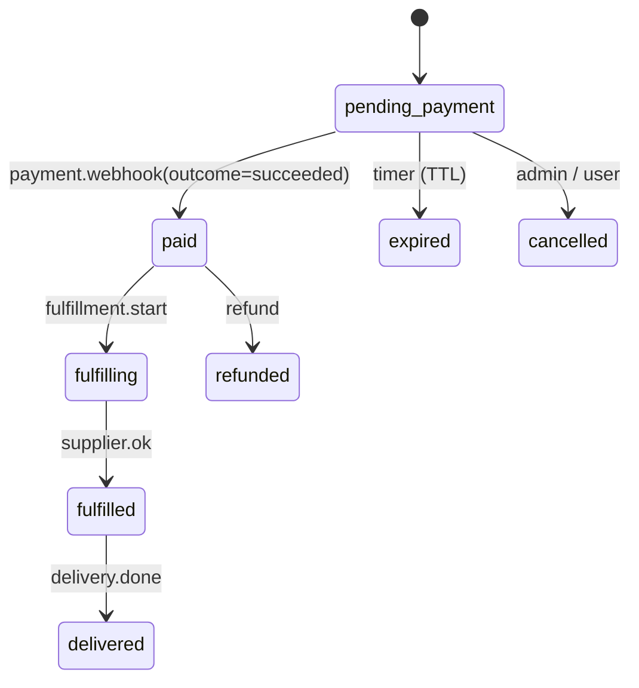
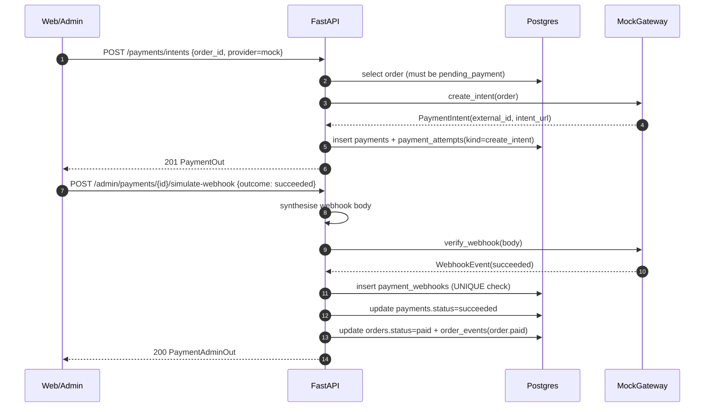

# `payments` — skeleton

Платёжный модуль YuPay. **Этап 1 — скелет** (ADR-0012): фиксируем схему БД, контракт
`PaymentGateway`, HTTP-роуты, FSM-переходы заказа и аудиторскую таблицу. Все реальные
эквайринги (Click, Payme, Uzum, YooKassa, Tinkoff, крипта) пока заглушены — их слоты
зарезервированы, чтобы будущая интеграция была "написать адаптер", а не "переделать
половину модуля".

См. также: [`docs/decisions/0012-payments-skeleton-and-provider-stubs.md`](../../../../../docs/decisions/0012-payments-skeleton-and-provider-stubs.md).

## Контракт `PaymentGateway`

Каждый провайдер реализует один и тот же протокол
(`yupay.modules.payments.gateways.base.PaymentGateway`):

```python
class PaymentGateway(Protocol):
    provider: str                        # slug в URL и БД ("mock", "click", ...)

    @property
    def available(self) -> bool: ...     # выключатель: stub'ы и mock в проде → False

    async def create_intent(*, order, return_url) -> PaymentIntent: ...
    async def verify_webhook(*, headers, body: bytes) -> WebhookEvent: ...
    async def refund(*, payment, amount: Decimal) -> RefundResult: ...
```

### Провайдеры

| Slug       | Статус                         | Что делает                                                                                                                                                                                                                                                                                                                                                                      |
| ---------- | ------------------------------ | ------------------------------------------------------------------------------------------------------------------------------------------------------------------------------------------------------------------------------------------------------------------------------------------------------------------------------------------------------------------------------- |
| `mock`     | **функционален в dev/staging** | Возвращает stub-URL, принимает любой webhook с правильной shape. В проде `available=False`.                                                                                                                                                                                                                                                                                     |
| `click`    | заглушка                       | `available=False`, любой метод → `PaymentNotIntegratedError`.                                                                                                                                                                                                                                                                                                                   |
| `payme`    | заглушка                       | то же                                                                                                                                                                                                                                                                                                                                                                           |
| `uzum`     | заглушка                       | то же                                                                                                                                                                                                                                                                                                                                                                           |
| `yookassa` | заглушка                       | то же                                                                                                                                                                                                                                                                                                                                                                           |
| `tinkoff`  | заглушка                       | то же                                                                                                                                                                                                                                                                                                                                                                           |
| `crypto`   | заглушка (USDT)                | то же                                                                                                                                                                                                                                                                                                                                                                           |
| `p2p`      | **работает** (ADR-0097)        | Перевод на карту владельца точной суммой. `create_intent` держит сумму на карте до истечения заказа (`p2p.reservations.reserve_for_order`), редиректа нет; реквизиты и сумма отдаются в `PaymentOut.p2p` (`payments/p2p_details.py`). Оплата приходит через Telegram-intake `modules/p2p`, который зовёт `settle_provider_payment`. Своего вебхука нет, возврат только вручную. |

Реестр в `yupay/modules/payments/gateways/__init__.py:REGISTRY`. Добавление нового
провайдера = реализовать класс + зарегистрировать slug.

## Таблицы

| Таблица            | Зачем                                                                                                                                                                                                                                                  |
| ------------------ | ------------------------------------------------------------------------------------------------------------------------------------------------------------------------------------------------------------------------------------------------------ |
| `payments`         | один платёжный intent на заказ. Поля: `provider`, `status`, `amount`, `currency`, `intent_url`, `external_id`, `metadata jsonb`, таймстемпы (`succeeded_at` / `failed_at`). Partial UNIQUE на `(provider, external_id) WHERE external_id IS NOT NULL`. |
| `payment_attempts` | append-only аудит каждого тика (`kind` ∈ `create_intent` / `webhook` / `refund` / `cancel` / `status_check`, `status` ∈ `ok` / `error`, `payload jsonb`).                                                                                              |
| `payment_webhooks` | идемпотентная запись каждого входящего webhook'а. UNIQUE `(provider, external_event_id)` — реплеи короткозамыкаются.                                                                                                                                   |

Миграция: `apps/api/migrations/versions/0007_payments_init.py`.

## FSM заказа



Переход `pending_payment → paid` происходит **только** в
`payments.service._mark_payment_succeeded` — один источник истины.

## Идемпотентность

- **Intent**: `POST /intents` требует `Idempotency-Key` (>=16 символов; 422 без него).
  Повтор ключа реплеит исходный платёж — в том числе после того как заказ ушёл из
  `pending_payment` (ретрай после таймаута), где обычная проверка статуса ответила бы 409.
  Ключ на другой заказ/провайдер → 409. Без учёта ключа: повторный POST для того же
  заказа с тем же провайдером возвращает существующий pending-payment (без создания
  нового), разный провайдер → 409.
- **Повторная попытка после отмены** (карта не прошла, клиент жмёт «Оплатить» ещё
  раз): Payme / Uzum / Click ключуют платёж по заказу (`payme:<order>`), а
  отменённый платёж этот `external_id` держит. Новый получает
  `payme:<order>:<payment_id>` (`payments/external_ids.py`); до 2026-09-29 он падал на
  `uq_payments_provider_external`, и Payme показывал «Сервис поставщика услуг
  недоступен». Колбэки провайдеров ищут платёж через свои таблицы транзакций, не по
  этому id.
- **Refund**: `POST /admin/payments/{id}/refund` требует `Idempotency-Key`; повтор ключа
  возвращает платёж как есть — без второго вызова шлюза и второй ledger-проводки
  (ключ хранится в `metadata.last_refund.idempotency_key`, строка платежа берётся
  `FOR UPDATE`). Новый ключ по уже возвращённому платежу → 409, как раньше.
- **Webhook**: `payment_webhooks(provider, external_event_id) UNIQUE` ловит дубли
  через `IntegrityError` под SAVEPOINT'ом (`begin_nested`) — дубль откатывает только
  вставку webhook-строки, не всю request-транзакцию. Дубль → 200 `{"status": "duplicate"}`.
- **Bad signature / shape**: 422 + `ValidationError`. Никогда не отвечаем 200 на
  невалидный webhook. Аудит-строка отказа (`signature_ok=false`) и error-attempt
  отклонённого рефанда **коммитятся до raise** — иначе откат request-транзакции
  молча стирал бы след, который код обещает хранить.

## HTTP

```
GET  /api/v1/payments/providers                       — список «живых» slug'ов
POST /api/v1/payments/intents                         — создать или переиспользовать intent
GET  /api/v1/payments/{payment_id}                    — owner-only
POST /api/v1/webhooks/payments/{provider}             — провайдерский webhook (без авторизации, signature внутри)
GET  /api/v1/admin/payments                           — admin
GET  /api/v1/admin/payments/{payment_id}              — admin detail + список attempts
POST /api/v1/admin/payments/{payment_id}/simulate-webhook — dev-only, только для mock
```

## Mock-flow (как протестировать end-to-end в dev)



## Что в проде НЕ работает

- `mock` отключается (`Settings.is_prod is True`).
- `/admin/payments/{id}/simulate-webhook` отвечает 403 в проде.
- Все stub-провайдеры всегда отказывают (`available=False`).

## Следующий шаг

Адаптер реального провайдера: создать `gateways/<provider>.py`, реализовать
`PaymentGateway`, обновить `REGISTRY`, добавить интеграционные тесты на
success / retryable failure / idempotent replay. **Никогда** не парсить тело
webhook'а до проверки подписи.

## Per-kassa spend limit (2026-10-21)

`payment_review_limits` holds, per payment slug, how much one buyer may pay through it in a
window before a human looks (`review_limits.py`: `GET/PUT /admin/payments/review-limits`). The
rule that reads it is `orders.provider_limit`; settlement calls it through `orders.risk`. A
**wallet top-up** past the limit settles but is not credited (`_mark_payment_succeeded`, and the
late-payment path) until an operator releases it — `credit_held_wallet_topup`, reached from the
fulfilment «release» route. A refund of such a top-up skips the balance reversal
(`wallet.topup_was_credited`). Runbook: `docs/runbooks/order-held-for-review.md`.

## Refunding a delivered order to the card (2026-10-26)

`provider_cancel.py`, two admin routes, both on the order page's payments card:

- **Paynet, Payme, Uzum** refund from their own cabinet, and their cancel is refused once the
  goods shipped (`306` / `-31007` / `10017`). When the goods did not really arrive (a dead
  code, currency never credited) an operator lifts that for one payment —
  `POST /admin/payments/{id}/allow-provider-cancel` with a reason («Разрешить возврат через
  …») stamps `extra_metadata.cancel_allowed` and an `admin.provider_cancel_allowed` order
  event. The next cancel from that provider runs `reverse_provider_payment` as usual. No money
  moves until the provider calls.
- **Click** sends nothing when a refund is made in its cabinet, so the order stayed paid and
  the ledger kept the money. `POST /admin/payments/{id}/record-cabinet-refund` (reason + the
  refund's number in Click; «Отметить возврат, сделанный в Click») books it through the same
  reversal and records `last_refund.refunded_to = "card"`. Refused while a supplier or a CS2
  trade is still working on the order.

Runbook: `docs/runbooks/refund-delivered-order.md`.
