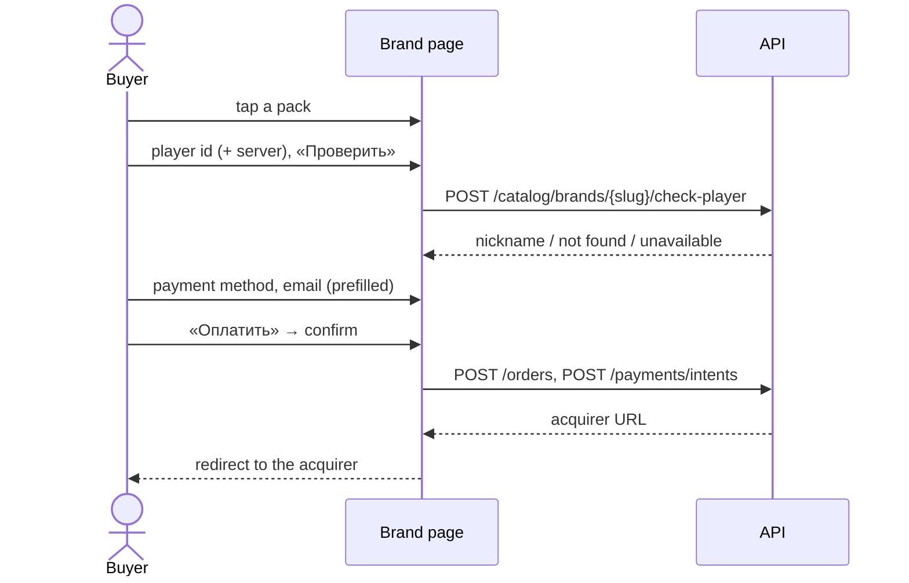

# Brand page checkout (web)

The game page (`/store/{brand}`): pick a pack, fill the order panel, pay. Layout
rules as of 2026-10-26 (design review of the live pages):

- **The packs are on the first screen.** On a phone the hero is a 150px band
  cropped from the top; on desktop the art fills the 330px hero card behind the
  copy, on a dark fade from the left. The short description shows from `sm`
  only (the full text is in «Об услуге»), and the chips scroll in one row on a
  phone.
- **The order panel asks for the account first, the address last:** player id
  → server → «Проверить» → payment method → email → promo → «Оплатить».
- **Email starts filled in** — from the account, else from the last checkout in
  this browser (`localStorage` key `yupay.checkout.email`,
  `lib/guest-orders.ts`). It is still required for a guest: the guest's claim
  on the order is that address (`orders.guest_email`), so an email-less guest
  order needs a new guest identity first — not done.
- **Under a disabled «Оплатить»** the panel names everything still empty
  («Осталось заполнить: ID игрока, email»), not only the first gap.
- **On desktop the panel sticks so its bottom stays on screen** when it is taller
  than the window (`lib/useStickyFit.ts`); otherwise it sticks under the header.
- **A brand in maintenance** keeps its packs and copy but takes no orders; when
  it names a `maintenance_redirect`, an amber card above the packs says the
  purchase is unavailable and links to the brand that sells the same goods
  (Standoff 2 promo codes → «Standoff 2 по ID»).
- **The phone's bottom bar** shows the pack and the total, never cut, and a lime
  button that says what it does: «Оплатить» or «Перейти к оплате».

