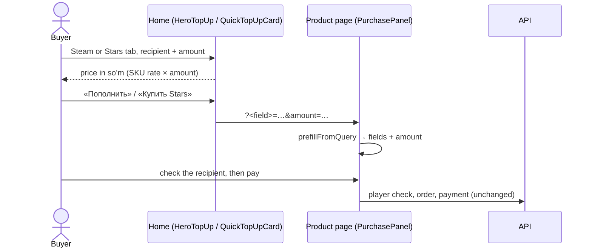

# Home page: Steam and Stars forms first

Most visitors come to top up Steam, so the home page's first screen is a working top-up
form instead of mini app screenshots (owner, 2026-09-29), with Telegram Stars one tab
away. The form prices the amount in soʻm as it is typed and hands off to the product
page; nothing is charged on the home page.

- **Left:** the headline and subtitle of the product in front («Пополните Steam в сумах»
  / «Купите Stars в сумах»), then `HeroTiles` for everything else, each fronted by catalogue art: CS2 skins (while
  the section is on; the skins band's gloves, Karambit and AK-47 as app-icon squares on
  their rarity colour), games (PUBG Mobile, Mobile Legends, Free Fire icons) and gift cards
  (Minecraft, Discord, Roblox as plastic cards in the brand's colours, fanned, Roblox on top). A
  tile links to the category its brands actually sit in — production files games under
  `top-ups` — and shows its icon when no logo is set. Both
  headlines share one grid cell, so switching never moves the tiles. On phones, one
  «Открыть в Telegram» link; the mini app itself is shown further down (`AppShowcase`).
- **Right:** `HeroTopUp` — tabs «Steam» / «Telegram Stars» over a stack of two
  `QuickTopUpCard`s. The card behind shows its top edge above the one in front and slides
  forward on a tab, a horizontal swipe on the stack, or the arrow keys on the tabs; the
  headline swaps with it. The card behind is `inert`.
- **Each card:** the recipient (Steam login / Telegram username, each with its product's
  own pattern), the amount (dollars for Steam; whole stars for Stars, within the SKU's
  `min_qty`–`max_qty`), «К оплате» in soʻm from the SKU's rate, and «Мы принимаем» with
  the Payme, Click and Uzum marks. With no rate it is a plain link to the product page.
- **Hand-off:** `/store/steam?steam_login=…&amount=…` or
  `/store/telegram-stars?username=…&amount=…`. `PurchasePanel` reads it once on arrival
  (`prefillFromQuery`): only the product's own fields, only values their pattern accepts,
  never over what the buyer already typed. The recipient is checked and the order paid
  there, as for any buyer.

## Below the hero

Steam 0% → CS2 skins → catalogue → the mini app → «Почему нам доверяют» → the closing
call to action. «От тапа до игры» and the old facts band (0% / 3 / 24 h) are gone: the
trust block (`TrustReviews`) now shows the overall rating from every published review,
24/7 support and the money-back promise, then a wall of the newest written reviews
(`GET /reviews/featured`) — author, avatar or initial, stars, text and the brand bought —
drifting in two rows (one on phones), paused on hover. Without the endpoint (an older
API) it shows the two promises alone.
