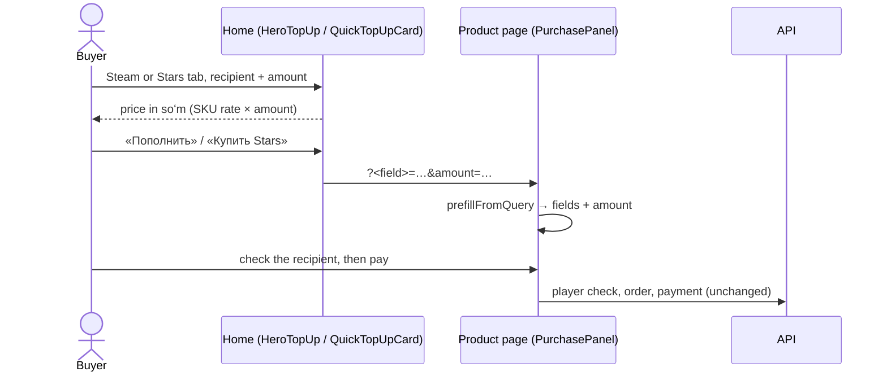

# Home page: Steam and Stars forms first

Most visitors come to top up Steam, so the home page's first screen is a working top-up
form instead of mini app screenshots (owner, 2026-09-29), with Telegram Stars one tab
away. The form prices the amount in soʻm as it is typed and hands off to the product
page; nothing is charged on the home page.

- **Left:** the headline and subtitle of the product in front («Пополните Steam в сумах»
  / «Купите Stars в сумах»), then tiles for everything else — CS2 skins (while the
  section is on), games (`/store?cat=games`), gift cards (`/store?cat=gift-cards`). Both
  headlines share one grid cell, so switching never moves the tiles. On phones, one
  «Открыть в Telegram» link; the mini app itself is shown further down (`AppShowcase`).
- **Right:** `HeroTopUp` — tabs «Steam» / «Telegram Stars» over a stack of two
  `QuickTopUpCard`s. The card behind shows its top edge above the one in front and slides
  forward on a tab, a horizontal swipe on the stack, or the arrow keys on the tabs; the
  headline swaps with it. The card behind is `inert`.
- **Each card:** the recipient (Steam login / Telegram username, each with its product's
  own pattern), the amount (dollars for Steam; whole stars for Stars, within the SKU's
  `min_qty`–`max_qty`), «К оплате» in soʻm from the SKU's rate, and «Мы принимаем» with
  the Payme, Click and Uzum marks. With no rate it is a plain link to the product page.
- **Hand-off:** `/store/steam?steam_login=…&amount=…` or
  `/store/telegram-stars?username=…&amount=…`. `PurchasePanel` reads it once on arrival
  (`prefillFromQuery`): only the product's own fields, only values their pattern accepts,
  never over what the buyer already typed. The recipient is checked and the order paid
  there, as for any buyer.

