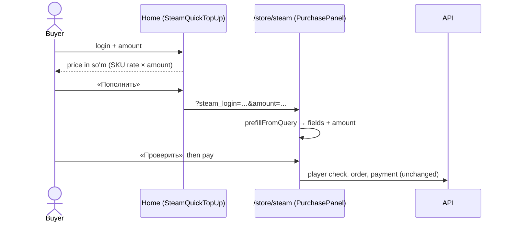

# Home page: Steam top-up first

Most visitors come to top up Steam, so the home page's first screen is a working Steam
form instead of mini app screenshots (owner, 2026-09-29). The form prices the amount in
soʻm as it is typed and hands off to the Steam page; nothing is charged on the home page.

- **Left:** «Пополните Steam в сумах», one line on login-not-password and the UZ payment
  rails, then tiles for everything else — CS2 skins (while the section is on), games
  (`/store?cat=games`), gift cards (`/store?cat=gift-cards`). On phones, one «Открыть в
  Telegram» link; the mini app itself is shown further down (`AppShowcase`).
- **Right:** `SteamQuickTopUp` — Steam login (the product's own pattern), a dollar amount
  with $5 / $10 / $20 / $50 presets, «К оплате» in soʻm from the Steam SKU's rate. With no
  rate it is a plain link to the Steam page.
- **Hand-off:** `/store/steam?steam_login=…&amount=…`. `PurchasePanel` reads it once on
  arrival (`prefillFromQuery`): only the product's own fields, only values their pattern
  accepts, never over what the buyer already typed. The login is checked and the order
  paid there, as for any Steam buyer.

