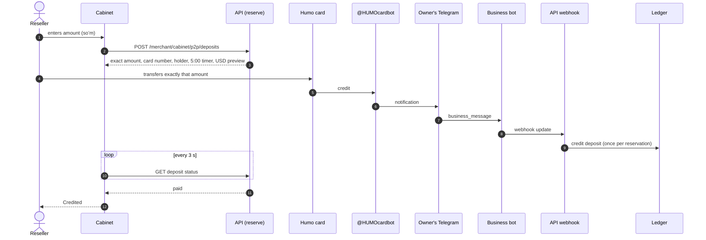

# Reseller deposit top-up by card transfer (P2P)

A reseller tops up the USD deposit by transferring an exact soʻm amount to the owner's Humo
card. The deposit is credited automatically once the bank's notification reaches us. Design:
`docs/superpowers/specs/2026-10-04-p2p-deposit-design.md`; decision:
[ADR-0094](../../decisions/0094-p2p-deposit-via-telegram-business-bot.md).

## Rules the reseller sees

- The amount must be exact. One soʻm more or less is not credited automatically. The amount
  shown can be up to 99 soʻm above what was typed when that amount was already held.
- The reservation lives 5 minutes. Cancelling or expiring keeps the amount out of circulation
  for 10 more minutes.
- One open reservation per reseller. Reloading the page restores it.
- USD credited = soʻm / our rate at reservation time, rounded down to a cent.
- Limits per card: minimum 10 000, maximum 10 000 000 soʻm, optional daily limit.

## Outcomes

| Outcome   | What happens                                                                               |
| --------- | ------------------------------------------------------------------------------------------ |
| Paid      | Deposit credited with note `P2P · T…`; the reservation shows the USD amount.               |
| Expired   | The reseller writes to support with the receipt and the reservation number.                |
| Cancelled | Back to the amount step. A transfer made anyway is unmatched; support credits it by hand.  |
| Unmatched | Wrong amount, amount with tiyin, or a late transfer. An admin credits it from the journal. |

## Availability

P2P top-up is gated by the admin setting `off` / `allowlist` / `all`. When it is off for a
merchant the cabinet keeps the support link. Open reservations live out their 5 minutes and
still match.
