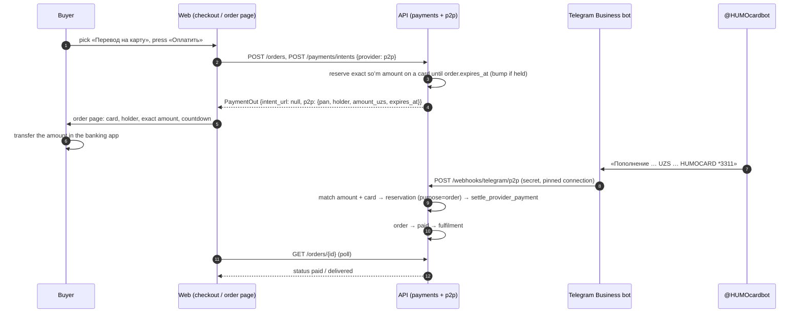

# Flow — paying a storefront order by card transfer (P2P)

ADR-0097. The buyer picks «Перевод на карту» at checkout, transfers the exact amount to the
owner's Humo card from a banking app, and the order pays itself when the @HUMOcardbot
notification reaches the API through the Telegram Business bot (ADR-0094).

What can go wrong and what the buyer sees:

- The exact total is held by another payer → the amount shown is bumped by a few soʻm; the
  page says «ровно».
- The window ends before the transfer → «Время на перевод вышло», the order expires; a
  transfer that still arrives pays it late (paid-after-expiry runbook).
- Provider in maintenance → the tile is greyed out; disabled → not shown.
- Bot not connected or no active card → «перевод на карту сейчас недоступен» at «Оплатить».
