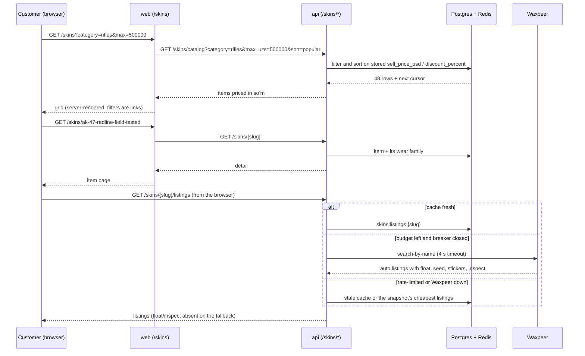

# Flow: browsing CS2 skins

The read-only half of the CS2 skins section (ADR-0093). Buying is a later plan.

Prices everywhere are our sell price from `pricing.quote()`, stored per row by
`repricing.reprice_rows` after every price sync and every pricing change, so a
filter bound, a sort and a card always agree.

The filter panel follows the category, as Waxpeer's does (`filterSections` in
`@yupay/utils`, shared by web and mini app): its rarities are the category's own (agents:
Master…Distinguished; cases: Base / Highlight Base Grade); with no category picked it offers
the weapon scale, Contraband…Consumer Grade, not all seventeen grades mixed. Wear shows only
where items have an exterior (not agents, cases, keys, charms, music kits), StatTrak™ only
for weapons, knives and music kits. A value already chosen from a link stays visible.

## Mini app

`/cs2-market` (catalogue) and `/cs2-market/:slug` (item) in the Telegram mini app read the
same `/skins/*` endpoints from the browser; the query model is shared with web through
`@yupay/utils` (`parseSkinQuery`, `skinQueryString`).

- Filters live in the route's query string. A filter change **replaces** the history entry,
  so Telegram's back button from an item returns to the same filtered grid, and from the
  grid leaves the market instead of undoing filters one tap at a time. Wear tiles on the
  item page also replace, for the same reason.
- Wear, rarity, StatTrak and the soʻm price range sit in a bottom sheet applied together;
  sort is a native select beside it.
- While the API has skins switched off, `/skins/facets` 404s and the page shows the
  «Скоро» screen — the mini app has no flag of its own.

## What the pages show (plan 2c)

- **Default order** is «Сначала дороже» (`-price`): knives and gloves first, as skinsavdo.uz
  opens. `popular` opened on a wall of cases and capsules.
- **Categories** are icon tiles: one Steam item image per category, self-hosted in each
  app's `public/skins/categories/` (`scripts/skins/fetch-category-icons.sh`) and drawn as a
  `currentColor` silhouette with a CSS mask. The weapon row and the filter counts come from
  `/skins/facets?category=`, so they describe the whole category, classics first.
- **Headline price** on an item page is the cheapest live offer once offers load; before
  that, or with none, the stored price reads «от …». The price is never one nobody sells at.
- **Wear** is a row of plain names plus StatTrak™/Souvenir toggles; a wear with nothing on
  sale is greyed, not hidden.
- **Cases, keys, agents, music kits, charms** (`hasWear` false) show «В наличии: N шт.»
  instead of a list of identical offers.
- **Web on a phone**: filters open in a bottom drawer beside sort.
