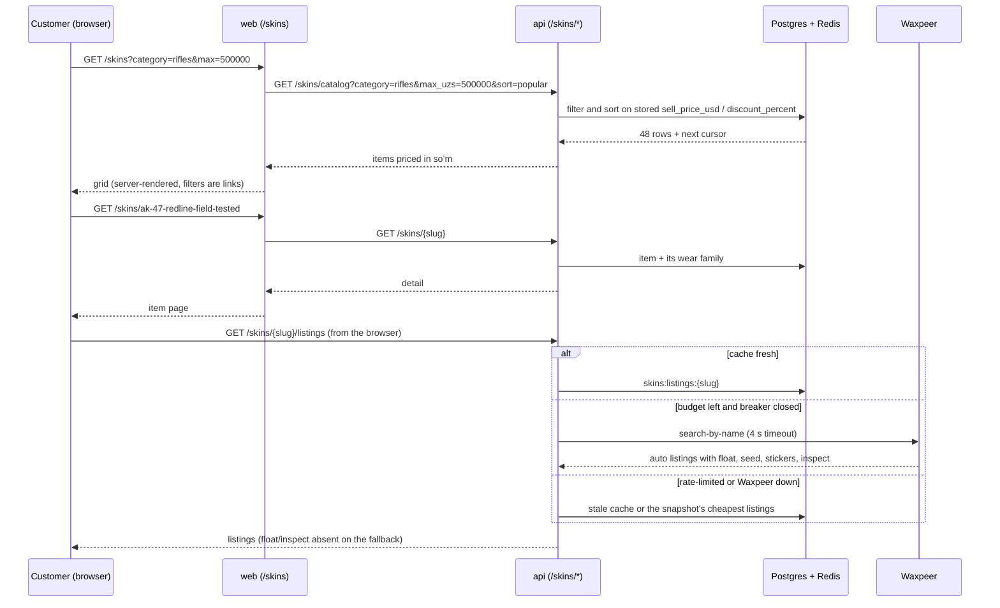

# Flow: browsing CS2 skins

The read-only half of the CS2 skins section (ADR-0093). Buying is a later plan.

Prices everywhere are our sell price from `pricing.quote()`, stored per row by
`repricing.reprice_rows` after every price sync and every pricing change, so a
filter bound, a sort and a card always agree.
