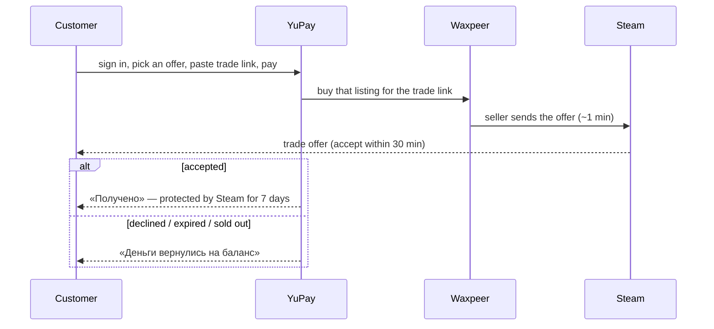

# Flow: buying a CS2 skin

The customer picks one offer on the item page (web `/skins/{slug}`, mini app
`/cs2-market/{slug}`), pays, and receives a Steam trade offer from the seller within about a
minute.

The supplier is Waxpeer or, with `CS2_SKINS_SOURCE=csmarket` (ADR-0098), the owner's
csmarket.uz, which buys from Skinslink and LIS-SKINS. The customer sees no difference: the
same offers screen, the same trade offer from a seller, the same order states. With
csmarket, a sold offer is replaced by the cheapest same-item offer no dearer, chosen by
csmarket; csmarket reports no rollback after acceptance.

Rules the customer meets:

- **Sign-in is required.** A failed purchase refunds to the YuPay balance, which a guest
  does not have. A card refund is a support request.
- **The trade link** is checked before paying (private inventory, trade ban, a hold because
  the account has no Steam Guard mobile authenticator for 7 days). If the customer signed in
  with Steam, the link must be that account's.
- **The offer they chose** is what is bought. If it sold in the meantime, a same-name offer
  no dearer is bought instead; if none, the money goes back to the balance.
- **Order page states**: `buying` → `offer_sent` (link to the offer, seller's name and avatar,
  accept-by time) → `accepted` (Steam protection until `release_date`) → `released`; or
  `failed` with `not_accepted` / `sold_out` / `try_later` (Waxpeer was short of our money —
  «попробуйте через несколько минут») or `support` / `other`. Where the money went is its own
  field, `refunded_to` (`wallet` / `card`, from the payment): the page says «деньги на балансе»
  only when that is true, and support otherwise.

## UI states

Item page, buy panel (shown only when the item API names `buy_sku_id`):

| State                       | What the customer sees                                                                 |
| --------------------------- | -------------------------------------------------------------------------------------- |
| Guest (web only)            | «Войдите, чтобы купить» opens the sign-in modal. The mini app is always signed in.     |
| Default                     | The cheapest offer is selected; a row's «Купить» selects another («Выбран»).           |
| Trade link empty / checking | Prefilled from the last skin order; checked as typed. The button says what is missing. |
| Link refused                | Private inventory, trade ban, Steam hold, not a trade link — the button stays off.     |
| Check unavailable           | Nothing is said and paying is allowed: the check is advisory.                          |
| Ready                       | «Оплатить {price}» with the balance tile and Payme / Click / Uzum.                     |
| Price moved                 | «Цена изменилась: теперь $X» — nothing is charged; the customer presses again.         |
| Offer sold                  | «Этот лот уже купили. Следующий — $X», the next offer selected; or «закончились».      |
| Link of another account     | «Эта ссылка от другого аккаунта Steam — укажите свою».                                 |

In the mini app the purchase is two steps, as for every other brand: the item page picks
the wear, the offer and the trade link («Далее»), then «Оформление заказа» shows the order
details (skin, wear, the offer's float and seed, the Steam account the trade goes to — never
the link's token — and the price) with the payment methods and «Оплатить». The web keeps the
one-panel form.

«Как проходит покупка» explains the five steps — trade link and Steam Guard, payment, accept
within 30 minutes, Steam's 7-day protection, the refund to the balance — under the offers on
the web (only where buying is on) and on the mini app's pay step.

A refund reaches the buyer wherever they are: `order.refunded` over the order socket re-reads
the order and the balance and shows a toast, and the bot sends «Скин не получилось купить —
деньги вернулись на баланс YuPay».

After paying, the customer lands on the order page. Its status hero never says "credited"
or "back to your card" for a skin: in flight it says the trade is coming, a refund says the
YuPay balance, a failure says support. The trade card below it follows the states above.

In the order list and on the order page a skin line is named and pictured as the skin
bought — the name snapshotted at checkout, the picture from the catalogue
(`skins/order_display.py`) — not as the generic `cs2-skin` SKU. Its checkout data (slug,
listing, trade link) is never listed; only the float is.
