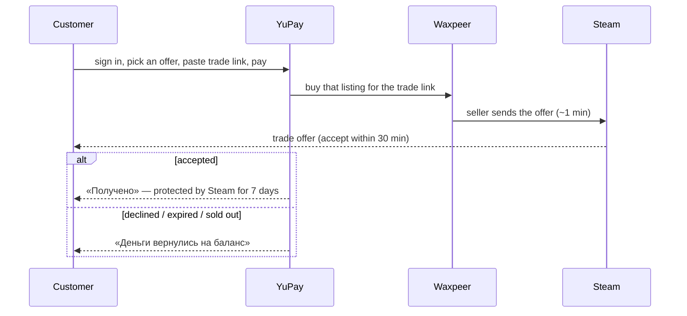

# Flow: buying a CS2 skin

Plan 3a (backend). The customer picks one offer on the item page, pays, and receives a
Steam trade offer from the seller within about a minute.

Rules the customer meets:

- **Sign-in is required.** A failed purchase refunds to the YuPay balance, which a guest
  does not have. A card refund is a support request.
- **The trade link** is checked before paying (private inventory, trade ban, a hold because
  the account has no Steam Guard mobile authenticator for 7 days). If the customer signed in
  with Steam, the link must be that account's.
- **The offer they chose** is what is bought. If it sold in the meantime, a same-name offer
  no dearer is bought instead; if none, the money goes back to the balance.
- **Order page states**: `buying` → `offer_sent` (link to the offer, seller's name and avatar,
  accept-by time) → `accepted` (Steam protection until `release_date`) → `released`; or
  `failed` with `not_accepted` / `sold_out` / `other`.
