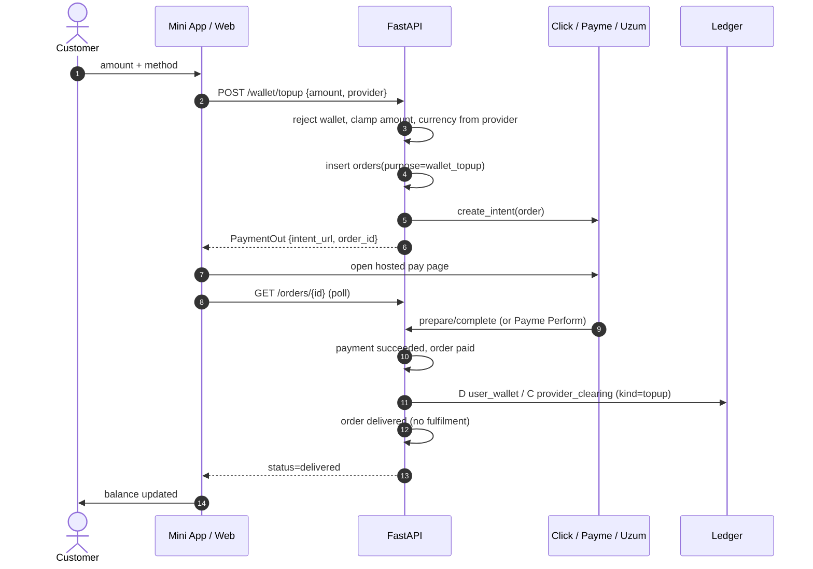
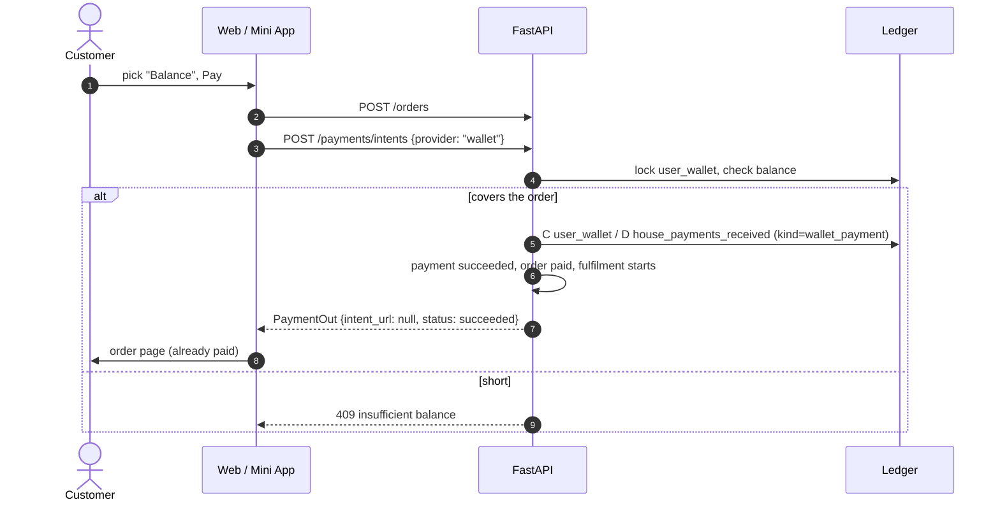

# Wallet top-up and paying from the balance

Customer funds `user_wallet` in the same currency they pay with. No FX.
See [ADR-0058](../../decisions/0058-wallet-customer-topup.md).

Limits: UZS 5 000–5 000 000 (whole so'm); USDT 5–500 (0.01). Topping the
wallet up _from_ the wallet is refused.

## Surfaces

Both storefronts run the same endpoints; only the entry points differ.

|           | Mini App                     | Web                                                    |
| --------- | ---------------------------- | ------------------------------------------------------ |
| Balance   | wallet tab                   | chip in the header (desktop), account menu, mobile nav |
| Top-up    | `/wallet/top-up`             | `/account/wallet/top-up`                               |
| Acquirers | `click_miniapp`, Payme, Uzum | `click`, Payme, Uzum                                   |
| Also      | card transfer `p2p`          | card transfer `p2p`                                    |

After the intent both surfaces land on the order page, which for a deposit is
one status card with four phases — waiting (the pay-now block: the card to
transfer to, or the acquirer link), crediting (paid, ledger entry on its way),
credited, failed — and the credited phase refetches the wallet so the balance
in the header moves at the same moment. Until 2026-10-06 the web card said
«Баланс обновится, когда банк подтвердит платёж» whatever the status, which
read as "still waiting" on a deposit that had already landed.

Click bills through a per-surface merchant service, so the web must send
`click` and the mini app `click_miniapp`. `X-Yupay-Surface` is what records
the order's `source`.

Every call must carry it, not only the ones that go through the app's API
client. Checkout on the web calls `fetch` directly, and because only
`apiFetch` set the header, every web order recorded `source = unknown` while
the mini app's recorded `miniapp`. Web now imports `SURFACE` from
`lib/client.ts` at each raw call site; a new one must do the same.

## Paying an order from the balance

`WalletGateway` is not an acquirer: it posts against our own ledger inside
`create_intent` and returns `status="succeeded"` with `intent_url: null`, so
there is no hosted page and no webhook. The storefront's existing
"no intent_url" branch already lands on the order, which is why paying from
the balance needed no second checkout path.

The whole order is charged or none of it: there is no split between the
balance and a card. The storefront therefore refuses the tile before
submitting — showing the shortfall — rather than letting the gateway answer
409 after the order row exists.

**When the ledger disagrees with the tile** (2026-10-07). The tile judges on
the client's total and the cached balance; the ledger judges on the order's
own amount, which can be a few soʻm higher (FX rounding at order time) or the
balance can have moved. One customer 846 soʻm short saw a "ready" tile, got
409 on every tap, read "couldn't create the order" and left 60 unpaid orders in
four minutes. Web now (`lib/intent-failure.ts`, `PurchasePanel`):

- parses the 409's `have`/`need` and says **how much is missing** with a link
  to the top-up page (`store.balanceShort`, `store.balanceTopUp`);
- flips the tile to _short_ using the ledger's `need`, so the next tap goes to
  a card;
- **keeps the created order for nine minutes** (`PENDING_ORDER_REUSE_MS`,
  under the server's ten-minute expiry) and pays _it_ on the retry — the same
  cart (SKU, fields, email, promo) never gets a sibling order from this panel;
- every other intent refusal says "payment didn't start" rather than "order
  not created" (`store.payErrorIntent`).

Server-side dedupe of unpaid sibling orders was considered and declined
(owner, 2026-10-07).

**The default method.** When the balance covers the order, «Баланс» is selected
by default in every checkout — web (`PurchasePanel`, Steam Gifts, CS2 skins) and
mini app (`TopUp`, `GiftGame`, `SkinPayStep`) — through `usePreferBalance`
(`lib/prefer-balance.ts`, one copy per app) (owner, 2026-09-30). The balance has
to be loaded, something picked and priced, and the wallet rail active. If the order
then grows past the balance, an automatic choice goes back to the first active
acquirer; a method the buyer tapped is never changed.
