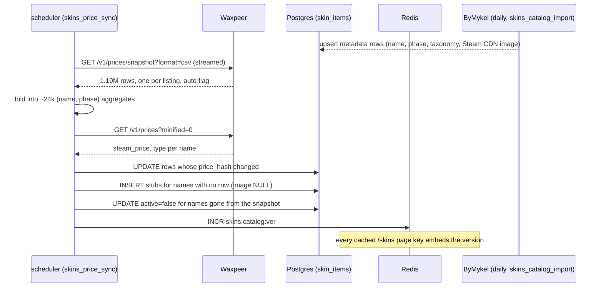

# CS2 Skins — Catalogue Backend Implementation Plan

> **For agentic workers:** REQUIRED SUB-SKILL: Use superpowers:subagent-driven-development (recommended) or superpowers:executing-plans to implement this plan task-by-task. Steps use checkbox (`- [ ]`) syntax for tracking.

**Goal:** A browsable CS2 skins catalogue — our own item rows from ByMykel/CSGO-API, Waxpeer's `auto` listings folded onto them every five minutes, and a read API (catalogue, facets, suggest, detail, listings) that never blocks on the supplier.

**Architecture:** New modular-monolith module `apps/api/src/yupay/modules/skins/` owning three tables and every parser; two `apps/scheduler` jobs call its import/sync functions; the `waxpeer` HTTP client in `fulfillment/suppliers/waxpeer_client.py` gains three read methods. Reads are Postgres + Redis; the item-page listings read is the one carve-out and degrades to snapshot data.

**Tech Stack:** Python 3.12, FastAPI, SQLAlchemy 2 async, Alembic, httpx (streaming), Redis, pg_trgm; pytest + respx + fakeredis + testcontainers.

**Spec:** `docs/superpowers/specs/2026-09-28-cs2-skins-design.md` (§4 is this plan's scope). ADR: `docs/decisions/0093-cs2-skins-via-waxpeer.md`.

## Global Constraints

- **No catalogue read calls Waxpeer** except `GET /skins/{slug}/listings`, and that one degrades instead of failing (spec §4.5).
- **Nothing Waxpeer-branded reaches a client.** Image URLs are Steam's CDN; listing ids are Steam asset ids exposed as `listing_id`; no `images.waxpeer.com`, no `item_id` field name in a public DTO.
- **The snapshot is streamed, never buffered.** 237 MB of text; the api container has 2 GiB and was OOM-killed by a buffered read on 2026-09-28. Both jobs run in `apps/scheduler` only.
- **Only `auto` listings count.** `count_auto == 0` means `active = false`; hold listings are never requested (`include_hold` is never passed).
- **Money is `Decimal`; Waxpeer units are `int` (`1000 = $1`).** `pricing.quote` rounds **up** to the cent, enforces the minimum margin and the floor, and never lets a fixed price undercut cost; a price is never a float anywhere.
- **`phase` is `''` when absent, never NULL** — the `(market_hash_name, phase)` unique constraint depends on it; the API renders `''` as `null`.
- **Every public `/skins/*` route 404s while `cs2_skins_enabled` is off**; both jobs are no-ops while `cs2_skins_sync_enabled` is off.
- `ruff` line-length 100, `mypy --strict`, Google docstrings; run `uv run ruff check apps && uv run ruff format --check apps && uv run mypy apps` from the repo root. Integration tests need the dev Redis up (`make dev` or `docker compose up -d redis`).
- Every new Redis key gets a row in `docs/architecture/cache-keys.md`; the module gets a README, a `module-map.md` row and a sequence diagram (AGENTS.md §5).
- No pushing, no deploying, no prod writes. Branch: `feat/cs2-skins`. Commit after every task.

## Review Focus

1. **A Waxpeer name whose Doppler phase is inline** (`★ Karambit | Doppler Phase 2 (Factory New)`) must land on the ByMykel row `(★ Karambit | Doppler (Factory New), Phase 2)`, not create a stub. Pinned in Task 2 (`canonical_name`) and Task 4 (`aggregate` keys).
2. **A name in the snapshot that has only manual listings** must become `active = false` with `min_auto_units = NULL`, even though `count_all > 0`. Pinned in Task 4.
3. **A listing priced at 5 units ($0.005)** must sell at the floor, not at $0.01. Pinned in Task 5 (`pricing.quote`, `test_half_cent_listing_hits_the_floor`).
4. **A search query with a Russian alias** («ак 47 редлайн») must find `AK-47 | Redline` through alias expansion, and a query with no match must return an empty page, not 500. Pinned in Task 5.
5. **The listings read when Waxpeer answers 429** must return the snapshot's cheapest listings with `degraded = true` and HTTP 200. Pinned in Task 6.

---

## File Structure

| File                                                                                                                                                                                                                                | Responsibility                                                                                                                                             |
| ----------------------------------------------------------------------------------------------------------------------------------------------------------------------------------------------------------------------------------- | ---------------------------------------------------------------------------------------------------------------------------------------------------------- |
| `apps/api/src/yupay/modules/skins/__init__.py`, `api.py`                                                                                                                                                                            | module marker; public re-exports (routers, settings loaders, sync entry points)                                                                            |
| `apps/api/src/yupay/modules/skins/models.py`                                                                                                                                                                                        | `SkinItem` (+ per-item pricing overrides), `SkinPricingRules`, `SkinSearchAlias`                                                                           |
| `apps/api/migrations/versions/0087_cs2_skins.py`                                                                                                                                                                                    | the three tables, indexes, `pg_trgm` guard                                                                                                                 |
| `apps/api/src/yupay/modules/skins/naming.py`                                                                                                                                                                                        | pure parsing of market hash names: phase, flags, weapon/skin/exterior, slug, search text                                                                   |
| `apps/api/src/yupay/modules/skins/taxonomy.py`                                                                                                                                                                                      | category slugs and the ByMykel / Waxpeer → category maps                                                                                                   |
| `apps/api/src/yupay/modules/skins/bymykel.py`                                                                                                                                                                                       | fetch the eleven JSON files, turn entries into `CatalogRow`s, upsert metadata                                                                              |
| `apps/api/src/yupay/modules/skins/prices.py`                                                                                                                                                                                        | stream-aggregate the snapshot, apply prices (changed rows only), stubs, catalogue version bump                                                             |
| `apps/api/src/yupay/modules/fulfillment/suppliers/waxpeer_client.py`                                                                                                                                                                | `+ iter_snapshot_rows`, `+ prices`, `+ search_listings`, `WaxpeerRateLimitedError`                                                                         |
| `apps/scheduler/src/yupay_scheduler/jobs/skins_catalog_import.py`, `skins_price_sync.py`                                                                                                                                            | the daily and five-minute ticks                                                                                                                            |
| `apps/api/src/yupay/modules/skins/settings.py`, `pricing.py`                                                                                                                                                                        | pricing rules (brackets per channel, category pp, min margin, floor, UZS rounding, Steam cap): Redis → row 1 → `DEFAULT_RULES`; `quote()` with a breakdown |
| `apps/api/src/yupay/modules/skins/service.py`                                                                                                                                                                                       | catalogue query with keyset cursor, facets, suggest with alias expansion, detail                                                                           |
| `apps/api/src/yupay/modules/skins/schemas.py`, `routes.py`, `admin.py`                                                                                                                                                              | DTOs, `/skins/*`, `/admin/skins/pricing` (+ `/preview`), `/admin/skins/items/{slug}`                                                                       |
| `apps/api/src/yupay/modules/skins/listings.py`                                                                                                                                                                                      | the search-v2 proxy: cache, stale twin, token bucket, breaker, snapshot fallback                                                                           |
| `apps/api/tests/fixtures/skins/`                                                                                                                                                                                                    | `bymykel_skins.json`, `bymykel_agents.json`, `bymykel_crates.json`, `snapshot.csv`, `prices.json`, `search_v2.json`                                        |
| `apps/api/src/yupay/modules/skins/README.md`, `docs/architecture/module-map.md`, `docs/architecture/cache-keys.md`, `docs/architecture/sequence-diagrams/skins-catalog-sync.mmd`, `docs/runbooks/skins-catalog.md`, `AGENTS.md` §10 | documentation                                                                                                                                              |

---

## Task 1: Module skeleton, config, models, migration

**Files:**

- Create: `apps/api/src/yupay/modules/skins/__init__.py` (empty docstring module), `models.py`, `README.md`
- Create: `apps/api/migrations/versions/0087_cs2_skins.py`
- Modify: `apps/api/src/yupay/core/config.py` (after the `# --- Steam Gifts ---` block, ~line 830)
- Test: `apps/api/tests/integration/test_skins_models.py`

**Interfaces:**

- Produces: `SkinItem` (incl. `margin_override_pp`, `fixed_price_usd`), `SkinPricingRules`, `SkinSearchAlias` ORM classes; settings fields `cs2_skins_enabled`, `cs2_skins_sync_enabled`, `cs2_skins_categories`, `cs2_skins_listings_bucket_per_minute`, `bymykel_base_url`, `skins_snapshot_interval_minutes`, `skins_import_interval_hours`.

- [ ] **Step 1: Write the failing test**

```python
# apps/api/tests/integration/test_skins_models.py
"""The skins tables exist after migration and enforce (name, phase) uniqueness."""

from __future__ import annotations

import pytest
from sqlalchemy.exc import IntegrityError
from sqlalchemy.ext.asyncio import AsyncSession
from yupay.core.ids import new_id
from yupay.modules.skins.models import SkinItem, SkinPricingRules

pytestmark = pytest.mark.asyncio


def _item(name: str, phase: str = "", slug: str | None = None) -> SkinItem:
    return SkinItem(
        id=new_id(),
        market_hash_name=name,
        phase=phase,
        slug=slug or name.lower().replace(" ", "-"),
        category="rifles",
        search_text=name.lower(),
    )


async def test_item_round_trips(db_session: AsyncSession) -> None:
    db_session.add(_item("AK-47 | Redline (Field-Tested)"))
    await db_session.commit()
    row = await db_session.get(SkinItem, (await db_session.execute(
        __import__("sqlalchemy").select(SkinItem.id)
    )).scalar_one())
    assert row is not None
    assert row.phase == ""
    assert row.active is False
    assert row.count_auto == 0
    assert row.cheapest_auto == []


async def test_same_name_and_phase_is_refused(db_session: AsyncSession) -> None:
    db_session.add(_item("★ Karambit | Doppler (Factory New)", "Phase 2", "k-p2"))
    await db_session.commit()
    db_session.add(_item("★ Karambit | Doppler (Factory New)", "Phase 2", "k-p2-dup"))
    with pytest.raises(IntegrityError):
        await db_session.commit()
    await db_session.rollback()


async def test_same_name_different_phase_is_two_rows(db_session: AsyncSession) -> None:
    db_session.add(_item("★ Karambit | Doppler (Factory New)", "Phase 1", "k-p1"))
    db_session.add(_item("★ Karambit | Doppler (Factory New)", "Phase 3", "k-p3"))
    await db_session.commit()


async def test_pricing_rules_is_a_singleton(db_session: AsyncSession) -> None:
    db_session.add(SkinPricingRules(id=2, rules={}))
    with pytest.raises(IntegrityError):
        await db_session.commit()
    await db_session.rollback()
```

- [ ] **Step 2: Run it, watch it fail**

Run: `cd apps/api && uv run pytest tests/integration/test_skins_models.py -v`
Expected: FAIL — `ModuleNotFoundError: yupay.modules.skins`.

- [ ] **Step 3: Config fields**

In `apps/api/src/yupay/core/config.py`, directly after the Steam Gifts block:

```python
    # --- CS2 skins (ADR-0093) ---
    # ``cs2_skins_enabled`` gates every public ``/skins/*`` route (404 while
    # off); ``cs2_skins_sync_enabled`` gates the two scheduler jobs, so prod
    # can fill the catalogue for days before the routes open. Pricing rules
    # (brackets, category adjustments, min margin, floor) are not env: they
    # live in ``skin_pricing_rules`` row 1 with ``pricing.DEFAULT_RULES`` as
    # the seed, edited from the admin.
    cs2_skins_enabled: bool = Field(default=False)
    cs2_skins_sync_enabled: bool = Field(default=False)
    # Category slugs the storefront offers (spec §4.4). Everything else is
    # imported and priced but hidden from every public read.
    cs2_skins_categories: str = Field(
        default="rifles,pistols,smgs,heavy,knives,gloves,agents,cases,keys,music-kits,charms"
    )
    # Waxpeer's search-by-name limit is 20/min for non-partner accounts; the
    # listings proxy keeps a process-wide budget under it and degrades to
    # snapshot data when the budget is spent.
    cs2_skins_listings_bucket_per_minute: int = Field(default=18)
    bymykel_base_url: str = Field(
        default="https://raw.githubusercontent.com/ByMykel/CSGO-API/main/public/api/en"
    )
    skins_snapshot_interval_minutes: int = Field(default=5)
    skins_import_interval_hours: int = Field(default=24)
```

And in the `ip_guard` bucket table (~line 249, next to `"gifts-steam-profile": 120`):

```python
            # `GET /skins/{slug}/listings` spends Waxpeer's 20/min search
            # quota on a cache miss; the Redis cache (90 s) makes a repeat of
            # the same item free, so this only bounds distinct items from one
            # address.
            "skins-listings": 60,
```

- [ ] **Step 4: Models**

```python
# apps/api/src/yupay/modules/skins/models.py
"""SQLAlchemy ORM for the ``skins`` module (ADR-0093).

- :class:`SkinItem` — one row per ``(market_hash_name, phase)``: our own
  identity, taxonomy and image (from ByMykel/CSGO-API, daily) plus the
  Waxpeer side folded on every five minutes by ``skins.prices``.
  ``phase`` is ``''`` when the item has none — never NULL, so the unique
  constraint below holds.
- :class:`SkinPricingRules` — singleton (``id = 1``) holding the whole
  pricing document as JSONB (validated by ``pricing.PricingRules`` on every
  read and write); the shape of ``gifts.models.SteamGiftSettings`` with a
  document instead of two numbers.
- :class:`SkinSearchAlias` — ``alias -> text`` expansions applied to a
  search query before the trigram match («ак» -> ``ak-47``).
"""

from __future__ import annotations

from datetime import datetime
from decimal import Decimal
from typing import Any

from sqlalchemy import (
    BigInteger,
    Boolean,
    CheckConstraint,
    DateTime,
    ForeignKey,
    Index,
    Integer,
    Numeric,
    String,
    Text,
    UniqueConstraint,
    text,
)
from sqlalchemy.dialects.postgresql import JSONB, UUID
from sqlalchemy.orm import Mapped, mapped_column

from yupay.core.db import Base


class SkinItem(Base):
    """One sellable CS2 item at one wear (and one Doppler phase)."""

    __tablename__ = "skin_items"

    id: Mapped[str] = mapped_column(UUID(as_uuid=False), primary_key=True)
    market_hash_name: Mapped[str] = mapped_column(String(255), nullable=False)
    phase: Mapped[str] = mapped_column(String(16), nullable=False, server_default=text("''"))
    slug: Mapped[str] = mapped_column(String(255), nullable=False)
    category: Mapped[str] = mapped_column(String(32), nullable=False)
    weapon: Mapped[str | None] = mapped_column(String(64), nullable=True)
    skin: Mapped[str | None] = mapped_column(String(128), nullable=True)
    exterior: Mapped[str | None] = mapped_column(String(2), nullable=True)
    stattrak: Mapped[bool] = mapped_column(Boolean, nullable=False, server_default=text("false"))
    souvenir: Mapped[bool] = mapped_column(Boolean, nullable=False, server_default=text("false"))
    rarity: Mapped[str | None] = mapped_column(String(64), nullable=True)
    rarity_color: Mapped[str | None] = mapped_column(String(9), nullable=True)
    image_url: Mapped[str | None] = mapped_column(Text, nullable=True)
    min_float: Mapped[Decimal | None] = mapped_column(Numeric(6, 5), nullable=True)
    max_float: Mapped[Decimal | None] = mapped_column(Numeric(6, 5), nullable=True)
    paint_index: Mapped[int | None] = mapped_column(Integer, nullable=True)
    #: ``'bymykel'`` once the daily import has written the row, ``'stub'``
    #: while it only exists because the snapshot named it.
    source: Mapped[str] = mapped_column(String(16), nullable=False, server_default=text("'stub'"))
    search_text: Mapped[str] = mapped_column(Text, nullable=False)

    # ---- the Waxpeer side (units: 1000 = $1) ----
    steam_price_units: Mapped[int | None] = mapped_column(BigInteger, nullable=True)
    min_auto_units: Mapped[int | None] = mapped_column(BigInteger, nullable=True)
    count_auto: Mapped[int] = mapped_column(Integer, nullable=False, server_default=text("0"))
    #: Up to ten ``{"listing_id": int, "price_units": int}`` cheapest auto listings.
    cheapest_auto: Mapped[list[dict[str, Any]]] = mapped_column(
        JSONB, nullable=False, server_default=text("'[]'::jsonb")
    )
    min_all_units: Mapped[int | None] = mapped_column(BigInteger, nullable=True)
    count_all: Mapped[int] = mapped_column(Integer, nullable=False, server_default=text("0"))
    price_hash: Mapped[str | None] = mapped_column(String(40), nullable=True)
    prices_updated_at: Mapped[datetime | None] = mapped_column(
        DateTime(timezone=True), nullable=True
    )
    active: Mapped[bool] = mapped_column(Boolean, nullable=False, server_default=text("false"))

    # ---- per-item pricing overrides (admin, ``PATCH /admin/skins/items/{slug}``) ----
    #: Percentage points added to the bracket margin for this item only.
    margin_override_pp: Mapped[Decimal | None] = mapped_column(Numeric(6, 2), nullable=True)
    #: A pinned sell price. Honoured only while it covers cost + min margin.
    fixed_price_usd: Mapped[Decimal | None] = mapped_column(Numeric(12, 2), nullable=True)

    created_at: Mapped[datetime] = mapped_column(
        DateTime(timezone=True), nullable=False, server_default=text("CURRENT_TIMESTAMP")
    )
    updated_at: Mapped[datetime] = mapped_column(
        DateTime(timezone=True), nullable=False, server_default=text("CURRENT_TIMESTAMP")
    )

    __table_args__ = (
        UniqueConstraint("market_hash_name", "phase", name="uq_skin_items_name_phase"),
        UniqueConstraint("slug", name="uq_skin_items_slug"),
        Index("ix_skin_items_category_price", "category", "min_auto_units"),
        Index("ix_skin_items_weapon", "weapon"),
        Index("ix_skin_items_active", "active"),
        Index(
            "ix_skin_items_search_trgm",
            "search_text",
            postgresql_using="gin",
            postgresql_ops={"search_text": "gin_trgm_ops"},
        ),
    )


class SkinPricingRules(Base):
    """Row 1: the pricing document (``pricing.PricingRules``) an admin edits."""

    __tablename__ = "skin_pricing_rules"

    id: Mapped[int] = mapped_column(Integer, primary_key=True)
    rules: Mapped[dict[str, Any]] = mapped_column(JSONB, nullable=False)
    updated_by: Mapped[str | None] = mapped_column(
        UUID(as_uuid=False), ForeignKey("users.id"), nullable=True
    )
    updated_at: Mapped[datetime] = mapped_column(
        DateTime(timezone=True), nullable=False, server_default=text("CURRENT_TIMESTAMP")
    )

    __table_args__ = (CheckConstraint("id = 1", name="ck_skin_pricing_rules_singleton"),)


class SkinSearchAlias(Base):
    """``alias`` (lower-case, one token or a phrase) -> ``text`` substituted into a query."""

    __tablename__ = "skin_search_aliases"

    alias: Mapped[str] = mapped_column(String(64), primary_key=True)
    text: Mapped[str] = mapped_column(String(128), nullable=False)


__all__ = ["SkinItem", "SkinPricingRules", "SkinSearchAlias"]
```

- [ ] **Step 5: Migration**

```python
# apps/api/migrations/versions/0087_cs2_skins.py
"""CS2 skins: item catalogue, settings singleton, search aliases (ADR-0093).

Revision ID: 0087_cs2_skins
Revises: 0086_catalog_cache_voucher_denom
"""

from __future__ import annotations

import sqlalchemy as sa
from alembic import op
from sqlalchemy.dialects.postgresql import JSONB, UUID

revision: str = "0087_cs2_skins"
down_revision: str | None = "0086_catalog_cache_voucher_denom"
branch_labels: str | None = None
depends_on: str | None = None


def upgrade() -> None:
    # Present on prod via infra/postgres/init; the test container starts bare.
    op.execute("CREATE EXTENSION IF NOT EXISTS pg_trgm")
    op.create_table(
        "skin_items",
        sa.Column("id", UUID(as_uuid=False), primary_key=True),
        sa.Column("market_hash_name", sa.String(255), nullable=False),
        sa.Column("phase", sa.String(16), nullable=False, server_default=sa.text("''")),
        sa.Column("slug", sa.String(255), nullable=False),
        sa.Column("category", sa.String(32), nullable=False),
        sa.Column("weapon", sa.String(64), nullable=True),
        sa.Column("skin", sa.String(128), nullable=True),
        sa.Column("exterior", sa.String(2), nullable=True),
        sa.Column("stattrak", sa.Boolean(), nullable=False, server_default=sa.text("false")),
        sa.Column("souvenir", sa.Boolean(), nullable=False, server_default=sa.text("false")),
        sa.Column("rarity", sa.String(64), nullable=True),
        sa.Column("rarity_color", sa.String(9), nullable=True),
        sa.Column("image_url", sa.Text(), nullable=True),
        sa.Column("min_float", sa.Numeric(6, 5), nullable=True),
        sa.Column("max_float", sa.Numeric(6, 5), nullable=True),
        sa.Column("paint_index", sa.Integer(), nullable=True),
        sa.Column("source", sa.String(16), nullable=False, server_default=sa.text("'stub'")),
        sa.Column("search_text", sa.Text(), nullable=False),
        sa.Column("steam_price_units", sa.BigInteger(), nullable=True),
        sa.Column("min_auto_units", sa.BigInteger(), nullable=True),
        sa.Column("count_auto", sa.Integer(), nullable=False, server_default=sa.text("0")),
        sa.Column(
            "cheapest_auto", JSONB(), nullable=False, server_default=sa.text("'[]'::jsonb")
        ),
        sa.Column("min_all_units", sa.BigInteger(), nullable=True),
        sa.Column("count_all", sa.Integer(), nullable=False, server_default=sa.text("0")),
        sa.Column("price_hash", sa.String(40), nullable=True),
        sa.Column("prices_updated_at", sa.DateTime(timezone=True), nullable=True),
        sa.Column("active", sa.Boolean(), nullable=False, server_default=sa.text("false")),
        sa.Column("margin_override_pp", sa.Numeric(6, 2), nullable=True),
        sa.Column("fixed_price_usd", sa.Numeric(12, 2), nullable=True),
        sa.Column(
            "created_at",
            sa.DateTime(timezone=True),
            nullable=False,
            server_default=sa.text("CURRENT_TIMESTAMP"),
        ),
        sa.Column(
            "updated_at",
            sa.DateTime(timezone=True),
            nullable=False,
            server_default=sa.text("CURRENT_TIMESTAMP"),
        ),
        sa.UniqueConstraint("market_hash_name", "phase", name="uq_skin_items_name_phase"),
        sa.UniqueConstraint("slug", name="uq_skin_items_slug"),
    )
    op.create_index("ix_skin_items_category_price", "skin_items", ["category", "min_auto_units"])
    op.create_index("ix_skin_items_weapon", "skin_items", ["weapon"])
    op.create_index("ix_skin_items_active", "skin_items", ["active"])
    op.create_index(
        "ix_skin_items_search_trgm",
        "skin_items",
        ["search_text"],
        postgresql_using="gin",
        postgresql_ops={"search_text": "gin_trgm_ops"},
    )
    op.create_table(
        "skin_pricing_rules",
        sa.Column("id", sa.Integer(), primary_key=True),
        sa.Column("rules", JSONB(), nullable=False),
        sa.Column("updated_by", UUID(as_uuid=False), sa.ForeignKey("users.id"), nullable=True),
        sa.Column(
            "updated_at",
            sa.DateTime(timezone=True),
            nullable=False,
            server_default=sa.text("CURRENT_TIMESTAMP"),
        ),
        sa.CheckConstraint("id = 1", name="ck_skin_pricing_rules_singleton"),
    )
    op.create_table(
        "skin_search_aliases",
        sa.Column("alias", sa.String(64), primary_key=True),
        sa.Column("text", sa.String(128), nullable=False),
    )


def downgrade() -> None:
    op.drop_table("skin_search_aliases")
    op.drop_table("skin_pricing_rules")
    op.drop_index("ix_skin_items_search_trgm", table_name="skin_items")
    op.drop_index("ix_skin_items_active", table_name="skin_items")
    op.drop_index("ix_skin_items_weapon", table_name="skin_items")
    op.drop_index("ix_skin_items_category_price", table_name="skin_items")
    op.drop_table("skin_items")
```

- [ ] **Step 6: README skeleton**

```markdown
# `skins` module

CS2 skins (ADR-0093): our own item catalogue from ByMykel/CSGO-API, Waxpeer's
`auto` listings folded onto it every five minutes, and the read API the
storefront browses. Purchase, fulfilment and tracking are separate plans
(spec §9) and do not exist yet.

## Responsibilities

- Own `skin_items` (one row per market hash name + Doppler phase, plus two
  per-item pricing overrides), `skin_pricing_rules` (row 1: the pricing
  document — brackets per channel, category adjustments, min margin, floor,
  UZS rounding, Steam cap) and `skin_search_aliases`.
- Parse market hash names deterministically (`naming.py`) so a Waxpeer
  name with an inline phase lands on the ByMykel row.
- Import the catalogue daily (`bymykel.py`) and prices every five minutes
  (`prices.py`) — both run from `apps/scheduler`, never in the api process.
- Serve `/skins/catalog`, `/skins/facets`, `/skins/suggest`, `/skins/{slug}`
  from Postgres + Redis, and `/skins/{slug}/listings` through a rate-budgeted,
  cached, degradable proxy to Waxpeer (the §10 carve-out).

Every public route 404s while `cs2_skins_enabled` is off; both jobs are
no-ops while `cs2_skins_sync_enabled` is off.
```

- [ ] **Step 7: Run the test, watch it pass**

Run: `cd apps/api && uv run pytest tests/integration/test_skins_models.py -v`
Expected: 4 PASS.

- [ ] **Step 8: Lint, typecheck, commit**

Run: `uv run ruff check apps && uv run ruff format --check apps && uv run mypy apps`

```bash
git add apps/api/src/yupay/modules/skins apps/api/migrations/versions/0087_cs2_skins.py apps/api/src/yupay/core/config.py apps/api/tests/integration/test_skins_models.py
git commit -m "feat(api/skins): module skeleton, tables and config for the CS2 skins catalogue"
```

---

## Task 2: Name parsing — `naming.py` and `taxonomy.py`

**Files:**

- Create: `apps/api/src/yupay/modules/skins/naming.py`, `apps/api/src/yupay/modules/skins/taxonomy.py`
- Test: `apps/api/tests/unit/test_skins_naming.py`

**Interfaces:**

- Produces:
  - `naming.canonical_name(raw: str) -> tuple[str, str]` — Waxpeer/ByMykel name → `(market_hash_name, phase)`, phase `''` when none.
  - `naming.parse_market_name(raw: str) -> ParsedName` (frozen dataclass: `market_hash_name`, `phase`, `stattrak`, `souvenir`, `star`, `weapon`, `skin`, `exterior`).
  - `naming.slug_for(market_hash_name: str, phase: str) -> str`, `naming.search_text(market_hash_name: str, phase: str) -> str`.
  - `naming.EXTERIOR_CODES: dict[str, str]`, `naming.PHASES: tuple[str, ...]`.
  - `taxonomy.CATEGORY_SLUGS`, `taxonomy.category_for_skin(entry: dict[str, Any], parsed: ParsedName) -> str`, `taxonomy.category_for_file(file_key: str) -> str`, `taxonomy.category_for_waxpeer_type(type_name: str | None) -> str`.

- [ ] **Step 1: Write the failing tests**

```python
# apps/api/tests/unit/test_skins_naming.py
"""Market hash names are parsed deterministically — the join key between
ByMykel rows and Waxpeer listings, so every case here is a real name from
one of the two feeds (2026-09-28)."""

from __future__ import annotations

import pytest
from yupay.modules.skins.naming import (
    canonical_name,
    parse_market_name,
    search_text,
    slug_for,
)
from yupay.modules.skins.taxonomy import (
    category_for_file,
    category_for_skin,
    category_for_waxpeer_type,
)


@pytest.mark.parametrize(
    ("raw", "name", "phase"),
    [
        ("AK-47 | Redline (Field-Tested)", "AK-47 | Redline (Field-Tested)", ""),
        (
            "★ Karambit | Doppler Phase 2 (Factory New)",
            "★ Karambit | Doppler (Factory New)",
            "Phase 2",
        ),
        (
            "★ StatTrak™ Butterfly Knife | Gamma Doppler Emerald (Factory New)",
            "★ StatTrak™ Butterfly Knife | Gamma Doppler (Factory New)",
            "Emerald",
        ),
        (
            "★ Nomad Knife | Doppler Ruby (Minimal Wear)",
            "★ Nomad Knife | Doppler (Minimal Wear)",
            "Ruby",
        ),
        (
            "Glock-18 | Gamma Doppler Emerald (Factory New)",
            "Glock-18 | Gamma Doppler (Factory New)",
            "Emerald",
        ),
        (
            "★ Shadow Daggers | Doppler Black Pearl (Factory New)",
            "★ Shadow Daggers | Doppler (Factory New)",
            "Black Pearl",
        ),
        ("Sticker | Aerial (Foil) | Katowice 2019", "Sticker | Aerial (Foil) | Katowice 2019", ""),
    ],
)
def test_canonical_name_strips_an_inline_phase(raw: str, name: str, phase: str) -> None:
    assert canonical_name(raw) == (name, phase)


def test_parse_plain_rifle() -> None:
    p = parse_market_name("AK-47 | Redline (Field-Tested)")
    assert (p.weapon, p.skin, p.exterior) == ("AK-47", "Redline", "FT")
    assert (p.stattrak, p.souvenir, p.star, p.phase) == (False, False, False, "")


def test_parse_stattrak_star_knife_with_phase() -> None:
    p = parse_market_name("★ StatTrak™ Karambit | Doppler Phase 4 (Factory New)")
    assert p.market_hash_name == "★ StatTrak™ Karambit | Doppler (Factory New)"
    assert (p.weapon, p.skin, p.exterior, p.phase) == ("Karambit", "Doppler", "FN", "Phase 4")
    assert (p.stattrak, p.star) == (True, True)


def test_parse_souvenir() -> None:
    p = parse_market_name("Souvenir AWP | Desert Hydra (Battle-Scarred)")
    assert (p.weapon, p.skin, p.exterior, p.souvenir) == ("AWP", "Desert Hydra", "BS", True)


def test_parse_gloves() -> None:
    p = parse_market_name("★ Sport Gloves | Hedge Maze (Field-Tested)")
    assert (p.weapon, p.skin, p.star) == ("Sport Gloves", "Hedge Maze", True)


def test_parse_vanilla_knife_has_no_skin() -> None:
    p = parse_market_name("★ Bayonet")
    assert (p.weapon, p.skin, p.exterior, p.star) == ("Bayonet", None, None, True)


def test_parse_case_and_sticker_have_no_weapon() -> None:
    assert parse_market_name("Kilowatt Case").weapon is None
    assert parse_market_name("Sticker | Aerial (Foil) | Katowice 2019").weapon is None


@pytest.mark.parametrize(
    ("name", "phase", "slug"),
    [
        ("AK-47 | Redline (Field-Tested)", "", "ak-47-redline-field-tested"),
        ("StatTrak™ AK-47 | Redline (Field-Tested)", "", "stattrak-ak-47-redline-field-tested"),
        ("★ Karambit | Doppler (Factory New)", "Phase 2", "karambit-doppler-factory-new-phase-2"),
        ("★ Karambit | Doppler (Factory New)", "Black Pearl", "karambit-doppler-factory-new-black-pearl"),
        ("Souvenir AWP | Desert Hydra (Battle-Scarred)", "", "souvenir-awp-desert-hydra-battle-scarred"),
        ("Sticker | Aerial (Foil) | Katowice 2019", "", "sticker-aerial-foil-katowice-2019"),
    ],
)
def test_slug_is_ascii_lowercase_and_carries_the_phase(name: str, phase: str, slug: str) -> None:
    assert slug_for(name, phase) == slug


def test_search_text_drops_decoration() -> None:
    assert search_text("★ StatTrak™ Karambit | Doppler (Factory New)", "Phase 2") == (
        "stattrak karambit doppler factory new phase 2"
    )


def test_category_for_skin_reads_bymykel_category_then_star_heuristics() -> None:
    p = parse_market_name("★ Sport Gloves | Hedge Maze (Field-Tested)")
    assert category_for_skin({"category": {"name": "Gloves"}}, p) == "gloves"
    assert category_for_skin({"category": {"name": "Rifles"}}, p) == "rifles"
    assert category_for_skin({}, p) == "gloves"
    assert category_for_skin({}, parse_market_name("★ Bayonet")) == "knives"
    assert category_for_skin({}, parse_market_name("AK-47 | Redline (Field-Tested)")) == "other"


def test_category_for_file_and_waxpeer_type() -> None:
    assert category_for_file("crates") == "cases"
    assert category_for_file("keychains") == "charms"
    assert category_for_waxpeer_type("Weapon Charms") == "charms"
    assert category_for_waxpeer_type("Graffities") == "graffiti"
    assert category_for_waxpeer_type("Knife") == "knives"
    assert category_for_waxpeer_type(None) == "other"
```

- [ ] **Step 2: Run, watch them fail**

Run: `cd apps/api && uv run pytest tests/unit/test_skins_naming.py -v`
Expected: FAIL — `ModuleNotFoundError: yupay.modules.skins.naming`.

- [ ] **Step 3: Implement `naming.py`**

```python
# apps/api/src/yupay/modules/skins/naming.py
"""Deterministic parsing of CS2 market hash names.

The market hash name is the join key between our catalogue (ByMykel) and
Waxpeer's listings, and the two feeds spell one thing differently: Waxpeer
writes a Doppler phase *inside* the name (``★ Karambit | Doppler Phase 2
(Factory New)``), ByMykel keeps ``market_hash_name`` phase-less and carries
``phase`` beside it. :func:`canonical_name` moves every name to the second
form; everything else here is derived from that canonical pair.
"""

from __future__ import annotations

import re
import unicodedata
from dataclasses import dataclass

EXTERIOR_CODES: dict[str, str] = {
    "Factory New": "FN",
    "Minimal Wear": "MW",
    "Field-Tested": "FT",
    "Well-Worn": "WW",
    "Battle-Scarred": "BS",
}
PHASES: tuple[str, ...] = (
    "Phase 1",
    "Phase 2",
    "Phase 3",
    "Phase 4",
    "Ruby",
    "Sapphire",
    "Emerald",
    "Black Pearl",
)

_STAR = "★ "
_STATTRAK = "StatTrak™ "
_SOUVENIR = "Souvenir "
_PHASE_RE = re.compile(
    r"^(?P<base>.*\| (?:Gamma )?Doppler) (?P<phase>Phase [1-4]|Ruby|Sapphire|Emerald|Black Pearl)"
    r"(?P<rest>(?: \([^()]*\))?)$"
)
_EXTERIOR_RE = re.compile(
    r"^(?P<body>.*) \((?P<ext>Factory New|Minimal Wear|Field-Tested|Well-Worn|Battle-Scarred)\)$"
)
_NON_SLUG = re.compile(r"[^a-z0-9]+")


@dataclass(frozen=True)
class ParsedName:
    """A market hash name taken apart. ``phase`` is ``''`` when there is none."""

    market_hash_name: str
    phase: str
    stattrak: bool
    souvenir: bool
    star: bool
    weapon: str | None
    skin: str | None
    exterior: str | None


def canonical_name(raw: str) -> tuple[str, str]:
    """Return ``(market_hash_name, phase)`` with any inline Doppler phase moved out."""
    name = raw.strip()
    match = _PHASE_RE.match(name)
    if match is None:
        return name, ""
    return f"{match.group('base')}{match.group('rest')}", match.group("phase")


def parse_market_name(raw: str) -> ParsedName:
    """Split a name into its flags, weapon, skin and exterior."""
    name, phase = canonical_name(raw)
    body = name
    star = body.startswith(_STAR)
    if star:
        body = body[len(_STAR) :]
    stattrak = body.startswith(_STATTRAK)
    if stattrak:
        body = body[len(_STATTRAK) :]
    souvenir = body.startswith(_SOUVENIR)
    if souvenir:
        body = body[len(_SOUVENIR) :]
    exterior: str | None = None
    ext_match = _EXTERIOR_RE.match(body)
    if ext_match is not None:
        body = ext_match.group("body")
        exterior = EXTERIOR_CODES[ext_match.group("ext")]
    weapon: str | None = None
    skin: str | None = None
    if " | " in body and not body.startswith(("Sticker", "Sealed Graffiti", "Patch", "Charm")):
        weapon, skin = (part.strip() for part in body.split(" | ", 1))
    elif star:
        weapon = body.strip()
    return ParsedName(
        market_hash_name=name,
        phase=phase,
        stattrak=stattrak,
        souvenir=souvenir,
        star=star,
        weapon=weapon or None,
        skin=skin or None,
        exterior=exterior,
    )


def _ascii_fold(value: str) -> str:
    folded = unicodedata.normalize("NFKD", value.replace("★", " ").replace("™", " "))
    return folded.encode("ascii", "ignore").decode("ascii").lower()


def slug_for(market_hash_name: str, phase: str) -> str:
    """``ak-47-redline-field-tested``; the phase is appended when present."""
    text = _ascii_fold(market_hash_name)
    if phase:
        text = f"{text} {phase.lower()}"
    return _NON_SLUG.sub("-", text).strip("-")


def search_text(market_hash_name: str, phase: str) -> str:
    """Lower-case words only — what the trigram index and the alias expansion see."""
    text = _ascii_fold(market_hash_name)
    if phase:
        text = f"{text} {phase.lower()}"
    return " ".join(_NON_SLUG.sub(" ", text).split())


__all__ = [
    "EXTERIOR_CODES",
    "PHASES",
    "ParsedName",
    "canonical_name",
    "parse_market_name",
    "search_text",
    "slug_for",
]
```

- [ ] **Step 4: Implement `taxonomy.py`**

```python
# apps/api/src/yupay/modules/skins/taxonomy.py
"""Our category slugs and the maps from both feeds onto them (spec §4.4)."""

from __future__ import annotations

from typing import Any

from yupay.modules.skins.naming import ParsedName

CATEGORY_SLUGS: tuple[str, ...] = (
    "rifles",
    "pistols",
    "smgs",
    "heavy",
    "knives",
    "gloves",
    "agents",
    "cases",
    "keys",
    "music-kits",
    "charms",
    "stickers",
    "graffiti",
    "patches",
    "collectibles",
    "highlights",
    "other",
)

#: ByMykel file key -> category. ``skins_not_grouped`` is decided per entry.
FILE_CATEGORIES: dict[str, str] = {
    "stickers": "stickers",
    "agents": "agents",
    "crates": "cases",
    "keys": "keys",
    "music_kits": "music-kits",
    "graffiti": "graffiti",
    "patches": "patches",
    "collectibles": "collectibles",
    "keychains": "charms",
    "highlights": "highlights",
}

_SKIN_CATEGORY_BY_NAME: dict[str, str] = {
    "Rifles": "rifles",
    "Pistols": "pistols",
    "SMGs": "smgs",
    "Heavy": "heavy",
    "Knives": "knives",
    "Gloves": "gloves",
}

_WAXPEER_TYPE_TO_CATEGORY: dict[str, str] = {
    "Rifles": "rifles",
    "Pistols": "pistols",
    "SMGs": "smgs",
    "Heavy": "heavy",
    "Knives": "knives",
    "Knife": "knives",
    "Gloves": "gloves",
    "Agents": "agents",
    "Case": "cases",
    "Crates": "cases",
    "Keys": "keys",
    "Music Kits": "music-kits",
    "Music Kit Box": "music-kits",
    "Weapon Charms": "charms",
    "Stickers": "stickers",
    "Sticker Capsule": "stickers",
    "Autograph Capsule": "stickers",
    "Graffities": "graffiti",
    "Graffiti": "graffiti",
    "Patches": "patches",
    "Patch Capsule": "patches",
    "Collectibles": "collectibles",
    "Pins": "collectibles",
    "Highlights": "highlights",
    "Souvenir Highlight": "highlights",
}


def category_for_skin(entry: dict[str, Any], parsed: ParsedName) -> str:
    """ByMykel's ``category.name`` when it maps; else the star heuristics; else ``other``."""
    category = entry.get("category")
    name = category.get("name") if isinstance(category, dict) else None
    if isinstance(name, str) and name in _SKIN_CATEGORY_BY_NAME:
        return _SKIN_CATEGORY_BY_NAME[name]
    if parsed.star and parsed.weapon is not None and parsed.weapon.endswith("Gloves"):
        return "gloves"
    if parsed.star and parsed.weapon is not None and "Wraps" in parsed.weapon:
        return "gloves"
    if parsed.star:
        return "knives"
    return "other"


def category_for_file(file_key: str) -> str:
    """Category for every non-skin ByMykel file; ``other`` for an unknown key."""
    return FILE_CATEGORIES.get(file_key, "other")


def category_for_waxpeer_type(type_name: str | None) -> str:
    """Category for a stub row created from a Waxpeer ``/v1/prices`` ``type``."""
    if type_name is None:
        return "other"
    return _WAXPEER_TYPE_TO_CATEGORY.get(type_name, "other")


__all__ = [
    "CATEGORY_SLUGS",
    "FILE_CATEGORIES",
    "category_for_file",
    "category_for_skin",
    "category_for_waxpeer_type",
]
```

- [ ] **Step 5: Run, watch them pass**

Run: `cd apps/api && uv run pytest tests/unit/test_skins_naming.py -v`
Expected: all PASS.

- [ ] **Step 6: Lint, typecheck, commit**

```bash
uv run ruff check apps && uv run ruff format --check apps && uv run mypy apps
git add apps/api/src/yupay/modules/skins/naming.py apps/api/src/yupay/modules/skins/taxonomy.py apps/api/tests/unit/test_skins_naming.py
git commit -m "feat(api/skins): parse market hash names, phases and categories"
```

---

## Task 3: ByMykel import — `bymykel.py` and the daily job

**Files:**

- Create: `apps/api/src/yupay/modules/skins/bymykel.py`
- Create: `apps/scheduler/src/yupay_scheduler/jobs/skins_catalog_import.py`; register in `apps/scheduler/src/yupay_scheduler/main.py` (alphabetical, after `review_reminder.register`)
- Create fixtures: `apps/api/tests/fixtures/skins/bymykel_skins.json`, `bymykel_agents.json`
- Test: `apps/api/tests/unit/test_skins_bymykel.py`, `apps/api/tests/integration/test_skins_import.py`

**Interfaces:**

- Consumes: `naming.parse_market_name`, `naming.slug_for`, `naming.search_text`, `taxonomy.category_for_skin`, `taxonomy.category_for_file`, `taxonomy.FILE_CATEGORIES`.
- Produces:
  - `CatalogRow` (frozen dataclass): `market_hash_name`, `phase`, `slug`, `category`, `weapon`, `skin`, `exterior`, `stattrak`, `souvenir`, `rarity`, `rarity_color`, `image_url`, `min_float`, `max_float`, `paint_index`, `search_text`.
  - `rows_from_skins(entries) -> list[CatalogRow]`, `rows_from_file(file_key, entries) -> list[CatalogRow]`, `dedupe(rows) -> list[CatalogRow]`.
  - `async fetch_file(http, base_url, file_key) -> list[dict[str, Any]]`.
  - `async upsert_items(db, rows) -> int` — rows inserted or changed; never touches price columns.
  - `async import_catalog(session_factory, *, base_url, http=None) -> ImportSummary(files: int, rows: int, changed: int)`.

- [ ] **Step 1: Fixtures**

`apps/api/tests/fixtures/skins/bymykel_skins.json` — three entries with the real shape (trim `description`):

```json
[
  {
    "id": "skin-91a429af4a60_2",
    "name": "AK-47 | Redline (Field-Tested)",
    "weapon": { "id": "weapon_ak47", "weapon_id": 7, "name": "AK-47" },
    "category": { "id": "csgo_inventory_weapon_category_rifles", "name": "Rifles" },
    "pattern": { "id": "cu_ak47_cobra", "name": "Redline" },
    "min_float": 0.1,
    "max_float": 0.7,
    "wear": { "id": "SFUI_InvTooltip_Wear_Amount_2", "name": "Field-Tested" },
    "stattrak": false,
    "souvenir": false,
    "paint_index": "282",
    "rarity": { "id": "rarity_legendary_weapon", "name": "Classified", "color": "#d32ce6" },
    "market_hash_name": "AK-47 | Redline (Field-Tested)",
    "image": "https://community.akamai.steamstatic.com/economy/image/ak47redline"
  },
  {
    "id": "skin-91a429af4a60_2_st",
    "name": "StatTrak™ AK-47 | Redline (Field-Tested)",
    "weapon": { "id": "weapon_ak47", "weapon_id": 7, "name": "AK-47" },
    "category": { "id": "csgo_inventory_weapon_category_rifles", "name": "Rifles" },
    "pattern": { "id": "cu_ak47_cobra", "name": "Redline" },
    "min_float": 0.1,
    "max_float": 0.7,
    "wear": { "id": "SFUI_InvTooltip_Wear_Amount_2", "name": "Field-Tested" },
    "stattrak": true,
    "souvenir": false,
    "paint_index": "282",
    "rarity": { "id": "rarity_legendary_weapon", "name": "Classified", "color": "#d32ce6" },
    "market_hash_name": "StatTrak™ AK-47 | Redline (Field-Tested)",
    "image": "https://community.akamai.steamstatic.com/economy/image/ak47redline"
  },
  {
    "id": "skin-doppler_0_p2",
    "name": "★ Karambit | Doppler (Factory New)",
    "weapon": { "id": "weapon_knife_karambit", "weapon_id": 507, "name": "★ Karambit" },
    "category": { "id": "csgo_inventory_weapon_category_knives", "name": "Knives" },
    "pattern": { "id": "am_doppler_phase2", "name": "Doppler" },
    "min_float": 0.0,
    "max_float": 0.08,
    "wear": { "id": "SFUI_InvTooltip_Wear_Amount_0", "name": "Factory New" },
    "stattrak": false,
    "souvenir": false,
    "paint_index": "418",
    "phase": "Phase 2",
    "rarity": { "id": "rarity_ancient_weapon", "name": "Covert", "color": "#eb4b4b" },
    "market_hash_name": "★ Karambit | Doppler (Factory New)",
    "image": "https://community.akamai.steamstatic.com/economy/image/karambitp2"
  }
]
```

`apps/api/tests/fixtures/skins/bymykel_agents.json`:

```json
[
  {
    "id": "agent-4711",
    "name": "Bloody Darryl The Strapped | The Professionals",
    "market_hash_name": "Bloody Darryl The Strapped | The Professionals",
    "team": { "id": "terrorists", "name": "Terrorist" },
    "rarity": { "id": "rarity_legendary_character", "name": "Superior", "color": "#d32ce6" },
    "image": "https://community.akamai.steamstatic.com/economy/image/darryl"
  }
]
```

- [ ] **Step 2: Write the failing unit tests**

```python
# apps/api/tests/unit/test_skins_bymykel.py
"""ByMykel entries become catalogue rows; duplicates collapse; a missing
market_hash_name is skipped rather than crashing the whole import."""

from __future__ import annotations

import json
from decimal import Decimal
from pathlib import Path

from yupay.modules.skins.bymykel import CatalogRow, dedupe, rows_from_file, rows_from_skins

FIXTURES = Path(__file__).resolve().parents[1] / "fixtures" / "skins"


def _load(name: str) -> list[dict[str, object]]:
    return json.loads((FIXTURES / name).read_text())  # type: ignore[no-any-return]


def test_skin_rows_carry_taxonomy_and_phase() -> None:
    rows = rows_from_skins(_load("bymykel_skins.json"))
    by_slug = {row.slug: row for row in rows}
    ak = by_slug["ak-47-redline-field-tested"]
    assert (ak.category, ak.weapon, ak.skin, ak.exterior) == ("rifles", "AK-47", "Redline", "FT")
    assert (ak.stattrak, ak.phase, ak.paint_index) == (False, "", 282)
    assert (ak.min_float, ak.max_float) == (Decimal("0.1"), Decimal("0.7"))
    assert ak.rarity == "Classified" and ak.rarity_color == "#d32ce6"
    assert ak.image_url == "https://community.akamai.steamstatic.com/economy/image/ak47redline"
    assert by_slug["stattrak-ak-47-redline-field-tested"].stattrak is True
    knife = by_slug["karambit-doppler-factory-new-phase-2"]
    assert (knife.category, knife.weapon, knife.phase) == ("knives", "Karambit", "Phase 2")
    assert knife.market_hash_name == "★ Karambit | Doppler (Factory New)"


def test_non_skin_file_rows_take_the_file_category() -> None:
    rows = rows_from_file("agents", _load("bymykel_agents.json"))
    assert len(rows) == 1
    assert rows[0].category == "agents"
    assert rows[0].weapon is None
    assert rows[0].search_text == "bloody darryl the strapped the professionals"


def test_entry_without_market_hash_name_is_skipped() -> None:
    assert rows_from_file("keys", [{"id": "k", "name": "no market name"}]) == []


def test_dedupe_keeps_the_first_of_a_name_and_phase() -> None:
    rows = rows_from_skins(_load("bymykel_skins.json"))
    doubled = rows + [rows[0]]
    kept = dedupe(doubled)
    assert len(kept) == len(rows)
    assert all(isinstance(row, CatalogRow) for row in kept)
```

- [ ] **Step 3: Run, watch them fail**

Run: `cd apps/api && uv run pytest tests/unit/test_skins_bymykel.py -v`
Expected: FAIL — `ModuleNotFoundError: yupay.modules.skins.bymykel`.

- [ ] **Step 4: Implement `bymykel.py`**

```python
# apps/api/src/yupay/modules/skins/bymykel.py
"""The daily catalogue import from ByMykel/CSGO-API (spec §4.1, §4.3).

Eleven JSON files, one entry per item-and-wear, become :class:`CatalogRow`s
and are upserted into ``skin_items`` by ``(market_hash_name, phase)``. Only
metadata columns are written here — the Waxpeer side of a row belongs to
``skins.prices`` and is never touched by an import, so a re-import can run
at any time without disturbing prices.

Fetching is streamed to disk-free memory per file (the largest file is
37 MB of JSON); the parse is one file at a time and rows are flushed in
batches of 1 000.
"""

from __future__ import annotations

from collections.abc import Callable, Iterable
from dataclasses import asdict, dataclass
from decimal import Decimal, InvalidOperation
from typing import Any

import httpx
from sqlalchemy.dialects.postgresql import insert as pg_insert
from sqlalchemy.ext.asyncio import AsyncSession, async_sessionmaker

from yupay.core.clock import now
from yupay.core.ids import new_id
from yupay.core.logging import get_logger
from yupay.modules.skins.models import SkinItem
from yupay.modules.skins.naming import parse_market_name, search_text, slug_for
from yupay.modules.skins.taxonomy import FILE_CATEGORIES, category_for_file, category_for_skin

log = get_logger("yupay.skins.bymykel")

SKINS_FILE = "skins_not_grouped"
#: Every file the import reads, skins first.
FILES: tuple[str, ...] = (SKINS_FILE, *FILE_CATEGORIES)
_BATCH = 1000


@dataclass(frozen=True)
class CatalogRow:
    """What the import knows about one item — the metadata half of ``skin_items``."""

    market_hash_name: str
    phase: str
    slug: str
    category: str
    weapon: str | None
    skin: str | None
    exterior: str | None
    stattrak: bool
    souvenir: bool
    rarity: str | None
    rarity_color: str | None
    image_url: str | None
    min_float: Decimal | None
    max_float: Decimal | None
    paint_index: int | None
    search_text: str


@dataclass(frozen=True)
class ImportSummary:
    files: int
    rows: int
    changed: int


def _decimal(value: Any) -> Decimal | None:
    if value is None or isinstance(value, bool):
        return None
    try:
        return Decimal(str(value))
    except InvalidOperation:
        return None


def _int(value: Any) -> int | None:
    try:
        return int(value) if value is not None and not isinstance(value, bool) else None
    except (TypeError, ValueError):
        return None


def _rarity(entry: dict[str, Any]) -> tuple[str | None, str | None]:
    rarity = entry.get("rarity")
    if not isinstance(rarity, dict):
        return None, None
    name = rarity.get("name")
    color = rarity.get("color")
    return (name if isinstance(name, str) else None, color if isinstance(color, str) else None)


def _row(entry: dict[str, Any], category: Callable[[Any], str]) -> CatalogRow | None:
    name = entry.get("market_hash_name")
    if not isinstance(name, str) or not name.strip():
        return None
    parsed = parse_market_name(name)
    phase = entry.get("phase") if isinstance(entry.get("phase"), str) else parsed.phase
    rarity, color = _rarity(entry)
    image = entry.get("image")
    return CatalogRow(
        market_hash_name=parsed.market_hash_name,
        phase=phase or "",
        slug=slug_for(parsed.market_hash_name, phase or ""),
        category=category(parsed),
        weapon=parsed.weapon,
        skin=parsed.skin,
        exterior=parsed.exterior,
        stattrak=bool(entry.get("stattrak", parsed.stattrak)),
        souvenir=bool(entry.get("souvenir", parsed.souvenir)),
        rarity=rarity,
        rarity_color=color,
        image_url=image if isinstance(image, str) and image else None,
        min_float=_decimal(entry.get("min_float")),
        max_float=_decimal(entry.get("max_float")),
        paint_index=_int(entry.get("paint_index")),
        search_text=search_text(parsed.market_hash_name, phase or ""),
    )


def rows_from_skins(entries: list[dict[str, Any]]) -> list[CatalogRow]:
    """Rows for ``skins_not_grouped.json``; the category comes from each entry."""
    rows: list[CatalogRow] = []
    for entry in entries:
        row = _row(entry, lambda parsed, e=entry: category_for_skin(e, parsed))
        if row is not None:
            rows.append(row)
    return rows


def rows_from_file(file_key: str, entries: list[dict[str, Any]]) -> list[CatalogRow]:
    """Rows for any non-skin file; the category is the file's."""
    category = category_for_file(file_key)
    rows: list[CatalogRow] = []
    for entry in entries:
        row = _row(entry, lambda _parsed: category)
        if row is not None:
            rows.append(row)
    return rows


def dedupe(rows: Iterable[CatalogRow]) -> list[CatalogRow]:
    """First row per ``(market_hash_name, phase)`` wins; slugs are unique by construction."""
    seen: set[tuple[str, str]] = set()
    kept: list[CatalogRow] = []
    for row in rows:
        key = (row.market_hash_name, row.phase)
        if key in seen:
            continue
        seen.add(key)
        kept.append(row)
    return kept


async def fetch_file(
    http: httpx.AsyncClient, base_url: str, file_key: str
) -> list[dict[str, Any]]:
    """``GET {base_url}/{file_key}.json``; a non-list body is an empty file."""
    response = await http.get(f"{base_url.rstrip('/')}/{file_key}.json", timeout=120.0)
    response.raise_for_status()
    body = response.json()
    return body if isinstance(body, list) else []


_METADATA_COLUMNS: tuple[str, ...] = (
    "slug",
    "category",
    "weapon",
    "skin",
    "exterior",
    "stattrak",
    "souvenir",
    "rarity",
    "rarity_color",
    "image_url",
    "min_float",
    "max_float",
    "paint_index",
    "search_text",
)


async def upsert_items(db: AsyncSession, rows: Iterable[CatalogRow]) -> int:
    """Insert new rows, update metadata on existing ones; price columns untouched.

    Returns the number of rows the statement wrote — Postgres counts an
    ``ON CONFLICT DO UPDATE`` whose ``WHERE`` excluded the row as not
    written, so an unchanged catalogue reports ``0``.
    """
    written = 0
    batch: list[dict[str, Any]] = []

    async def flush() -> None:
        nonlocal written
        if not batch:
            return
        stmt = pg_insert(SkinItem).values(batch)
        changed = [getattr(stmt.excluded, col) != getattr(SkinItem, col) for col in _METADATA_COLUMNS]
        from sqlalchemy import or_  # noqa: PLC0415 -- local to keep the module header short

        stmt = stmt.on_conflict_do_update(
            constraint="uq_skin_items_name_phase",
            set_={
                **{col: getattr(stmt.excluded, col) for col in _METADATA_COLUMNS},
                "source": "bymykel",
                "updated_at": now(),
            },
            where=or_(*changed, SkinItem.source != "bymykel"),
        )
        result = await db.execute(stmt)
        written += result.rowcount or 0
        batch.clear()

    for row in rows:
        batch.append({"id": new_id(), "source": "bymykel", **asdict(row)})
        if len(batch) >= _BATCH:
            await flush()
    await flush()
    return written


async def import_catalog(
    session_factory: async_sessionmaker[AsyncSession],
    *,
    base_url: str,
    http: httpx.AsyncClient | None = None,
) -> ImportSummary:
    """One import tick: every file, parsed and upserted in its own transaction."""
    own_client = http is None
    client = http or httpx.AsyncClient()
    files = rows = changed = 0
    try:
        for file_key in FILES:
            entries = await fetch_file(client, base_url, file_key)
            parsed = (
                rows_from_skins(entries)
                if file_key == SKINS_FILE
                else rows_from_file(file_key, entries)
            )
            unique = dedupe(parsed)
            async with session_factory() as db:
                written = await upsert_items(db, unique)
                await db.commit()
            files += 1
            rows += len(unique)
            changed += written
            log.info("skins.import.file", file=file_key, rows=len(unique), changed=written)
    finally:
        if own_client:
            await client.aclose()
    return ImportSummary(files=files, rows=rows, changed=changed)


__all__ = [
    "FILES",
    "CatalogRow",
    "ImportSummary",
    "dedupe",
    "fetch_file",
    "import_catalog",
    "rows_from_file",
    "rows_from_skins",
    "upsert_items",
]
```

Move the `from sqlalchemy import or_` to the module header (it is shown inline only to keep the snippet readable); `ruff` will flag it otherwise.

- [ ] **Step 5: Run the unit tests, watch them pass**

Run: `cd apps/api && uv run pytest tests/unit/test_skins_bymykel.py -v`
Expected: 4 PASS.

- [ ] **Step 6: Write the failing integration test**

```python
# apps/api/tests/integration/test_skins_import.py
"""``upsert_items`` is idempotent, updates metadata, and never touches prices."""

from __future__ import annotations

import json
from pathlib import Path

import pytest
from sqlalchemy import select
from sqlalchemy.ext.asyncio import AsyncSession
from yupay.modules.skins.bymykel import dedupe, rows_from_skins, upsert_items
from yupay.modules.skins.models import SkinItem

pytestmark = pytest.mark.asyncio
FIXTURES = Path(__file__).resolve().parents[1] / "fixtures" / "skins"


def _rows():
    return dedupe(rows_from_skins(json.loads((FIXTURES / "bymykel_skins.json").read_text())))


async def test_second_import_writes_nothing(db_session: AsyncSession) -> None:
    assert await upsert_items(db_session, _rows()) == 3
    await db_session.commit()
    assert await upsert_items(db_session, _rows()) == 0


async def test_changed_image_is_written_and_prices_survive(db_session: AsyncSession) -> None:
    await upsert_items(db_session, _rows())
    await db_session.commit()
    row = (
        await db_session.execute(
            select(SkinItem).where(SkinItem.slug == "ak-47-redline-field-tested")
        )
    ).scalar_one()
    row.min_auto_units = 27867
    row.count_auto = 49
    row.active = True
    await db_session.commit()

    from dataclasses import replace

    changed = [
        replace(r, image_url="https://community.akamai.steamstatic.com/economy/image/new")
        if r.slug == "ak-47-redline-field-tested"
        else r
        for r in _rows()
    ]
    assert await upsert_items(db_session, changed) == 1
    await db_session.commit()
    db_session.expire_all()
    row = (
        await db_session.execute(
            select(SkinItem).where(SkinItem.slug == "ak-47-redline-field-tested")
        )
    ).scalar_one()
    assert row.image_url.endswith("/new")
    assert (row.min_auto_units, row.count_auto, row.active) == (27867, 49, True)
```

- [ ] **Step 7: Run it, watch it pass** (the implementation above already satisfies it)

Run: `cd apps/api && uv run pytest tests/integration/test_skins_import.py -v`
Expected: 2 PASS. If the first assertion returns `0` instead of `3`, the `where=` clause is excluding inserts — the `WHERE` on `ON CONFLICT DO UPDATE` applies only to conflicts, so check the constraint name.

- [ ] **Step 8: Scheduler job**

```python
# apps/scheduler/src/yupay_scheduler/jobs/skins_catalog_import.py
"""Daily import of the CS2 item catalogue from ByMykel/CSGO-API (ADR-0093).

Metadata only — prices are ``skins_price_sync``'s. Skipped entirely while
``cs2_skins_sync_enabled`` is off, so a deploy with the flag down costs
nothing. ``max_instances=1``: an import takes a minute or two and must not
overlap itself.
"""

from __future__ import annotations

from apscheduler.schedulers.asyncio import AsyncIOScheduler
from yupay.core.config import get_settings
from yupay.core.db import get_session_factory
from yupay.core.logging import get_logger
from yupay.modules.skins.bymykel import import_catalog

from yupay_scheduler.startup import first_run_after

log = get_logger("yupay.scheduler.skins_catalog_import")

_JOB_ID = "skins.catalog_import"


async def run_skins_catalog_import() -> None:
    """One tick: fetch every file and upsert, or log that the flag is off."""
    settings = get_settings()
    if not settings.cs2_skins_sync_enabled:
        log.info("skins.import.skipped", reason="cs2_skins_sync_enabled=false")
        return
    summary = await import_catalog(get_session_factory(), base_url=settings.bymykel_base_url)
    log.info(
        "skins.import.done", files=summary.files, rows=summary.rows, changed=summary.changed
    )


def register(scheduler: AsyncIOScheduler) -> None:
    hours = max(1, int(get_settings().skins_import_interval_hours))
    scheduler.add_job(
        run_skins_catalog_import,
        trigger="interval",
        hours=hours,
        id=_JOB_ID,
        next_run_time=first_run_after(120),
        replace_existing=True,
        coalesce=True,
        max_instances=1,
    )
    log.info("scheduler.job.registered", job=_JOB_ID, interval_hours=hours)
```

In `apps/scheduler/src/yupay_scheduler/main.py` add `skins_catalog_import` to the `from yupay_scheduler.jobs import (...)` list and `skins_catalog_import.register(scheduler)` after `review_reminder.register(scheduler)`.

- [ ] **Step 9: Lint, typecheck, commit**

```bash
uv run ruff check apps && uv run ruff format --check apps && uv run mypy apps
git add apps/api/src/yupay/modules/skins/bymykel.py apps/api/tests/fixtures/skins apps/api/tests/unit/test_skins_bymykel.py apps/api/tests/integration/test_skins_import.py apps/scheduler/src/yupay_scheduler/jobs/skins_catalog_import.py apps/scheduler/src/yupay_scheduler/main.py
git commit -m "feat(skins): daily catalogue import from ByMykel/CSGO-API"
```

---

## Task 4: Price sync — snapshot streaming, `prices.py`, the five-minute job

**Files:**

- Modify: `apps/api/src/yupay/modules/fulfillment/suppliers/waxpeer_client.py` (add `SnapshotRow`, `WaxpeerRateLimitedError`, `_host`, `iter_snapshot_rows`, `prices`)
- Create: `apps/api/src/yupay/modules/skins/prices.py`
- Create: `apps/scheduler/src/yupay_scheduler/jobs/skins_price_sync.py`; register in `main.py` after `skins_catalog_import.register(scheduler)`
- Create fixtures: `apps/api/tests/fixtures/skins/snapshot.csv`, `prices.json`
- Test: `apps/api/tests/contract/test_waxpeer_client_skins.py`, `apps/api/tests/unit/test_skins_prices.py`, `apps/api/tests/integration/test_skins_price_sync.py`

**Interfaces:**

- Consumes: `naming.canonical_name`, `naming.slug_for`, `naming.search_text`, `naming.parse_market_name`, `taxonomy.category_for_waxpeer_type`, `SkinItem`.
- Produces:
  - `WaxpeerClient.iter_snapshot_rows(*, game="csgo") -> AsyncIterator[SnapshotRow]` with `SnapshotRow(item_id: int, name: str, price_units: int, auto: bool)`.
  - `WaxpeerClient.prices(*, game="csgo") -> list[dict[str, Any]]` (`/v1/prices?minified=0`).
  - `WaxpeerRateLimitedError(WaxpeerError)` with `retry_after_ms: int | None`.
  - `prices.PriceAggregate` (mutable dataclass: `min_auto`, `count_auto`, `cheapest: list[tuple[int, int]]`, `min_all`, `count_all`), `prices.aggregate(rows) -> dict[tuple[str, str], PriceAggregate]`, `prices.price_hash(agg) -> str`.
  - `prices.apply_prices(db, aggregates, *, meta, at) -> ApplyResult(changed: int, deactivated: int, stubs: int)`.
  - `prices.sync_prices(session_factory, client, redis) -> ApplyResult` (bumps `skins:catalog:ver`).
  - Redis key `skins:catalog:ver` (integer, no TTL).

- [ ] **Step 1: Fixtures**

`apps/api/tests/fixtures/skins/snapshot.csv` (the documented column order; a doubled quote inside a name; prices zero-padded as Waxpeer writes them):

```csv
item_id,name,price,auto,inspect
53857957789,"AK-47 | Redline (Field-Tested)",000000027867,true,steam://rungame/730/1/+csgo_econ_action_preview%20S1A53857957789D1
53863078495,"AK-47 | Redline (Field-Tested)",000000027878,true,steam://rungame/730/1/+csgo_econ_action_preview%20S1A53863078495D2
53800000001,"AK-47 | Redline (Field-Tested)",000000027000,false,steam://rungame/730/1/+csgo_econ_action_preview%20S1A53800000001D3
53900000001,"★ Karambit | Doppler Phase 2 (Factory New)",000001450000,true,steam://rungame/730/1/+csgo_econ_action_preview%20S1A53900000001D4
53900000002,"Sticker | Say ""GG"" (Holo)",000000000120,true,steam://rungame/730/1/+csgo_econ_action_preview%20S1A53900000002D5
53900000003,"AWP | Manual Only (Field-Tested)",000000005000,false,steam://rungame/730/1/+csgo_econ_action_preview%20S1A53900000003D6
```

`apps/api/tests/fixtures/skins/prices.json` (the `/v1/prices?minified=0` shape, one row per Waxpeer name):

```json
{
  "success": true,
  "items": [
    {
      "name": "AK-47 | Redline (Field-Tested)",
      "count": 3,
      "min": 27000,
      "steam_price": 43794,
      "img": "https://images.waxpeer.com/i/730-ak-47-redline-field-tested.webp",
      "type": "Rifles",
      "rarity_color": "#d32ce6",
      "rarity": "Classified"
    },
    {
      "name": "★ Karambit | Doppler Phase 2 (Factory New)",
      "count": 1,
      "min": 1450000,
      "steam_price": 1600000,
      "img": "https://images.waxpeer.com/i/730-karambit.webp",
      "type": "Knives",
      "rarity_color": "#eb4b4b",
      "rarity": "Covert"
    },
    {
      "name": "Sticker | Say \"GG\" (Holo)",
      "count": 1,
      "min": 120,
      "steam_price": 200,
      "img": "https://images.waxpeer.com/i/730-sticker.webp",
      "type": "Stickers",
      "rarity_color": "#4b69ff",
      "rarity": "High Grade"
    },
    {
      "name": "AWP | Manual Only (Field-Tested)",
      "count": 1,
      "min": 5000,
      "steam_price": 9000,
      "img": "https://images.waxpeer.com/i/730-awp.webp",
      "type": "Rifles",
      "rarity_color": "#4b69ff",
      "rarity": "Mil-Spec"
    }
  ]
}
```

- [ ] **Step 2: Failing contract tests for the client**

```python
# apps/api/tests/contract/test_waxpeer_client_skins.py
"""Recorded Waxpeer catalogue shapes: the CSV snapshot and ``/v1/prices``.

The snapshot is consumed as a stream and must never be materialised; these
tests feed it line by line through respx and assert on the parsed rows.
"""

from __future__ import annotations

from pathlib import Path

import httpx
import pytest
import respx
from yupay.modules.fulfillment.suppliers.waxpeer_client import (
    WaxpeerClient,
    WaxpeerError,
    WaxpeerRateLimitedError,
)

BASE = "https://api.waxpeer.test/v1"
HOST = "https://api.waxpeer.test"
FIXTURES = Path(__file__).resolve().parents[1] / "fixtures" / "skins"


def _client() -> WaxpeerClient:
    return WaxpeerClient(api_key="k", base_url=BASE, timeout_seconds=5.0)


@respx.mock
async def test_snapshot_rows_are_parsed_from_csv() -> None:
    respx.get(f"{HOST}/v1/prices/snapshot").mock(
        return_value=httpx.Response(
            200,
            content=(FIXTURES / "snapshot.csv").read_bytes(),
            headers={"content-type": "text/csv; charset=utf-8"},
        )
    )
    rows = [row async for row in _client().iter_snapshot_rows()]
    assert len(rows) == 6
    assert rows[0].item_id == 53857957789
    assert rows[0].price_units == 27867
    assert rows[0].auto is True
    assert rows[2].auto is False
    assert rows[4].name == 'Sticker | Say "GG" (Holo)'
    sent = respx.calls.last.request
    assert sent.url.params["format"] == "csv"
    assert sent.url.params["api"] == "k"
    assert "include_hold" not in sent.url.params


@respx.mock
async def test_snapshot_503_raises() -> None:
    respx.get(f"{HOST}/v1/prices/snapshot").mock(return_value=httpx.Response(503, text="not ready"))
    with pytest.raises(WaxpeerError):
        _ = [row async for row in _client().iter_snapshot_rows()]


@respx.mock
async def test_snapshot_429_is_rate_limited() -> None:
    respx.get(f"{HOST}/v1/prices/snapshot").mock(
        return_value=httpx.Response(429, text="busy", headers={"Retry-After": "1"})
    )
    with pytest.raises(WaxpeerRateLimitedError) as exc:
        _ = [row async for row in _client().iter_snapshot_rows()]
    assert exc.value.retry_after_ms == 1000


@respx.mock
async def test_prices_returns_items() -> None:
    respx.get(f"{HOST}/v1/prices").mock(
        return_value=httpx.Response(200, content=(FIXTURES / "prices.json").read_bytes())
    )
    items = await _client().prices()
    assert len(items) == 4
    assert items[0]["type"] == "Rifles"
    assert respx.calls.last.request.url.params["minified"] == "0"
```

- [ ] **Step 3: Run, watch them fail**

Run: `cd apps/api && uv run pytest tests/contract/test_waxpeer_client_skins.py -v`
Expected: FAIL — `ImportError: cannot import name 'WaxpeerRateLimitedError'`.

- [ ] **Step 4: Extend the client**

Add to `waxpeer_client.py` (after `WaxpeerUnavailableError`):

```python
class WaxpeerRateLimitedError(WaxpeerError):
    """HTTP 429. ``retry_after_ms`` is Waxpeer's own hint when it gave one."""

    def __init__(self, message: str, *, retry_after_ms: int | None, body: str = "") -> None:
        super().__init__(message, status=429, body=body)
        self.retry_after_ms = retry_after_ms


@dataclass(frozen=True)
class SnapshotRow:
    """One listing from the CSV snapshot. ``auto`` is Waxpeer's instant-delivery flag."""

    item_id: int
    name: str
    price_units: int
    auto: bool
```

In `__init__`, after `self._base_url = ...`:

```python
        # ``base_url`` is the v1 root the top-up calls were built on; the
        # catalogue reads below address ``/v1/...`` and ``/v2/...`` explicitly.
        self._host = self._base_url.removesuffix("/v1")
```

New methods on the class (import `csv` and `AsyncIterator` is already imported):

```python
    async def iter_snapshot_rows(self, *, game: str = "csgo") -> AsyncIterator[SnapshotRow]:
        """Stream ``GET /v1/prices/snapshot?format=csv`` one listing at a time.

        The body is ~240 MB of text for CS2; it is consumed through
        ``aiter_lines`` and never held whole. Columns are read by name from
        the header so a reordering upstream fails loudly rather than
        silently swapping ``price`` and ``item_id``.
        """
        url = f"{self._host}/v1/prices/snapshot"
        params = {"api": self._api_key, "format": "csv", "game": game}
        try:
            async with self._session() as client, client.stream(
                "GET", url, params=params, timeout=httpx.Timeout(self._timeout, read=300.0)
            ) as resp:
                if resp.status_code == 429:
                    retry = resp.headers.get("Retry-After")
                    raise WaxpeerRateLimitedError(
                        "snapshot render busy",
                        retry_after_ms=int(float(retry) * 1000) if retry else None,
                    )
                if resp.status_code >= 400:
                    await resp.aread()
                    raise WaxpeerError(resp.text[:200], status=resp.status_code, body=resp.text)
                header: list[str] | None = None
                async for line in resp.aiter_lines():
                    if not line:
                        continue
                    cells = next(csv.reader([line]))
                    if header is None:
                        header = cells
                        continue
                    row = dict(zip(header, cells, strict=False))
                    try:
                        yield SnapshotRow(
                            item_id=int(row["item_id"]),
                            name=row["name"],
                            price_units=int(row["price"] or 0),
                            auto=row.get("auto") == "true",
                        )
                    except (KeyError, ValueError):
                        log.warning("waxpeer.snapshot.bad_row", line=line[:120])
        except httpx.HTTPError as exc:
            raise WaxpeerUnavailableError(transport_error_text(exc)) from exc

    async def prices(self, *, game: str = "csgo") -> list[dict[str, Any]]:
        """``GET /v1/prices?minified=0`` — one row per Waxpeer name with image, type, rarity."""
        url = f"{self._host}/v1/prices"
        params = {"api": self._api_key, "game": game, "minified": 0}
        try:
            async with self._session() as client:
                resp = await client.get(url, params=params, timeout=120.0)
        except httpx.HTTPError as exc:
            raise WaxpeerUnavailableError(transport_error_text(exc)) from exc
        if resp.status_code >= 400:
            raise WaxpeerError(resp.text[:200], status=resp.status_code, body=resp.text)
        body = resp.json()
        items = body.get("items") if isinstance(body, dict) else None
        return items if isinstance(items, list) else []
```

Add `"SnapshotRow"` and `"WaxpeerRateLimitedError"` to `__all__`.

- [ ] **Step 5: Run the contract tests, watch them pass**

Run: `cd apps/api && uv run pytest tests/contract/test_waxpeer_client_skins.py -v`
Expected: 4 PASS.

- [ ] **Step 6: Failing unit tests for the aggregation**

```python
# apps/api/tests/unit/test_skins_prices.py
"""Snapshot rows fold into one aggregate per canonical (name, phase)."""

from __future__ import annotations

from yupay.modules.fulfillment.suppliers.waxpeer_client import SnapshotRow
from yupay.modules.skins.prices import aggregate, price_hash


def _rows() -> list[SnapshotRow]:
    return [
        SnapshotRow(1, "AK-47 | Redline (Field-Tested)", 27867, True),
        SnapshotRow(2, "AK-47 | Redline (Field-Tested)", 27878, True),
        SnapshotRow(3, "AK-47 | Redline (Field-Tested)", 27000, False),
        SnapshotRow(4, "★ Karambit | Doppler Phase 2 (Factory New)", 1450000, True),
        SnapshotRow(5, "AWP | Manual Only (Field-Tested)", 5000, False),
    ]


def test_manual_listings_count_but_never_price() -> None:
    agg = aggregate(_rows())
    ak = agg[("AK-47 | Redline (Field-Tested)", "")]
    assert (ak.min_auto, ak.count_auto) == (27867, 2)
    assert (ak.min_all, ak.count_all) == (27000, 3)
    assert ak.cheapest == [(1, 27867), (2, 27878)]


def test_a_manual_only_name_has_no_auto_price() -> None:
    awp = aggregate(_rows())[("AWP | Manual Only (Field-Tested)", "")]
    assert (awp.min_auto, awp.count_auto, awp.cheapest) == (None, 0, [])
    assert (awp.min_all, awp.count_all) == (5000, 1)


def test_inline_phase_is_the_aggregate_key() -> None:
    assert ("★ Karambit | Doppler (Factory New)", "Phase 2") in aggregate(_rows())


def test_cheapest_is_capped_at_ten_and_sorted() -> None:
    rows = [SnapshotRow(i, "P250 | Sand Dune (Field-Tested)", 1000 - i, True) for i in range(15)]
    agg = aggregate(rows)[("P250 | Sand Dune (Field-Tested)", "")]
    assert len(agg.cheapest) == 10
    assert agg.cheapest[0] == (14, 986)
    assert [p for _, p in agg.cheapest] == sorted(p for _, p in agg.cheapest)


def test_hash_changes_with_prices_only() -> None:
    a = aggregate(_rows())[("AK-47 | Redline (Field-Tested)", "")]
    b = aggregate(_rows())[("AK-47 | Redline (Field-Tested)", "")]
    assert price_hash(a) == price_hash(b)
    b.min_auto = 27866
    assert price_hash(a) != price_hash(b)
```

- [ ] **Step 7: Run, watch them fail**

Run: `cd apps/api && uv run pytest tests/unit/test_skins_prices.py -v`
Expected: FAIL — `ModuleNotFoundError: yupay.modules.skins.prices`.

- [ ] **Step 8: Implement `prices.py`**

```python
# apps/api/src/yupay/modules/skins/prices.py
"""Fold Waxpeer's CSV snapshot onto ``skin_items`` every five minutes (spec §4.3).

Streamed, never buffered: 1.19 M rows become ~24 000 aggregates in one
pass. Then, in one transaction: rows whose ``price_hash`` changed are
updated, rows absent from the snapshot go inactive, names the catalogue
has never seen get a stub row from ``/v1/prices`` metadata, and the
catalogue cache version is bumped so every cached page expires at once.
"""

from __future__ import annotations

import contextlib
import hashlib
import heapq
from collections.abc import AsyncIterator, Iterable, Mapping
from dataclasses import dataclass, field
from datetime import datetime
from typing import Any

from redis.asyncio import Redis
from redis.exceptions import RedisError
from sqlalchemy import select, update
from sqlalchemy.dialects.postgresql import insert as pg_insert
from sqlalchemy.ext.asyncio import AsyncSession, async_sessionmaker

from yupay.core.clock import now
from yupay.core.ids import new_id
from yupay.core.logging import get_logger
from yupay.modules.fulfillment.suppliers.waxpeer_client import SnapshotRow, WaxpeerClient
from yupay.modules.skins.models import SkinItem
from yupay.modules.skins.naming import canonical_name, parse_market_name, search_text, slug_for
from yupay.modules.skins.taxonomy import category_for_waxpeer_type

log = get_logger("yupay.skins.prices")

CATALOG_VERSION_KEY = "skins:catalog:ver"
CHEAPEST_KEPT = 10
_BATCH = 1000


@dataclass
class PriceAggregate:
    """Everything the snapshot says about one canonical name."""

    min_auto: int | None = None
    count_auto: int = 0
    #: ``(item_id, price_units)`` of the cheapest auto listings, ascending, ≤ 10.
    cheapest: list[tuple[int, int]] = field(default_factory=list)
    min_all: int | None = None
    count_all: int = 0
    #: max-heap of ``(-price, item_id)`` used while aggregating; dropped afterwards.
    _heap: list[tuple[int, int]] = field(default_factory=list, repr=False)


@dataclass(frozen=True)
class ApplyResult:
    changed: int
    deactivated: int
    stubs: int


def aggregate(rows: Iterable[SnapshotRow]) -> dict[tuple[str, str], PriceAggregate]:
    """One pass over the rows; the key is ``naming.canonical_name`` of the listing name."""
    out: dict[tuple[str, str], PriceAggregate] = {}
    for row in rows:
        key = canonical_name(row.name)
        agg = out.get(key)
        if agg is None:
            agg = out[key] = PriceAggregate()
        agg.count_all += 1
        if agg.min_all is None or row.price_units < agg.min_all:
            agg.min_all = row.price_units
        if not row.auto:
            continue
        agg.count_auto += 1
        if agg.min_auto is None or row.price_units < agg.min_auto:
            agg.min_auto = row.price_units
        entry = (-row.price_units, row.item_id)
        if len(agg._heap) < CHEAPEST_KEPT:
            heapq.heappush(agg._heap, entry)
        elif entry > agg._heap[0]:
            heapq.heapreplace(agg._heap, entry)
    for agg in out.values():
        agg.cheapest = sorted(((item_id, -neg) for neg, item_id in agg._heap), key=lambda t: (t[1], t[0]))
        agg._heap = []
    return out


def price_hash(agg: PriceAggregate) -> str:
    """Stable digest of the price columns, so an unchanged row costs no UPDATE."""
    parts = [
        str(agg.min_auto),
        str(agg.count_auto),
        ",".join(f"{i}:{p}" for i, p in agg.cheapest),
        str(agg.min_all),
        str(agg.count_all),
    ]
    return hashlib.sha1("|".join(parts).encode()).hexdigest()


def _meta_by_name(meta: Iterable[Mapping[str, Any]]) -> dict[tuple[str, str], Mapping[str, Any]]:
    return {canonical_name(str(m.get("name", ""))): m for m in meta if m.get("name")}


async def apply_prices(
    db: AsyncSession,
    aggregates: Mapping[tuple[str, str], PriceAggregate],
    *,
    meta: Iterable[Mapping[str, Any]],
    at: datetime,
) -> ApplyResult:
    """Write the aggregates onto ``skin_items``: changed rows, deactivations, stubs."""
    existing = (
        await db.execute(
            select(SkinItem.id, SkinItem.market_hash_name, SkinItem.phase, SkinItem.price_hash)
        )
    ).all()
    by_key = {(name, phase): (item_id, digest) for item_id, name, phase, digest in existing}
    meta_by_key = _meta_by_name(meta)

    updates: list[dict[str, Any]] = []
    stubs: list[dict[str, Any]] = []
    for key, agg in aggregates.items():
        digest = price_hash(agg)
        steam = meta_by_key.get(key, {}).get("steam_price")
        values = {
            "min_auto_units": agg.min_auto,
            "count_auto": agg.count_auto,
            "cheapest_auto": [
                {"listing_id": item_id, "price_units": price} for item_id, price in agg.cheapest
            ],
            "min_all_units": agg.min_all,
            "count_all": agg.count_all,
            "steam_price_units": int(steam) if isinstance(steam, int | float) else None,
            "price_hash": digest,
            "prices_updated_at": at,
            "active": agg.count_auto > 0,
            "updated_at": at,
        }
        found = by_key.get(key)
        if found is None:
            name, phase = key
            parsed = parse_market_name(name)
            m = meta_by_key.get(key, {})
            stubs.append(
                {
                    "id": new_id(),
                    "market_hash_name": name,
                    "phase": phase,
                    "slug": slug_for(name, phase),
                    "category": category_for_waxpeer_type(m.get("type")),
                    "weapon": parsed.weapon,
                    "skin": parsed.skin,
                    "exterior": parsed.exterior,
                    "stattrak": parsed.stattrak,
                    "souvenir": parsed.souvenir,
                    "rarity": m.get("rarity"),
                    "rarity_color": m.get("rarity_color"),
                    "image_url": None,  # Waxpeer's CDN is never stored; the import fills it
                    "source": "stub",
                    "search_text": search_text(name, phase),
                    **values,
                }
            )
        elif found[1] != digest:
            updates.append({"id": found[0], **values})

    for start in range(0, len(updates), _BATCH):
        await db.execute(update(SkinItem), updates[start : start + _BATCH])
    for start in range(0, len(stubs), _BATCH):
        await db.execute(
            pg_insert(SkinItem)
            .values(stubs[start : start + _BATCH])
            .on_conflict_do_nothing(constraint="uq_skin_items_name_phase")
        )

    missing = [item_id for key, (item_id, _) in by_key.items() if key not in aggregates]
    deactivated = 0
    if missing:
        result = await db.execute(
            update(SkinItem)
            .where(SkinItem.id.in_(missing), SkinItem.active.is_(True))
            .values(
                active=False,
                min_auto_units=None,
                count_auto=0,
                cheapest_auto=[],
                price_hash=None,
                prices_updated_at=at,
                updated_at=at,
            )
        )
        deactivated = result.rowcount or 0
    return ApplyResult(changed=len(updates), deactivated=deactivated, stubs=len(stubs))


async def bump_catalog_version(redis: Redis) -> None:
    """Every cached catalogue page carries this number in its key; +1 expires them all."""
    with contextlib.suppress(RedisError):
        await redis.incr(CATALOG_VERSION_KEY)


async def sync_prices(
    session_factory: async_sessionmaker[AsyncSession],
    client: WaxpeerClient,
    redis: Redis,
) -> ApplyResult:
    """One tick: stream the snapshot, read ``/v1/prices``, apply, bump the version."""
    aggregates = aggregate(await _collect(client.iter_snapshot_rows()))
    meta = await client.prices()
    async with session_factory() as db:
        result = await apply_prices(db, aggregates, meta=meta, at=now())
        await db.commit()
    await bump_catalog_version(redis)
    log.info(
        "skins.prices.synced",
        names=len(aggregates),
        changed=result.changed,
        deactivated=result.deactivated,
        stubs=result.stubs,
    )
    return result


async def _collect(rows: AsyncIterator[SnapshotRow]) -> list[SnapshotRow]:
    # Not the whole file: the aggregate consumes rows as they arrive. This
    # helper exists so ``aggregate`` stays synchronous and unit-testable.
    return [row async for row in rows]


__all__ = [
    "CATALOG_VERSION_KEY",
    "ApplyResult",
    "PriceAggregate",
    "aggregate",
    "apply_prices",
    "bump_catalog_version",
    "price_hash",
    "sync_prices",
]
```

**Correction before you commit:** `_collect` as written _does_ materialise every `SnapshotRow` (1.19 M small objects ≈ 150 MB) — the global constraint forbids that. Replace the first line of `sync_prices` with an async aggregate:

```python
async def aggregate_stream(rows: AsyncIterator[SnapshotRow]) -> dict[tuple[str, str], PriceAggregate]:
    """The streaming twin of :func:`aggregate`: same folding, one row in memory at a time."""
    out: dict[tuple[str, str], PriceAggregate] = {}
    async for row in rows:
        _fold(out, row)
    _finish(out)
    return out
```

and refactor `aggregate` into `_fold(out, row)` (the per-row body) + `_finish(out)` (the heap → sorted list pass) so both entry points share the code; delete `_collect`. Add `aggregate_stream` to `__all__`.

- [ ] **Step 9: Run the unit tests, watch them pass**

Run: `cd apps/api && uv run pytest tests/unit/test_skins_prices.py -v`
Expected: 5 PASS.

- [ ] **Step 10: Failing integration test for `apply_prices`**

```python
# apps/api/tests/integration/test_skins_price_sync.py
"""Changed rows only; manual-only names go inactive; unknown names become stubs."""

from __future__ import annotations

import json
from pathlib import Path

import pytest
from sqlalchemy import select
from sqlalchemy.ext.asyncio import AsyncSession
from yupay.core.clock import now
from yupay.modules.fulfillment.suppliers.waxpeer_client import SnapshotRow
from yupay.modules.skins.bymykel import dedupe, rows_from_skins, upsert_items
from yupay.modules.skins.models import SkinItem
from yupay.modules.skins.prices import aggregate, apply_prices

pytestmark = pytest.mark.asyncio
FIXTURES = Path(__file__).resolve().parents[1] / "fixtures" / "skins"


def _snapshot() -> list[SnapshotRow]:
    return [
        SnapshotRow(1, "AK-47 | Redline (Field-Tested)", 27867, True),
        SnapshotRow(2, "AK-47 | Redline (Field-Tested)", 27000, False),
        SnapshotRow(3, "★ Karambit | Doppler Phase 2 (Factory New)", 1450000, True),
        SnapshotRow(4, "AWP | Manual Only (Field-Tested)", 5000, False),
    ]


def _meta() -> list[dict[str, object]]:
    return json.loads((FIXTURES / "prices.json").read_text())["items"]  # type: ignore[no-any-return]


async def _seed(db: AsyncSession) -> None:
    rows = dedupe(rows_from_skins(json.loads((FIXTURES / "bymykel_skins.json").read_text())))
    await upsert_items(db, rows)
    await db.commit()


async def _by_slug(db: AsyncSession, slug: str) -> SkinItem:
    db.expire_all()
    return (await db.execute(select(SkinItem).where(SkinItem.slug == slug))).scalar_one()


async def test_prices_land_on_bymykel_rows_including_the_phase(db_session: AsyncSession) -> None:
    await _seed(db_session)
    result = await apply_prices(db_session, aggregate(_snapshot()), meta=_meta(), at=now())
    await db_session.commit()
    assert result.changed == 2  # AK + Karambit; the StatTrak row is not in the snapshot
    ak = await _by_slug(db_session, "ak-47-redline-field-tested")
    assert (ak.min_auto_units, ak.count_auto, ak.min_all_units, ak.count_all) == (27867, 1, 27000, 2)
    assert ak.active is True
    assert ak.steam_price_units == 43794
    assert ak.cheapest_auto == [{"listing_id": 1, "price_units": 27867}]
    knife = await _by_slug(db_session, "karambit-doppler-factory-new-phase-2")
    assert knife.min_auto_units == 1450000 and knife.source == "bymykel"


async def test_unknown_name_becomes_a_stub_without_waxpeer_image(db_session: AsyncSession) -> None:
    await _seed(db_session)
    result = await apply_prices(db_session, aggregate(_snapshot()), meta=_meta(), at=now())
    await db_session.commit()
    assert result.stubs == 1
    awp = await _by_slug(db_session, "awp-manual-only-field-tested")
    assert (awp.source, awp.category, awp.image_url) == ("stub", "rifles", None)
    assert (awp.active, awp.min_auto_units, awp.count_all) == (False, None, 1)


async def test_second_identical_tick_changes_nothing(db_session: AsyncSession) -> None:
    await _seed(db_session)
    await apply_prices(db_session, aggregate(_snapshot()), meta=_meta(), at=now())
    await db_session.commit()
    result = await apply_prices(db_session, aggregate(_snapshot()), meta=_meta(), at=now())
    assert (result.changed, result.stubs, result.deactivated) == (0, 0, 0)


async def test_name_gone_from_snapshot_goes_inactive(db_session: AsyncSession) -> None:
    await _seed(db_session)
    await apply_prices(db_session, aggregate(_snapshot()), meta=_meta(), at=now())
    await db_session.commit()
    result = await apply_prices(db_session, aggregate(_snapshot()[2:]), meta=_meta(), at=now())
    await db_session.commit()
    assert result.deactivated == 1
    ak = await _by_slug(db_session, "ak-47-redline-field-tested")
    assert (ak.active, ak.min_auto_units, ak.count_auto, ak.cheapest_auto) == (False, None, 0, [])
```

- [ ] **Step 11: Run, watch it pass**

Run: `cd apps/api && uv run pytest tests/integration/test_skins_price_sync.py -v`
Expected: 4 PASS.

- [ ] **Step 12: Scheduler job**

```python
# apps/scheduler/src/yupay_scheduler/jobs/skins_price_sync.py
"""Five-minute fold of Waxpeer's CSV snapshot onto ``skin_items`` (ADR-0093).

Streams ~240 MB of CSV per tick in ~10 s and writes only rows whose prices
moved. Skipped while ``cs2_skins_sync_enabled`` is off or the Waxpeer key
is empty. ``max_instances=1`` and ``coalesce=True``: a slow tick must never
be joined by the next one.
"""

from __future__ import annotations

from apscheduler.schedulers.asyncio import AsyncIOScheduler
from yupay.core.config import get_settings
from yupay.core.db import get_session_factory
from yupay.core.logging import get_logger
from yupay.core.redis import get_redis
from yupay.modules.fulfillment.suppliers.waxpeer_client import (
    WaxpeerClient,
    WaxpeerError,
    WaxpeerUnavailableError,
)
from yupay.modules.skins.prices import sync_prices

from yupay_scheduler.startup import first_run_after

log = get_logger("yupay.scheduler.skins_price_sync")

_JOB_ID = "skins.price_sync"


async def run_skins_price_sync() -> None:
    """One tick. A supplier failure is logged and the previous prices stand."""
    settings = get_settings()
    if not settings.cs2_skins_sync_enabled or not settings.waxpeer_api_key:
        log.info("skins.prices.skipped", reason="sync disabled or no waxpeer key")
        return
    client = WaxpeerClient(
        api_key=settings.waxpeer_api_key,
        base_url=settings.waxpeer_base_url,
        timeout_seconds=settings.waxpeer_request_timeout_seconds,
    )
    try:
        await sync_prices(get_session_factory(), client, get_redis())
    except (WaxpeerError, WaxpeerUnavailableError) as exc:
        log.warning("skins.prices.failed", error=str(exc)[:200])


def register(scheduler: AsyncIOScheduler) -> None:
    minutes = max(1, int(get_settings().skins_snapshot_interval_minutes))
    scheduler.add_job(
        run_skins_price_sync,
        trigger="interval",
        minutes=minutes,
        id=_JOB_ID,
        next_run_time=first_run_after(60),
        replace_existing=True,
        coalesce=True,
        max_instances=1,
    )
    log.info("scheduler.job.registered", job=_JOB_ID, interval_minutes=minutes)
```

Register it in `main.py` right after `skins_catalog_import.register(scheduler)`.

- [ ] **Step 13: Lint, typecheck, commit**

```bash
uv run ruff check apps && uv run ruff format --check apps && uv run mypy apps
git add apps/api/src/yupay/modules/fulfillment/suppliers/waxpeer_client.py apps/api/src/yupay/modules/skins/prices.py apps/api/tests/fixtures/skins apps/api/tests/contract/test_waxpeer_client_skins.py apps/api/tests/unit/test_skins_prices.py apps/api/tests/integration/test_skins_price_sync.py apps/scheduler/src/yupay_scheduler/jobs/skins_price_sync.py apps/scheduler/src/yupay_scheduler/main.py
git commit -m "feat(skins): fold the Waxpeer snapshot onto the catalogue every five minutes"
```

---

## Task 5: Read API — settings, pricing, service, routes, admin

**Files:**

- Create: `apps/api/src/yupay/modules/skins/settings.py`, `pricing.py`, `schemas.py`, `service.py`, `routes.py`, `admin.py`, `api.py`
- Modify: `apps/api/src/yupay/api/v1/__init__.py` (import + `include_router` for both skins routers, next to the gifts lines ~32/82)
- Test: `apps/api/tests/unit/test_skins_pricing.py`, `apps/api/tests/unit/test_skins_cursor.py`, `apps/api/tests/integration/test_skins_catalog_routes.py`, `apps/api/tests/integration/test_skins_admin_pricing.py`

**Interfaces:**

- Consumes: `SkinItem`, `SkinPricingRules`, `SkinSearchAlias`, `CATALOG_VERSION_KEY`, `taxonomy.CATEGORY_SLUGS`, `naming.EXTERIOR_CODES`.
- Produces:
  - `pricing.Bracket`, `pricing.PricingRules` (pydantic, frozen, validated on every read and write), `pricing.DEFAULT_RULES`, `pricing.Quote`, `pricing.quote(cost_units, *, rules, category, channel="retail", item_pp=None, fixed_price_usd=None, steam_price_units=None, extra_pp=Decimal(0)) -> Quote`, `pricing.to_uzs(price_usd, rate, *, round_to) -> Decimal`.
  - `settings.load_rules(db) -> PricingRules`, `save_rules(db, *, rules, admin_id)`, `publish_rules(rules)`, `enabled_categories(settings) -> list[str]`. Redis key `skins:pricing` (the JSON document, 3600 s).
  - `service.CatalogQuery`, `service.list_items(db, query, *, categories) -> tuple[list[SkinItem], str | None]`, `service.facets(db, *, categories) -> Facets`, `service.suggest(db, q, *, categories, limit=10) -> list[SkinItem]`, `service.get_item(db, slug, *, categories) -> SkinItem`, `service.encode_cursor(...)`, `service.decode_cursor(...)`, `service.expand_aliases(db, q) -> str`, `service.catalog_version(redis) -> int`.
  - Routes: `GET /skins/catalog`, `GET /skins/facets`, `GET /skins/suggest`, `GET /skins/{slug}`; `GET|PUT /admin/skins/pricing`, `GET /admin/skins/pricing/preview`, `PATCH /admin/skins/items/{slug}`.
  - Redis keys: `skins:catalog:{ver}:{sha1}` (60 s), `skins:facets:{ver}:{sha1}` (60 s), `skins:suggest:{ver}:{sha1}` (60 s).

- [ ] **Step 1: Failing pricing tests**

```python
# apps/api/tests/unit/test_skins_pricing.py
"""``quote`` under the default rules and under hand-made ones. Every number
here is arithmetic on the spec's table (chat 2026-09-28): first $1 at 40 %,
$1-10 at 20 %, $10-100 at 12 %, $100-1000 at 8 %, above at 5 %; knives and
gloves -2 pp; min margin $0.10; floor $0.20; UZS rounded up to 100."""

from __future__ import annotations

from decimal import Decimal

import pytest
from pydantic import ValidationError
from yupay.modules.skins.pricing import (
    DEFAULT_RULES,
    Bracket,
    PricingRules,
    bracket_margin,
    quote,
    to_uzs,
)


def test_brackets_are_progressive() -> None:
    # 27.867: 1×40% + 9×20% + 17.867×12% = 0.40 + 1.80 + 2.14404 = 4.34404
    assert bracket_margin(Decimal("27.867"), DEFAULT_RULES.retail) == Decimal("4.34404")
    q = quote(27867, rules=DEFAULT_RULES, category="rifles")
    assert (q.price_usd, q.applied) == (Decimal("32.22"), "formula")
    assert q.effective_percent == Decimal("15.6")


def test_category_pp_and_item_pp_add_to_the_bracket_margin() -> None:
    # 1450: 0.40 + 1.80 + 10.80 + 72.00 + 22.50 = 107.50; knives -2 pp = -29.00
    knife = quote(1450000, rules=DEFAULT_RULES, category="knives")
    assert knife.price_usd == Decimal("1528.50")
    assert (knife.category_pp, knife.item_pp) == (Decimal("-2"), Decimal("0"))
    boosted = quote(1450000, rules=DEFAULT_RULES, category="knives", item_pp=Decimal("10"))
    assert boosted.price_usd == Decimal("1673.50")


def test_half_cent_listing_hits_the_floor() -> None:
    q = quote(5, rules=DEFAULT_RULES, category="stickers")
    assert (q.price_usd, q.applied) == (Decimal("0.20"), "floor")


def test_min_margin_beats_a_thin_percent() -> None:
    thin = DEFAULT_RULES.model_copy(update={"retail": [Bracket(from_usd=Decimal(0), percent=Decimal(2))]})
    q = quote(1000, rules=thin, category="rifles")
    assert (q.price_usd, q.applied) == (Decimal("1.10"), "min_margin")


def test_fixed_price_only_while_it_covers_cost_plus_min_margin() -> None:
    pinned = quote(27867, rules=DEFAULT_RULES, category="rifles", fixed_price_usd=Decimal("30.00"))
    assert (pinned.price_usd, pinned.applied) == (Decimal("30.00"), "fixed")
    too_low = quote(27867, rules=DEFAULT_RULES, category="rifles", fixed_price_usd=Decimal("27.90"))
    assert (too_low.price_usd, too_low.applied) == (Decimal("32.22"), "formula")


def test_steam_cap_when_enabled_never_undercuts_cost() -> None:
    capped = DEFAULT_RULES.model_copy(update={"cap_at_steam": True})
    q = quote(27867, rules=capped, category="rifles", steam_price_units=30000)
    assert (q.price_usd, q.applied) == (Decimal("30.00"), "steam_cap")
    q = quote(27867, rules=capped, category="rifles", steam_price_units=27900)
    assert q.price_usd == Decimal("27.97")  # cost + min margin, not Steam's 27.90
    off = quote(27867, rules=DEFAULT_RULES, category="rifles", steam_price_units=30000)
    assert off.price_usd == Decimal("32.22")


def test_b2b_channel_uses_its_own_brackets() -> None:
    retail = quote(27867, rules=DEFAULT_RULES, category="rifles").price_usd
    b2b = quote(27867, rules=DEFAULT_RULES, category="rifles", channel="b2b").price_usd
    assert b2b < retail


def test_price_never_drops_when_cost_rises() -> None:
    last = Decimal(0)
    for units in range(1, 2_000_000, 997):
        price = quote(units, rules=DEFAULT_RULES, category="rifles").price_usd
        assert price >= last, units
        last = price


def test_to_uzs_rounds_up_to_hundreds() -> None:
    assert to_uzs(Decimal("32.22"), Decimal("12700"), round_to=100) == Decimal("409200")
    assert to_uzs(Decimal("32.22"), Decimal("12700"), round_to=1) == Decimal("409194")


def test_rules_must_start_at_zero_and_ascend() -> None:
    with pytest.raises(ValidationError):
        PricingRules(retail=[Bracket(from_usd=Decimal(1), percent=Decimal(10))], b2b=DEFAULT_RULES.b2b)
    with pytest.raises(ValidationError):
        PricingRules(
            retail=[Bracket(from_usd=Decimal(0), percent=Decimal(10)), Bracket(from_usd=Decimal(0), percent=Decimal(5))],
            b2b=DEFAULT_RULES.b2b,
        )
```

- [ ] **Step 2: Run, watch them fail**

Run: `cd apps/api && uv run pytest tests/unit/test_skins_pricing.py -v`
Expected: FAIL — `ModuleNotFoundError`.

- [ ] **Step 3: `pricing.py` and `settings.py`**

```python
# apps/api/src/yupay/modules/skins/pricing.py
"""Sell price from a listing's cost under the admin-editable rules.

The rules are one document (:class:`PricingRules`): progressive price
brackets per channel — the first dollar at one rate, the next nine at
another, like tax bands, so the sell price is continuous and never falls
when the cost rises — plus per-category adjustments in percentage points,
a minimum margin in dollars for the cents-priced tail, a price floor for
the acquirers' minimum charge, UZS rounding, and an optional cap at the
Steam Market price. :func:`quote` applies them in a fixed order and says
which rule decided the number, so the admin preview can explain a price
and the checkout re-price computes exactly what the storefront showed.
"""

from __future__ import annotations

from dataclasses import dataclass
from decimal import ROUND_CEILING, Decimal
from typing import Literal

from pydantic import BaseModel, ConfigDict, Field, model_validator

Channel = Literal["retail", "b2b"]
Applied = Literal["formula", "fixed", "min_margin", "steam_cap", "floor"]

_CENT = Decimal("0.01")
_UNITS_PER_USD = Decimal(1000)


class Bracket(BaseModel):
    """``percent`` applies to the slice of cost from ``from_usd`` up to the next bracket."""

    model_config = ConfigDict(frozen=True)

    from_usd: Decimal = Field(ge=0, max_digits=12, decimal_places=2)
    percent: Decimal = Field(ge=-100, le=500, max_digits=7, decimal_places=2)


class PricingRules(BaseModel):
    """The whole pricing document, as stored in ``skin_pricing_rules.rules``."""

    model_config = ConfigDict(frozen=True)

    retail: list[Bracket] = Field(min_length=1)
    b2b: list[Bracket] = Field(min_length=1)
    #: category slug -> percentage points added on top of the bracket margin.
    category_pp: dict[str, Decimal] = Field(default_factory=dict)
    min_margin_usd: Decimal = Field(default=Decimal("0.10"), ge=0, decimal_places=2)
    price_floor_usd: Decimal = Field(default=Decimal("0.20"), ge=0, decimal_places=2)
    uzs_round_to: int = Field(default=100, ge=1, le=10000)
    cap_at_steam: bool = False

    @model_validator(mode="after")
    def _brackets_start_at_zero_and_ascend(self) -> PricingRules:
        for name in ("retail", "b2b"):
            brackets: list[Bracket] = getattr(self, name)
            if brackets[0].from_usd != 0:
                raise ValueError(f"{name}: the first bracket must start at 0")
            for prev, cur in zip(brackets, brackets[1:], strict=False):
                if cur.from_usd <= prev.from_usd:
                    raise ValueError(f"{name}: brackets must ascend strictly")
        return self


DEFAULT_RULES = PricingRules(
    retail=[
        Bracket(from_usd=Decimal("0"), percent=Decimal("40")),
        Bracket(from_usd=Decimal("1"), percent=Decimal("20")),
        Bracket(from_usd=Decimal("10"), percent=Decimal("12")),
        Bracket(from_usd=Decimal("100"), percent=Decimal("8")),
        Bracket(from_usd=Decimal("1000"), percent=Decimal("5")),
    ],
    b2b=[
        Bracket(from_usd=Decimal("0"), percent=Decimal("25")),
        Bracket(from_usd=Decimal("1"), percent=Decimal("12")),
        Bracket(from_usd=Decimal("10"), percent=Decimal("7")),
        Bracket(from_usd=Decimal("100"), percent=Decimal("5")),
        Bracket(from_usd=Decimal("1000"), percent=Decimal("3")),
    ],
    category_pp={"knives": Decimal("-2"), "gloves": Decimal("-2"), "stickers": Decimal("5")},
)


@dataclass(frozen=True)
class Quote:
    """A sell price and how it was reached."""

    price_usd: Decimal
    cost_usd: Decimal
    bracket_margin_usd: Decimal
    category_pp: Decimal
    item_pp: Decimal
    effective_percent: Decimal
    applied: Applied


def bracket_margin(cost: Decimal, brackets: list[Bracket]) -> Decimal:
    """Progressive margin: each bracket's percent on the slice of cost inside it."""
    margin = Decimal(0)
    for index, bracket in enumerate(brackets):
        upper = brackets[index + 1].from_usd if index + 1 < len(brackets) else None
        low = bracket.from_usd
        high = cost if upper is None else min(cost, upper)
        if high <= low:
            break
        margin += (high - low) * bracket.percent / Decimal(100)
    return margin


def quote(
    cost_units: int,
    *,
    rules: PricingRules,
    category: str,
    channel: Channel = "retail",
    item_pp: Decimal | None = None,
    fixed_price_usd: Decimal | None = None,
    steam_price_units: int | None = None,
    extra_pp: Decimal = Decimal(0),
) -> Quote:
    """Price one listing. ``extra_pp`` is the per-merchant adjustment (ADR-0089) for B2B.

    Order: formula (brackets + pp) → a pinned price if it covers cost + min
    margin → min margin → Steam cap (only downwards, never below cost + min
    margin) → ceil to the cent → floor. ``applied`` names the last rule that
    changed the number.
    """
    cost = Decimal(cost_units) / _UNITS_PER_USD
    brackets = rules.retail if channel == "retail" else rules.b2b
    margin = bracket_margin(cost, brackets)
    cat_pp = rules.category_pp.get(category, Decimal(0))
    pp = Decimal(item_pp or 0)
    price = cost + margin + cost * (cat_pp + pp + extra_pp) / Decimal(100)
    applied: Applied = "formula"
    minimum = cost + rules.min_margin_usd
    if fixed_price_usd is not None and fixed_price_usd >= minimum:
        price, applied = fixed_price_usd, "fixed"
    if price < minimum:
        price, applied = minimum, "min_margin"
    if rules.cap_at_steam and steam_price_units:
        steam = Decimal(steam_price_units) / _UNITS_PER_USD
        if price > steam:
            price, applied = max(steam, minimum), "steam_cap"
    price = price.quantize(_CENT, rounding=ROUND_CEILING)
    if price < rules.price_floor_usd:
        price, applied = rules.price_floor_usd.quantize(_CENT), "floor"
    effective = ((price - cost) / cost * Decimal(100)).quantize(Decimal("0.1")) if cost else Decimal(0)
    return Quote(
        price_usd=price,
        cost_usd=cost,
        bracket_margin_usd=margin,
        category_pp=cat_pp,
        item_pp=pp,
        effective_percent=effective,
        applied=applied,
    )


def to_uzs(price_usd: Decimal, rate: Decimal, *, round_to: int) -> Decimal:
    """USD → UZS, rounded **up** to a multiple of ``round_to`` (100 by default)."""
    raw = price_usd * rate
    step = Decimal(round_to)
    return (raw / step).quantize(Decimal(1), rounding=ROUND_CEILING) * step


__all__ = [
    "DEFAULT_RULES",
    "Applied",
    "Bracket",
    "Channel",
    "PricingRules",
    "Quote",
    "bracket_margin",
    "quote",
    "to_uzs",
]
```

```python
# apps/api/src/yupay/modules/skins/settings.py
"""Load and persist the pricing document: Redis -> ``skin_pricing_rules`` row 1 -> defaults.

Same contract as ``gifts.settings``: a save touches Postgres only and the
caller publishes to Redis after its own commit. The document is validated
through :class:`PricingRules` on both sides, so a hand-edited row that no
longer parses falls back to ``DEFAULT_RULES`` with a warning rather than
pricing the catalogue off garbage.
"""

from __future__ import annotations

import contextlib
import json

from pydantic import ValidationError
from redis.exceptions import RedisError
from sqlalchemy.ext.asyncio import AsyncSession

from yupay.core.clock import now
from yupay.core.config import Settings
from yupay.core.logging import get_logger
from yupay.core.redis import get_redis
from yupay.modules.skins.models import SkinPricingRules
from yupay.modules.skins.pricing import DEFAULT_RULES, PricingRules
from yupay.modules.skins.taxonomy import CATEGORY_SLUGS

log = get_logger("yupay.skins.settings")

_RULES_KEY = "skins:pricing"
_RULES_TTL_SECONDS = 3600


def _parse(raw: object) -> PricingRules | None:
    try:
        if isinstance(raw, bytes | str):
            return PricingRules.model_validate_json(raw)
        return PricingRules.model_validate(raw)
    except (ValidationError, ValueError):
        return None


async def load_rules(db: AsyncSession) -> PricingRules:
    """The live rules. A Redis error or a bad cached document falls through to Postgres."""
    redis = get_redis()
    with contextlib.suppress(RedisError):
        cached = await redis.get(_RULES_KEY)
        parsed = _parse(cached) if cached is not None else None
        if parsed is not None:
            return parsed
    row = await db.get(SkinPricingRules, 1)
    rules = _parse(row.rules) if row is not None else None
    if row is not None and rules is None:
        log.warning("skins.pricing.row_invalid", reason="falling back to DEFAULT_RULES")
    rules = rules or DEFAULT_RULES
    with contextlib.suppress(RedisError):
        await redis.set(_RULES_KEY, rules.model_dump_json(), ex=_RULES_TTL_SECONDS)
    return rules


async def save_rules(db: AsyncSession, *, rules: PricingRules, admin_id: str) -> None:
    """Upsert row 1. Postgres only — publish after commit."""
    document = json.loads(rules.model_dump_json())
    row = await db.get(SkinPricingRules, 1)
    if row is None:
        db.add(SkinPricingRules(id=1, rules=document, updated_by=admin_id))
    else:
        row.rules = document
        row.updated_by = admin_id
        row.updated_at = now()
    await db.flush()


async def publish_rules(rules: PricingRules) -> None:
    """Push a committed document into Redis. Call only after ``db.commit()``."""
    await get_redis().set(_RULES_KEY, rules.model_dump_json(), ex=_RULES_TTL_SECONDS)


def enabled_categories(settings: Settings) -> list[str]:
    """``cs2_skins_categories`` parsed, deduped, unknown slugs dropped, order kept."""
    out: list[str] = []
    for raw in settings.cs2_skins_categories.split(","):
        slug = raw.strip().lower()
        if slug in CATEGORY_SLUGS and slug not in out:
            out.append(slug)
    return out


__all__ = ["enabled_categories", "load_rules", "publish_rules", "save_rules"]
```

- [ ] **Step 4: Run the pricing tests, watch them pass**

Run: `cd apps/api && uv run pytest tests/unit/test_skins_pricing.py -v` — Expected: 10 PASS.

- [ ] **Step 5: Failing cursor tests**

```python
# apps/api/tests/unit/test_skins_cursor.py
import pytest
from yupay.core.errors import ValidationError
from yupay.modules.skins.service import decode_cursor, encode_cursor


def test_cursor_round_trips_value_and_id() -> None:
    token = encode_cursor(27867, "01a0e6aa-0000-7000-8000-000000000001")
    assert decode_cursor(token) == (27867, "01a0e6aa-0000-7000-8000-000000000001")


def test_cursor_round_trips_none_value_for_unpriced_rows() -> None:
    assert decode_cursor(encode_cursor(None, "x")) == (None, "x")


def test_garbage_cursor_is_a_validation_error() -> None:
    with pytest.raises(ValidationError):
        decode_cursor("not-a-cursor")
```

- [ ] **Step 6: `service.py`**

```python
# apps/api/src/yupay/modules/skins/service.py
"""Catalogue reads: filtered keyset pages, facets, suggest, detail — Postgres only.

No function here talks to Waxpeer. ``q`` switches the page to trigram
search ordered by similarity with an offset cursor; every other sort is a
keyset ``(sort value, id)`` cursor, which stays O(page) at any depth.
"""

from __future__ import annotations

import base64
import binascii
import contextlib
import json
from dataclasses import dataclass
from typing import Any, Literal

from redis.asyncio import Redis
from redis.exceptions import RedisError
from sqlalchemy import Select, and_, func, or_, select, tuple_
from sqlalchemy.ext.asyncio import AsyncSession

from yupay.core.errors import NotFoundError, ValidationError
from yupay.modules.skins.models import SkinItem, SkinSearchAlias
from yupay.modules.skins.prices import CATALOG_VERSION_KEY

Sort = Literal["price", "-price", "discount", "popular"]
_SIMILARITY_FLOOR = 0.25


@dataclass(frozen=True)
class CatalogQuery:
    category: str | None = None
    weapon: str | None = None
    exterior: str | None = None
    stattrak: bool | None = None
    souvenir: bool | None = None
    min_units: int | None = None
    max_units: int | None = None
    q: str | None = None
    sort: Sort = "price"
    cursor: str | None = None
    limit: int = 48


@dataclass(frozen=True)
class Facets:
    categories: list[tuple[str, int]]
    weapons: list[tuple[str, int]]
    exteriors: list[tuple[str, int]]


def encode_cursor(value: int | None, item_id: str) -> str:
    raw = json.dumps([value, item_id], separators=(",", ":")).encode()
    return base64.urlsafe_b64encode(raw).decode().rstrip("=")


def decode_cursor(token: str) -> tuple[int | None, str]:
    """Inverse of :func:`encode_cursor`; anything else is a 422, not a 500."""
    try:
        padded = token + "=" * (-len(token) % 4)
        value, item_id = json.loads(base64.urlsafe_b64decode(padded).decode())
    except (binascii.Error, ValueError, UnicodeDecodeError, TypeError) as exc:
        raise ValidationError("invalid cursor") from exc
    if (value is not None and not isinstance(value, int)) or not isinstance(item_id, str):
        raise ValidationError("invalid cursor")
    return value, item_id


def _base(categories: list[str]) -> Select[tuple[SkinItem]]:
    return select(SkinItem).where(SkinItem.active.is_(True), SkinItem.category.in_(categories))


def _filtered(query: CatalogQuery, categories: list[str]) -> Select[tuple[SkinItem]]:
    stmt = _base(categories)
    if query.category:
        stmt = stmt.where(SkinItem.category == query.category)
    if query.weapon:
        stmt = stmt.where(SkinItem.weapon == query.weapon)
    if query.exterior:
        stmt = stmt.where(SkinItem.exterior == query.exterior)
    if query.stattrak is not None:
        stmt = stmt.where(SkinItem.stattrak.is_(query.stattrak))
    if query.souvenir is not None:
        stmt = stmt.where(SkinItem.souvenir.is_(query.souvenir))
    if query.min_units is not None:
        stmt = stmt.where(SkinItem.min_auto_units >= query.min_units)
    if query.max_units is not None:
        stmt = stmt.where(SkinItem.min_auto_units <= query.max_units)
    return stmt


_DISCOUNT = (
    (SkinItem.steam_price_units - SkinItem.min_auto_units) * 100 / SkinItem.steam_price_units
)


def _sort_column(sort: Sort) -> Any:
    if sort == "discount":
        return func.coalesce(_DISCOUNT, 0)
    if sort == "popular":
        return SkinItem.count_auto
    return SkinItem.min_auto_units


async def expand_aliases(db: AsyncSession, q: str) -> str:
    """Replace whole-word aliases («ак» -> ``ak-47``) before the trigram match."""
    words = q.lower().split()
    if not words:
        return ""
    rows = (
        await db.execute(select(SkinSearchAlias).where(SkinSearchAlias.alias.in_(words)))
    ).scalars()
    table = {row.alias: row.text for row in rows}
    return " ".join(table.get(word, word) for word in words)


async def list_items(
    db: AsyncSession, query: CatalogQuery, *, categories: list[str]
) -> tuple[list[SkinItem], str | None]:
    """One page and the cursor for the next, or ``None`` on the last page."""
    limit = max(1, min(query.limit, 100))
    stmt = _filtered(query, categories)

    if query.q:
        needle = await expand_aliases(db, query.q)
        if not needle:
            return [], None
        similarity = func.similarity(SkinItem.search_text, needle)
        stmt = stmt.where(
            or_(similarity > _SIMILARITY_FLOOR, SkinItem.search_text.ilike(f"%{needle}%"))
        ).order_by(similarity.desc(), SkinItem.min_auto_units.asc(), SkinItem.id)
        offset = decode_cursor(query.cursor)[0] or 0 if query.cursor else 0
        rows = list((await db.execute(stmt.offset(offset).limit(limit + 1))).scalars())
        more = len(rows) > limit
        return rows[:limit], encode_cursor(offset + limit, "") if more else None

    column = _sort_column(query.sort)
    descending = query.sort in ("-price", "discount", "popular")
    if query.cursor:
        value, last_id = decode_cursor(query.cursor)
        if descending:
            stmt = stmt.where(tuple_(column, SkinItem.id) < tuple_(value, last_id))
        else:
            stmt = stmt.where(tuple_(column, SkinItem.id) > tuple_(value, last_id))
    order = (column.desc(), SkinItem.id.desc()) if descending else (column.asc(), SkinItem.id.asc())
    rows = list((await db.execute(stmt.order_by(*order).limit(limit + 1))).scalars())
    more = len(rows) > limit
    page = rows[:limit]
    if not more or not page:
        return page, None
    last = page[-1]
    last_value = (
        last.count_auto
        if query.sort == "popular"
        else (int(_discount_of(last)) if query.sort == "discount" else last.min_auto_units)
    )
    return page, encode_cursor(last_value, last.id)


def _discount_of(item: SkinItem) -> int:
    if not item.steam_price_units or item.min_auto_units is None:
        return 0
    return (item.steam_price_units - item.min_auto_units) * 100 // item.steam_price_units


async def facets(db: AsyncSession, *, categories: list[str]) -> Facets:
    """Counts of active rows per category, weapon and exterior."""

    async def count_by(column: Any) -> list[tuple[str, int]]:
        rows = await db.execute(
            select(column, func.count())
            .where(SkinItem.active.is_(True), SkinItem.category.in_(categories), column.is_not(None))
            .group_by(column)
            .order_by(func.count().desc(), column)
        )
        return [(str(value), int(count)) for value, count in rows.all()]

    return Facets(
        categories=await count_by(SkinItem.category),
        weapons=await count_by(SkinItem.weapon),
        exteriors=await count_by(SkinItem.exterior),
    )


async def suggest(
    db: AsyncSession, q: str, *, categories: list[str], limit: int = 10
) -> list[SkinItem]:
    needle = await expand_aliases(db, q)
    if not needle:
        return []
    similarity = func.similarity(SkinItem.search_text, needle)
    stmt = (
        _base(categories)
        .where(or_(similarity > _SIMILARITY_FLOOR, SkinItem.search_text.ilike(f"%{needle}%")))
        .order_by(similarity.desc(), SkinItem.count_auto.desc())
        .limit(limit)
    )
    return list((await db.execute(stmt)).scalars())


async def get_item(db: AsyncSession, slug: str, *, categories: list[str]) -> SkinItem:
    """An item by slug, active or not — a sold-out page is a page, not a 404."""
    row = (
        await db.execute(
            select(SkinItem).where(SkinItem.slug == slug, SkinItem.category.in_(categories))
        )
    ).scalar_one_or_none()
    if row is None:
        raise NotFoundError("skin not found")
    return row


async def catalog_version(redis: Redis) -> int:
    with contextlib.suppress(RedisError, ValueError, TypeError):
        raw = await redis.get(CATALOG_VERSION_KEY)
        if raw is not None:
            return int(raw)
    return 0


__all__ = [
    "CatalogQuery",
    "Facets",
    "catalog_version",
    "decode_cursor",
    "encode_cursor",
    "expand_aliases",
    "facets",
    "get_item",
    "list_items",
    "suggest",
]
```

`and_` is unused above — drop it from the import. `Select[tuple[SkinItem]]` needs `from sqlalchemy import Select`.

- [ ] **Step 7: Run the cursor tests, watch them pass**

Run: `cd apps/api && uv run pytest tests/unit/test_skins_cursor.py -v` — Expected: 3 PASS.

- [ ] **Step 8: `schemas.py`**

```python
# apps/api/src/yupay/modules/skins/schemas.py
"""Public and admin DTOs for the skins catalogue. Money is a string in transit."""

from __future__ import annotations

from decimal import Decimal

from pydantic import BaseModel, Field

from yupay.modules.skins.pricing import PricingRules


class SkinItemOut(BaseModel):
    slug: str
    name: str
    phase: str | None
    category: str
    weapon: str | None
    skin: str | None
    exterior: str | None
    stattrak: bool
    souvenir: bool
    rarity: str | None
    rarity_color: str | None
    image_url: str | None
    #: Our sell price for the cheapest auto listing; ``None`` when sold out.
    price_usd: str | None
    price_uzs: str | None
    steam_price_usd: str | None
    discount_percent: int | None
    count: int
    min_float: str | None
    max_float: str | None


class SkinsPageOut(BaseModel):
    items: list[SkinItemOut]
    next_cursor: str | None


class FacetOut(BaseModel):
    value: str
    count: int


class SkinFacetsOut(BaseModel):
    categories: list[FacetOut]
    weapons: list[FacetOut]
    exteriors: list[FacetOut]


class SkinSuggestOut(BaseModel):
    items: list[SkinItemOut]


class SkinListingSummaryOut(BaseModel):
    listing_id: int
    price_usd: str
    price_uzs: str | None


class SkinDetailOut(SkinItemOut):
    cheapest: list[SkinListingSummaryOut]


class SkinsPricingOut(BaseModel):
    """The rules document plus the flags that are env, not rules."""

    rules: PricingRules
    enabled: bool
    sync_enabled: bool
    categories: list[str]


class SkinQuoteOut(BaseModel):
    price_usd: str
    cost_usd: str
    bracket_margin_usd: str
    category_pp: str
    item_pp: str
    effective_percent: str
    applied: str


class SkinItemPricingIn(BaseModel):
    """Per-item overrides; ``null`` clears one."""

    margin_override_pp: Decimal | None = Field(default=None, ge=-100, le=500, decimal_places=2)
    fixed_price_usd: Decimal | None = Field(default=None, ge=0, le=100000, decimal_places=2)
```

- [ ] **Step 9: `routes.py`**

```python
# apps/api/src/yupay/modules/skins/routes.py
"""Public ``/skins/*`` reads. Every one 404s while ``cs2_skins_enabled`` is off.

No per-route rate bucket here: these read only our own database, the same
posture as ``catalog/routes.py``. The listings proxy (``listings.py``) is
the exception and carries its own bucket.
"""

from __future__ import annotations

import contextlib
import hashlib
import json
from decimal import Decimal
from typing import Annotated, Any

from fastapi import APIRouter, Depends, Query
from redis.exceptions import RedisError
from sqlalchemy.ext.asyncio import AsyncSession

from yupay.api.v1.deps import db_session
from yupay.core.config import get_settings
from yupay.core.errors import NotFoundError
from yupay.core.redis import get_redis
from yupay.modules.fx.factory import build_default_service
from yupay.modules.fx.service import FxService, FxUnavailableError
from yupay.modules.skins.models import SkinItem
from yupay.modules.skins.pricing import PricingRules, quote, to_uzs
from yupay.modules.skins.schemas import (
    FacetOut,
    SkinDetailOut,
    SkinFacetsOut,
    SkinItemOut,
    SkinListingSummaryOut,
    SkinsPageOut,
    SkinSuggestOut,
)
from yupay.modules.skins.service import (
    CatalogQuery,
    Sort,
    catalog_version,
    facets,
    get_item,
    list_items,
    suggest,
)
from yupay.modules.skins.settings import enabled_categories, load_rules

_PAGE_TTL = 60


def _ensure_enabled() -> None:
    """404 every route under this router while the feature flag is off."""
    if not get_settings().cs2_skins_enabled:
        raise NotFoundError("cs2 skins catalog is not enabled")


router = APIRouter(prefix="/skins", tags=["skins"], dependencies=[Depends(_ensure_enabled)])


def _fx() -> FxService:
    return build_default_service()


async def _uzs_rate(fx: FxService) -> Decimal | None:
    try:
        return (await fx.convert(Decimal("1"), base="USD", quote="UZS")).rate
    except FxUnavailableError:
        return None


def _to_uzs(usd: Decimal | None, rate: Decimal | None, rules: PricingRules) -> str | None:
    if usd is None or rate is None:
        return None
    return str(to_uzs(usd, rate, round_to=rules.uzs_round_to))


def _units_to_usd(units: int | None) -> str | None:
    return None if units is None else str(Decimal(units) / Decimal(1000))


def _item_out(item: SkinItem, rules: PricingRules, rate: Decimal | None) -> SkinItemOut:
    q = (
        quote(
            item.min_auto_units,
            rules=rules,
            category=item.category,
            item_pp=item.margin_override_pp,
            fixed_price_usd=item.fixed_price_usd,
            steam_price_units=item.steam_price_units,
        )
        if item.min_auto_units is not None
        else None
    )
    price = None if q is None else q.price_usd
    discount = None
    if item.steam_price_units and price is not None:
        steam = Decimal(item.steam_price_units) / Decimal(1000)
        if steam > price:
            discount = int(((steam - price) / steam * 100).quantize(Decimal("1")))
    return SkinItemOut(
        slug=item.slug,
        name=item.market_hash_name,
        phase=item.phase or None,
        category=item.category,
        weapon=item.weapon,
        skin=item.skin,
        exterior=item.exterior,
        stattrak=item.stattrak,
        souvenir=item.souvenir,
        rarity=item.rarity,
        rarity_color=item.rarity_color,
        image_url=item.image_url,
        price_usd=None if price is None else str(price),
        price_uzs=_to_uzs(price, rate, rules),
        steam_price_usd=_units_to_usd(item.steam_price_units),
        discount_percent=discount,
        count=item.count_auto,
        min_float=None if item.min_float is None else str(item.min_float),
        max_float=None if item.max_float is None else str(item.max_float),
    )


async def _cached(key_parts: dict[str, Any], build: Any) -> Any:
    """60 s Redis cache keyed by the catalogue version and a digest of the query."""
    redis = get_redis()
    version = await catalog_version(redis)
    digest = hashlib.sha1(json.dumps(key_parts, sort_keys=True, default=str).encode()).hexdigest()
    key = f"skins:{key_parts['kind']}:{version}:{digest}"
    with contextlib.suppress(RedisError):
        cached = await redis.get(key)
        if cached is not None:
            return json.loads(cached)
    value = await build()
    with contextlib.suppress(RedisError):
        await redis.set(key, json.dumps(value), ex=_PAGE_TTL)
    return value


@router.get("/catalog", response_model=SkinsPageOut, summary="Browse the skins catalogue")
async def get_catalog(
    db: Annotated[AsyncSession, Depends(db_session)],
    category: str | None = None,
    weapon: str | None = None,
    exterior: str | None = None,
    stattrak: bool | None = None,
    souvenir: bool | None = None,
    min_usd: Annotated[Decimal | None, Query(ge=0)] = None,
    max_usd: Annotated[Decimal | None, Query(ge=0)] = None,
    q: Annotated[str | None, Query(max_length=80)] = None,
    sort: Sort = "price",
    cursor: str | None = None,
    limit: Annotated[int, Query(ge=1, le=100)] = 48,
) -> SkinsPageOut:
    query = CatalogQuery(
        category=category,
        weapon=weapon,
        exterior=exterior,
        stattrak=stattrak,
        souvenir=souvenir,
        min_units=None if min_usd is None else int(min_usd * 1000),
        max_units=None if max_usd is None else int(max_usd * 1000),
        q=q,
        sort=sort,
        cursor=cursor,
        limit=limit,
    )
    categories = enabled_categories(get_settings())

    async def build() -> dict[str, Any]:
        rules = await load_rules(db)
        rate = await _uzs_rate(_fx())
        items, next_cursor = await list_items(db, query, categories=categories)
        return SkinsPageOut(
            items=[_item_out(i, rules, rate) for i in items], next_cursor=next_cursor
        ).model_dump(mode="json")

    return SkinsPageOut.model_validate(await _cached({"kind": "catalog", **query.__dict__}, build))


@router.get("/facets", response_model=SkinFacetsOut, summary="Counts per category, weapon, wear")
async def get_facets(db: Annotated[AsyncSession, Depends(db_session)]) -> SkinFacetsOut:
    categories = enabled_categories(get_settings())

    async def build() -> dict[str, Any]:
        f = await facets(db, categories=categories)
        return SkinFacetsOut(
            categories=[FacetOut(value=v, count=c) for v, c in f.categories],
            weapons=[FacetOut(value=v, count=c) for v, c in f.weapons],
            exteriors=[FacetOut(value=v, count=c) for v, c in f.exteriors],
        ).model_dump(mode="json")

    return SkinFacetsOut.model_validate(await _cached({"kind": "facets"}, build))


@router.get("/suggest", response_model=SkinSuggestOut, summary="Search-as-you-type")
async def get_suggest(
    db: Annotated[AsyncSession, Depends(db_session)],
    q: Annotated[str, Query(min_length=1, max_length=80)],
) -> SkinSuggestOut:
    categories = enabled_categories(get_settings())

    async def build() -> dict[str, Any]:
        rules = await load_rules(db)
        rate = await _uzs_rate(_fx())
        items = await suggest(db, q, categories=categories)
        return SkinSuggestOut(items=[_item_out(i, rules, rate) for i in items]).model_dump(
            mode="json"
        )

    return SkinSuggestOut.model_validate(await _cached({"kind": "suggest", "q": q.lower()}, build))


@router.get("/{slug}", response_model=SkinDetailOut, summary="One item with its cheapest listings")
async def get_detail(
    slug: str, db: Annotated[AsyncSession, Depends(db_session)]
) -> SkinDetailOut:
    item = await get_item(db, slug, categories=enabled_categories(get_settings()))
    rules = await load_rules(db)
    rate = await _uzs_rate(_fx())
    base = _item_out(item, rules, rate)
    cheapest = []
    for entry in item.cheapest_auto:
        usd = quote(
            int(entry["price_units"]),
            rules=rules,
            category=item.category,
            item_pp=item.margin_override_pp,
            fixed_price_usd=item.fixed_price_usd,
            steam_price_units=item.steam_price_units,
        ).price_usd
        cheapest.append(
            SkinListingSummaryOut(
                listing_id=int(entry["listing_id"]),
                price_usd=str(usd),
                price_uzs=_to_uzs(usd, rate, rules),
            )
        )
    return SkinDetailOut(**base.model_dump(), cheapest=cheapest)


__all__ = ["router"]
```

- [ ] **Step 10: `admin.py` and `api.py`, mount both routers**

```python
# apps/api/src/yupay/modules/skins/admin.py
"""Admin HTTP routes for the ``skins`` module: the pricing document, a
price preview that explains itself, and per-item overrides."""

from __future__ import annotations

from decimal import Decimal
from typing import Annotated

from fastapi import APIRouter, Depends, Header, Query
from sqlalchemy import select
from sqlalchemy.ext.asyncio import AsyncSession

from yupay.api.v1.deps import db_session
from yupay.core.clock import now
from yupay.core.config import get_settings
from yupay.core.errors import NotFoundError
from yupay.core.idempotency import (
    IDEMPOTENCY_HEADER,
    load_replay,
    normalize_idempotency_key,
    save_replay,
)
from yupay.core.redis import get_redis
from yupay.modules.admin.deps import require_admin
from yupay.modules.skins.models import SkinItem
from yupay.modules.skins.prices import bump_catalog_version
from yupay.modules.skins.pricing import Channel, PricingRules, quote
from yupay.modules.skins.schemas import (
    SkinItemPricingIn,
    SkinQuoteOut,
    SkinsPricingOut,
)
from yupay.modules.skins.settings import (
    enabled_categories,
    load_rules,
    publish_rules,
    save_rules,
)
from yupay.modules.users.models import User

admin_router = APIRouter(
    prefix="/admin/skins", tags=["admin:skins"], dependencies=[Depends(require_admin)]
)


def _out(rules: PricingRules) -> SkinsPricingOut:
    settings = get_settings()
    return SkinsPricingOut(
        rules=rules,
        enabled=settings.cs2_skins_enabled,
        sync_enabled=settings.cs2_skins_sync_enabled,
        categories=enabled_categories(settings),
    )


@admin_router.get("/pricing", response_model=SkinsPricingOut, summary="The pricing rules")
async def admin_get_pricing(
    db: Annotated[AsyncSession, Depends(db_session)],
    _admin: Annotated[User, Depends(require_admin)],
) -> SkinsPricingOut:
    return _out(await load_rules(db))


@admin_router.put("/pricing", response_model=SkinsPricingOut, summary="Replace the pricing rules")
async def admin_put_pricing(
    body: PricingRules,
    db: Annotated[AsyncSession, Depends(db_session)],
    admin: Annotated[User, Depends(require_admin)],
    idempotency_key: Annotated[str | None, Header(alias=IDEMPOTENCY_HEADER)] = None,
) -> SkinsPricingOut:
    key = normalize_idempotency_key(idempotency_key)
    scope = "skins.put_pricing"
    if key is not None:
        cached = await load_replay(db, scope=scope, idempotency_key=key)
        if cached is not None and cached.body is not None:
            return SkinsPricingOut.model_validate(cached.body)
    await save_rules(db, rules=body, admin_id=admin.id)
    await db.commit()
    # Publish after the commit (the gifts/fx ordering), then expire every
    # cached catalogue page: the rules changed every price on the storefront.
    await publish_rules(body)
    await bump_catalog_version(get_redis())
    out = _out(body)
    if key is not None:
        await save_replay(db, scope=scope, idempotency_key=key, body=out.model_dump(mode="json"))
    return out


@admin_router.get(
    "/pricing/preview", response_model=SkinQuoteOut, summary="What would this cost sell for, and why"
)
async def admin_preview_price(
    db: Annotated[AsyncSession, Depends(db_session)],
    _admin: Annotated[User, Depends(require_admin)],
    cost_usd: Annotated[Decimal, Query(ge=0)],
    category: str = "rifles",
    channel: Channel = "retail",
    item_pp: Decimal | None = None,
    fixed_price_usd: Decimal | None = None,
    steam_price_usd: Decimal | None = None,
) -> SkinQuoteOut:
    rules = await load_rules(db)
    q = quote(
        int(cost_usd * 1000),
        rules=rules,
        category=category,
        channel=channel,
        item_pp=item_pp,
        fixed_price_usd=fixed_price_usd,
        steam_price_units=None if steam_price_usd is None else int(steam_price_usd * 1000),
    )
    return SkinQuoteOut(
        price_usd=str(q.price_usd),
        cost_usd=str(q.cost_usd),
        bracket_margin_usd=str(q.bracket_margin_usd),
        category_pp=str(q.category_pp),
        item_pp=str(q.item_pp),
        effective_percent=str(q.effective_percent),
        applied=q.applied,
    )


@admin_router.patch(
    "/items/{slug}", response_model=SkinItemPricingIn, summary="Pin a margin or a price for one item"
)
async def admin_set_item_pricing(
    slug: str,
    body: SkinItemPricingIn,
    db: Annotated[AsyncSession, Depends(db_session)],
    _admin: Annotated[User, Depends(require_admin)],
) -> SkinItemPricingIn:
    item = (await db.execute(select(SkinItem).where(SkinItem.slug == slug))).scalar_one_or_none()
    if item is None:
        raise NotFoundError("skin not found")
    item.margin_override_pp = body.margin_override_pp
    item.fixed_price_usd = body.fixed_price_usd
    item.updated_at = now()
    await db.commit()
    await bump_catalog_version(get_redis())
    return SkinItemPricingIn(
        margin_override_pp=item.margin_override_pp, fixed_price_usd=item.fixed_price_usd
    )


__all__ = ["admin_router"]
```

```python
# apps/api/src/yupay/modules/skins/api.py
"""Public interface of the ``skins`` module (AGENTS.md §4)."""

from yupay.modules.skins.admin import admin_router
from yupay.modules.skins.bymykel import import_catalog
from yupay.modules.skins.models import SkinItem, SkinPricingRules, SkinSearchAlias
from yupay.modules.skins.prices import sync_prices
from yupay.modules.skins.pricing import DEFAULT_RULES, PricingRules, Quote, quote
from yupay.modules.skins.routes import router
from yupay.modules.skins.settings import load_rules

__all__ = [
    "DEFAULT_RULES",
    "PricingRules",
    "Quote",
    "SkinItem",
    "SkinPricingRules",
    "SkinSearchAlias",
    "admin_router",
    "import_catalog",
    "load_rules",
    "quote",
    "router",
    "sync_prices",
]
```

In `apps/api/src/yupay/api/v1/__init__.py`, next to the gifts imports and includes:

```python
from yupay.modules.skins.api import admin_router as skins_admin_router
from yupay.modules.skins.api import router as skins_router
...
router.include_router(skins_router)
router.include_router(skins_admin_router)
```

- [ ] **Step 11: Failing integration tests for the routes**

```python
# apps/api/tests/integration/test_skins_catalog_routes.py
"""HTTP tests for ``GET /api/v1/skins/*``: the flag guard, pricing, filters,
keyset paging, search with a Russian alias, facets, detail. Waxpeer is never
called — everything is seeded straight into ``skin_items``."""

from __future__ import annotations

from decimal import Decimal
from typing import Any

import pytest
from httpx import AsyncClient
from sqlalchemy.ext.asyncio import AsyncSession
from yupay.core import config as cfg
from yupay.core.ids import new_id
from yupay.modules.fx.factory import build_default_service
from yupay.modules.fx.quote_settings import ManualOverride
from yupay.modules.skins.models import SkinItem, SkinSearchAlias
from yupay.modules.skins.naming import search_text, slug_for

pytestmark = pytest.mark.asyncio
_UZS_RATE = Decimal("12700")


def _uzs(usd: str) -> str:
    """Default rules round UZS up to 100."""
    raw = Decimal(usd) * _UZS_RATE
    return str(((raw / 100).to_integral_value(rounding="ROUND_CEILING")) * 100)


@pytest.fixture(autouse=True)
def _env(monkeypatch: pytest.MonkeyPatch):
    monkeypatch.setenv("CS2_SKINS_ENABLED", "true")
    cfg.get_settings.cache_clear()
    yield
    cfg.get_settings.cache_clear()


@pytest.fixture(autouse=True)
async def _uzs_manual_rate(integration_client: AsyncClient) -> None:
    fx = build_default_service()
    await fx.publish_quote_setting(
        ManualOverride(quote="UZS", use_manual=True, manual_rate=_UZS_RATE, updated_at=None)
    )


def _item(name: str, *, category: str, units: int | None, count: int, **extra: Any) -> SkinItem:
    from yupay.modules.skins.naming import parse_market_name

    p = parse_market_name(name)
    return SkinItem(
        id=new_id(),
        market_hash_name=p.market_hash_name,
        phase=p.phase,
        slug=slug_for(p.market_hash_name, p.phase),
        category=category,
        weapon=p.weapon,
        skin=p.skin,
        exterior=p.exterior,
        stattrak=p.stattrak,
        souvenir=p.souvenir,
        search_text=search_text(p.market_hash_name, p.phase),
        min_auto_units=units,
        count_auto=count,
        cheapest_auto=[{"listing_id": 1, "price_units": units}] if units else [],
        active=count > 0,
        **extra,
    )


@pytest.fixture
async def seeded(db_session: AsyncSession) -> None:
    db_session.add_all(
        [
            _item("AK-47 | Redline (Field-Tested)", category="rifles", units=27867, count=49, steam_price_units=43794),
            _item("StatTrak™ AK-47 | Redline (Field-Tested)", category="rifles", units=80000, count=3),
            _item("AWP | Asiimov (Field-Tested)", category="rifles", units=90000, count=20),
            _item("Glock-18 | Water Elemental (Field-Tested)", category="pistols", units=20230, count=50),
            _item("★ Karambit | Doppler Phase 2 (Factory New)", category="knives", units=1450000, count=1),
            _item("AWP | Manual Only (Field-Tested)", category="rifles", units=None, count=0),
            _item("Sticker | Aerial (Foil) | Katowice 2019", category="stickers", units=4284, count=1),
            SkinSearchAlias(alias="ак", text="ak-47"),
            SkinSearchAlias(alias="редлайн", text="redline"),
        ]
    )
    await db_session.commit()


async def test_routes_404_while_disabled(
    integration_client: AsyncClient, monkeypatch: pytest.MonkeyPatch
) -> None:
    monkeypatch.setenv("CS2_SKINS_ENABLED", "false")
    cfg.get_settings.cache_clear()
    for path in ("/api/v1/skins/catalog", "/api/v1/skins/facets", "/api/v1/skins/suggest?q=ak"):
        assert (await integration_client.get(path)).status_code == 404


async def test_catalog_prices_and_hides_sold_out_and_hidden_categories(
    integration_client: AsyncClient, seeded: None
) -> None:
    r = await integration_client.get("/api/v1/skins/catalog")
    assert r.status_code == 200
    body = r.json()
    names = [i["name"] for i in body["items"]]
    assert "AWP | Manual Only (Field-Tested)" not in names  # inactive
    assert "Sticker | Aerial (Foil) | Katowice 2019" not in names  # category not enabled
    ak = next(i for i in body["items"] if i["slug"] == "ak-47-redline-field-tested")
    assert ak["price_usd"] == "32.22"  # default brackets: 0.40 + 1.80 + 17.867×12% = 4.344 margin
    assert ak["price_uzs"] == _uzs("32.22")
    assert ak["discount_percent"] == 26
    assert ak["count"] == 49
    assert names[0] == "Glock-18 | Water Elemental (Field-Tested)"  # cheapest first


async def test_filters_and_keyset_paging(integration_client: AsyncClient, seeded: None) -> None:
    r = await integration_client.get("/api/v1/skins/catalog", params={"category": "rifles", "limit": 2})
    first = r.json()
    assert [i["name"] for i in first["items"]] == [
        "AK-47 | Redline (Field-Tested)",
        "StatTrak™ AK-47 | Redline (Field-Tested)",
    ]
    assert first["next_cursor"]
    r = await integration_client.get(
        "/api/v1/skins/catalog", params={"category": "rifles", "limit": 2, "cursor": first["next_cursor"]}
    )
    second = r.json()
    assert [i["name"] for i in second["items"]] == ["AWP | Asiimov (Field-Tested)"]
    assert second["next_cursor"] is None
    r = await integration_client.get("/api/v1/skins/catalog", params={"weapon": "AK-47", "stattrak": "true"})
    assert [i["name"] for i in r.json()["items"]] == ["StatTrak™ AK-47 | Redline (Field-Tested)"]
    r = await integration_client.get("/api/v1/skins/catalog", params={"cursor": "garbage"})
    assert r.status_code == 422


async def test_search_with_a_russian_alias(integration_client: AsyncClient, seeded: None) -> None:
    r = await integration_client.get("/api/v1/skins/catalog", params={"q": "ак 47 редлайн"})
    names = [i["name"] for i in r.json()["items"]]
    assert names[0] == "AK-47 | Redline (Field-Tested)"
    r = await integration_client.get("/api/v1/skins/suggest", params={"q": "asiim"})
    assert [i["slug"] for i in r.json()["items"]] == ["awp-asiimov-field-tested"]
    r = await integration_client.get("/api/v1/skins/catalog", params={"q": "zzzz nothing"})
    assert r.status_code == 200 and r.json()["items"] == []


async def test_facets_count_only_active_enabled_rows(integration_client: AsyncClient, seeded: None) -> None:
    body = (await integration_client.get("/api/v1/skins/facets")).json()
    assert {f["value"]: f["count"] for f in body["categories"]} == {"rifles": 3, "pistols": 1, "knives": 1}
    assert {"value": "FT", "count": 4} in body["exteriors"]


async def test_detail_has_phase_and_cheapest(integration_client: AsyncClient, seeded: None) -> None:
    r = await integration_client.get("/api/v1/skins/karambit-doppler-factory-new-phase-2")
    assert r.status_code == 200
    body = r.json()
    assert body["phase"] == "Phase 2"
    # 1450: 107.50 bracket margin, knives -2 pp = -29.00 -> 1528.50
    assert body["cheapest"] == [{"listing_id": 1, "price_usd": "1528.50", "price_uzs": _uzs("1528.50")}]
    assert (await integration_client.get("/api/v1/skins/nope")).status_code == 404
```

- [ ] **Step 11b: Failing integration tests for the admin pricing routes**

```python
# apps/api/tests/integration/test_skins_admin_pricing.py
"""``/admin/skins/pricing``: read defaults, replace, preview explains, item override
changes the storefront price, and a replaced document expires cached pages."""

from __future__ import annotations

from decimal import Decimal

import pytest
from httpx import AsyncClient
from sqlalchemy.ext.asyncio import AsyncSession
from yupay.core import config as cfg
from yupay.core.ids import new_id
from yupay.modules.skins.models import SkinItem

pytestmark = pytest.mark.asyncio

# Lift ``_sign_init_data``, ``_login_user``, ``_grant_admin`` and ``_admin_headers``
# verbatim from ``tests/integration/test_gifts_admin_settings.py`` (lines 29-60):
# an admin is a Telegram-webapp login whose user row is then given the
# ``admin`` role, and every admin call carries its bearer token.


@pytest.fixture
async def headers(integration_client: AsyncClient, db_session: AsyncSession) -> dict[str, str]:
    return await _admin_headers(integration_client, db_session, tg_id=910_001)


@pytest.fixture(autouse=True)
def _env(monkeypatch: pytest.MonkeyPatch):
    monkeypatch.setenv("CS2_SKINS_ENABLED", "true")
    cfg.get_settings.cache_clear()
    yield
    cfg.get_settings.cache_clear()


@pytest.fixture
async def ak(db_session: AsyncSession) -> SkinItem:
    row = SkinItem(
        id=new_id(), market_hash_name="AK-47 | Redline (Field-Tested)", phase="",
        slug="ak-47-redline-field-tested", category="rifles", search_text="ak 47 redline field tested",
        min_auto_units=27867, count_auto=49, active=True,
        cheapest_auto=[{"listing_id": 1, "price_units": 27867}],
    )
    db_session.add(row)
    await db_session.commit()
    return row


async def test_get_returns_defaults(integration_client: AsyncClient, headers: dict[str, str]) -> None:
    r = await integration_client.get("/api/v1/admin/skins/pricing", headers=headers)
    assert r.status_code == 200
    body = r.json()
    assert body["rules"]["retail"][0] == {"from_usd": "0", "percent": "40"}
    assert body["rules"]["min_margin_usd"] == "0.10"


async def test_preview_explains_the_number(integration_client: AsyncClient, headers: dict[str, str]) -> None:
    r = await integration_client.get(
        "/api/v1/admin/skins/pricing/preview",
        params={"cost_usd": "27.867", "category": "knives"},
        headers=headers,
    )
    assert r.status_code == 200
    body = r.json()
    # 4.34404 bracket margin, knives -2 pp on 27.867 = -0.55734 -> 31.65370 -> 31.66
    assert (body["price_usd"], body["applied"], body["category_pp"]) == ("31.66", "formula", "-2")


async def test_put_replaces_and_reprices_the_storefront(
    integration_client: AsyncClient, headers: dict[str, str], ak: SkinItem
) -> None:
    before = (await integration_client.get(f"/api/v1/skins/{ak.slug}")).json()["price_usd"]
    assert before == "32.22"
    r = await integration_client.get("/api/v1/admin/skins/pricing", headers=headers)
    rules = r.json()["rules"]
    rules["retail"] = [{"from_usd": "0", "percent": "50"}]
    r = await integration_client.put("/api/v1/admin/skins/pricing", json=rules, headers=headers)
    assert r.status_code == 200
    after = (await integration_client.get(f"/api/v1/skins/{ak.slug}")).json()["price_usd"]
    assert after == "41.81"  # 27.867 × 1.5 = 41.8005 -> ceil


async def test_put_refuses_brackets_that_do_not_start_at_zero(
    integration_client: AsyncClient, headers: dict[str, str]
) -> None:
    r = await integration_client.get("/api/v1/admin/skins/pricing", headers=headers)
    rules = r.json()["rules"]
    rules["retail"] = [{"from_usd": "5", "percent": "10"}]
    r = await integration_client.put("/api/v1/admin/skins/pricing", json=rules, headers=headers)
    assert r.status_code == 422


async def test_item_override_pins_a_price_while_it_covers_cost(
    integration_client: AsyncClient, headers: dict[str, str], ak: SkinItem
) -> None:
    url = f"/api/v1/admin/skins/items/{ak.slug}"
    r = await integration_client.patch(url, json={"fixed_price_usd": "35.00"}, headers=headers)
    assert r.status_code == 200
    assert (await integration_client.get(f"/api/v1/skins/{ak.slug}")).json()["price_usd"] == "35.00"
    await integration_client.patch(url, json={"fixed_price_usd": "20.00"}, headers=headers)
    assert (await integration_client.get(f"/api/v1/skins/{ak.slug}")).json()["price_usd"] == "32.22"
    r = await integration_client.patch("/api/v1/admin/skins/items/nope", json={}, headers=headers)
    assert r.status_code == 404
```

The public reads above are cached for 60 s per catalogue version; both writes bump the version, which is what these tests rely on — if a price does not move, check that `bump_catalog_version` ran after the commit.

- [ ] **Step 12: Run, fix, watch them pass**

Run: `cd apps/api && uv run pytest tests/integration/test_skins_catalog_routes.py tests/integration/test_skins_admin_pricing.py -v`
Expected: 11 PASS. If the alias test finds nothing, check that `expand_aliases` lower-cases the query before lookup and that `search_text` for the seeded rows was built through `naming.search_text` (it drops `|` and `-`, so `ak-47` in the alias must match `ak 47` — change the alias fixture and `expand_aliases` to normalise the expansion through `naming.search_text` as well).

- [ ] **Step 13: Lint, typecheck, commit**

```bash
uv run ruff check apps && uv run ruff format --check apps && uv run mypy apps
git add apps/api/src/yupay/modules/skins apps/api/src/yupay/api/v1/__init__.py apps/api/tests/unit/test_skins_pricing.py apps/api/tests/unit/test_skins_cursor.py apps/api/tests/integration/test_skins_catalog_routes.py apps/api/tests/integration/test_skins_admin_pricing.py
git commit -m "feat(api/skins): catalogue, facets, suggest and detail reads with admin pricing rules"
```

---

## Task 6: Listings proxy — `GET /skins/{slug}/listings`

**Files:**

- Modify: `apps/api/src/yupay/modules/fulfillment/suppliers/waxpeer_client.py` (add `search_listings`)
- Create: `apps/api/src/yupay/modules/skins/listings.py`
- Modify: `apps/api/src/yupay/modules/skins/routes.py` (one route), `schemas.py` (two DTOs)
- Modify: `AGENTS.md` §10 (register the carve-out)
- Create fixture: `apps/api/tests/fixtures/skins/search_v2.json`
- Test: `apps/api/tests/contract/test_waxpeer_client_skins.py` (+2), `apps/api/tests/unit/test_skins_listings.py`, `apps/api/tests/integration/test_skins_listings_route.py`

**Interfaces:**

- Consumes: `WaxpeerClient`, `WaxpeerRateLimitedError`, `WaxpeerUnavailableError`, `SkinItem.cheapest_auto`, `pricing.quote`, `settings.load_rules`.
- Produces:
  - `WaxpeerClient.search_listings(names: Sequence[str], *, game="csgo") -> dict[str, list[dict[str, Any]]]` — `/v2/search-items-by-name?minified=0&delivery_details=1`, repeated `name=` params, `include_hold` never sent; 429 → `WaxpeerRateLimitedError`.
  - `listings.Listing` (frozen): `listing_id`, `price_units`, `float_value: float | None`, `paint_seed: int | None`, `stickers: list[dict[str, Any]]`, `inspect_url: str | None`, `delivery: str | None`.
  - `listings.listings_for(item, *, client, redis, budget_per_minute) -> tuple[list[Listing], bool]` — `(listings, degraded)`.
  - Route `GET /skins/{slug}/listings` → `SkinListingsOut(items: list[SkinListingOut], degraded: bool)`.
  - Redis keys: `skins:listings:{slug}` (90 s), `skins:listings:{slug}:stale` (3600 s), `skins:wax:budget:{minute}` (counter, 120 s), `skins:wax:breaker` (flag, 120 s).

- [ ] **Step 1: Fixture `search_v2.json`** — one name, three listings, the live shape (2026-09-28), one manual:

```json
{
  "success": true,
  "items": {
    "AK-47 | Redline (Field-Tested)": [
      {
        "item_id": 53857957789,
        "brand": "rifle",
        "image": "https://steamcommunity-a.akamaihd.net/economy/image/class/730/7993036958",
        "price": 27867,
        "name": "AK-47 | Redline (Field-Tested)",
        "float": 0.3691926896572113,
        "sticker_names": ["Sticker | The Huns | Budapest 2025"],
        "steam_price_number": 43794,
        "phase": "",
        "auto": true,
        "delivery": "p2p",
        "paintseed": 421,
        "paintindex": 282,
        "inspect": "steam://rungame/730/76561202255233023/+csgo_econ_action_preview%20S76561198000000001A53857957789D1",
        "stickers": [
          {
            "wear": null,
            "slot": 1,
            "image": "https://community.akamai.steamstatic.com/economy/image/sticker1",
            "name": "Sticker | The Huns | Budapest 2025",
            "price": 30
          }
        ]
      },
      {
        "item_id": 53863078495,
        "brand": "rifle",
        "image": "https://steamcommunity-a.akamaihd.net/economy/image/class/730/7993036958",
        "price": 27878,
        "name": "AK-47 | Redline (Field-Tested)",
        "float": 0.354,
        "sticker_names": [],
        "steam_price_number": 43794,
        "phase": "",
        "auto": true,
        "delivery": "bot",
        "paintseed": 7,
        "paintindex": 282,
        "inspect": "steam://rungame/730/76561202255233023/+csgo_econ_action_preview%20S76561198000000002A53863078495D2",
        "stickers": []
      },
      {
        "item_id": 53800000001,
        "brand": "rifle",
        "image": "https://steamcommunity-a.akamaihd.net/economy/image/class/730/7993036958",
        "price": 27000,
        "name": "AK-47 | Redline (Field-Tested)",
        "float": 0.2,
        "sticker_names": [],
        "steam_price_number": 43794,
        "phase": "",
        "auto": false,
        "delivery": "p2p",
        "paintseed": 9,
        "paintindex": 282,
        "inspect": "steam://rungame/730/76561202255233023/+csgo_econ_action_preview%20S76561198000000003A53800000001D3",
        "stickers": []
      }
    ]
  }
}
```

- [ ] **Step 2: Failing contract tests (append to `test_waxpeer_client_skins.py`)**

```python
@respx.mock
async def test_search_listings_asks_for_delivery_details_and_never_hold() -> None:
    respx.get(f"{HOST}/v2/search-items-by-name").mock(
        return_value=httpx.Response(200, content=(FIXTURES / "search_v2.json").read_bytes())
    )
    items = await _client().search_listings(["AK-47 | Redline (Field-Tested)"])
    assert len(items["AK-47 | Redline (Field-Tested)"]) == 3
    params = respx.calls.last.request.url.params
    assert params["delivery_details"] == "1"
    assert params["minified"] == "0"
    assert params.get_list("name") == ["AK-47 | Redline (Field-Tested)"]
    assert "include_hold" not in params


@respx.mock
async def test_search_listings_429_is_rate_limited() -> None:
    respx.get(f"{HOST}/v2/search-items-by-name").mock(
        return_value=httpx.Response(429, json={"success": False, "msg": "Too many", "msBeforeNext": 2500})
    )
    with pytest.raises(WaxpeerRateLimitedError) as exc:
        await _client().search_listings(["x"])
    assert exc.value.retry_after_ms == 2500
```

- [ ] **Step 3: Client method**

```python
    async def search_listings(
        self, names: Sequence[str], *, game: str = "csgo"
    ) -> dict[str, list[dict[str, Any]]]:
        """``GET /v2/search-items-by-name`` with ``delivery_details=1`` (≤ 50 names).

        Returns Waxpeer's ``items`` map (name -> listings). Hold listings are
        never requested. 20/min for non-partner accounts: a 429 is raised as
        :class:`WaxpeerRateLimitedError` with Waxpeer's ``msBeforeNext``.
        """
        url = f"{self._host}/v2/search-items-by-name"
        params: list[tuple[str, Any]] = [
            ("api", self._api_key),
            ("game", game),
            ("minified", 0),
            ("delivery_details", 1),
            *[("name", name) for name in names[:50]],
        ]
        try:
            async with self._session() as client:
                resp = await client.get(url, params=params)
        except httpx.HTTPError as exc:
            raise WaxpeerUnavailableError(transport_error_text(exc)) from exc
        if resp.status_code == 429:
            body = resp.json() if resp.headers.get("content-type", "").startswith("application/json") else {}
            wait = body.get("msBeforeNext") if isinstance(body, dict) else None
            raise WaxpeerRateLimitedError(
                "search rate limited", retry_after_ms=int(wait) if isinstance(wait, int) else None, body=resp.text
            )
        if resp.status_code >= 400:
            raise WaxpeerError(resp.text[:200], status=resp.status_code, body=resp.text)
        payload = resp.json()
        items = payload.get("items") if isinstance(payload, dict) else None
        return items if isinstance(items, dict) else {}
```

Import `Sequence` from `collections.abc`. Run the contract tests: 6 PASS.

- [ ] **Step 4: Failing unit tests for the proxy**

```python
# apps/api/tests/unit/test_skins_listings.py
"""The listings proxy: fresh cache, budget, breaker, stale twin, snapshot fallback."""

from __future__ import annotations

import json
from collections.abc import AsyncIterator
from pathlib import Path
from typing import Any

import fakeredis.aioredis
import pytest
from yupay.core.ids import new_id
from yupay.modules.fulfillment.suppliers.waxpeer_client import (
    WaxpeerRateLimitedError,
    WaxpeerUnavailableError,
)
from yupay.modules.skins.listings import listings_for
from yupay.modules.skins.models import SkinItem

FIXTURES = Path(__file__).resolve().parents[1] / "fixtures" / "skins"
NAME = "AK-47 | Redline (Field-Tested)"


class _Client:
    def __init__(self, *, fail: Exception | None = None) -> None:
        self.calls = 0
        self.fail = fail

    async def search_listings(self, names: list[str], *, game: str = "csgo") -> dict[str, Any]:
        self.calls += 1
        if self.fail:
            raise self.fail
        return json.loads((FIXTURES / "search_v2.json").read_text())["items"]  # type: ignore[no-any-return]


@pytest.fixture
async def redis() -> AsyncIterator[fakeredis.aioredis.FakeRedis]:
    r = fakeredis.aioredis.FakeRedis(decode_responses=True)
    yield r
    await r.aclose()


def _item() -> SkinItem:
    return SkinItem(
        id=new_id(), market_hash_name=NAME, phase="", slug="ak-47-redline-field-tested",
        category="rifles", search_text="ak 47 redline field tested",
        cheapest_auto=[{"listing_id": 53857957789, "price_units": 27867}],
    )


async def test_live_read_keeps_auto_only_and_caches(redis: fakeredis.aioredis.FakeRedis) -> None:
    client = _Client()
    listings, degraded = await listings_for(_item(), client=client, redis=redis, budget_per_minute=18)
    assert degraded is False
    assert [l.listing_id for l in listings] == [53857957789, 53863078495]
    assert listings[0].float_value == pytest.approx(0.3691926896572113)
    assert listings[0].paint_seed == 421
    assert listings[0].inspect_url.startswith("steam://rungame/730/")
    assert listings[0].stickers[0]["name"] == "Sticker | The Huns | Budapest 2025"
    again, _ = await listings_for(_item(), client=client, redis=redis, budget_per_minute=18)
    assert client.calls == 1 and len(again) == 2


async def test_exhausted_budget_falls_back_to_snapshot(redis: fakeredis.aioredis.FakeRedis) -> None:
    client = _Client()
    listings, degraded = await listings_for(_item(), client=client, redis=redis, budget_per_minute=0)
    assert (client.calls, degraded) == (0, True)
    assert [(l.listing_id, l.price_units, l.float_value) for l in listings] == [(53857957789, 27867, None)]


async def test_429_serves_stale_then_opens_the_breaker(redis: fakeredis.aioredis.FakeRedis) -> None:
    await listings_for(_item(), client=_Client(), redis=redis, budget_per_minute=18)
    await redis.delete("skins:listings:ak-47-redline-field-tested")  # fresh gone, stale kept
    limited = _Client(fail=WaxpeerRateLimitedError("busy", retry_after_ms=1000))
    listings, degraded = await listings_for(_item(), client=limited, redis=redis, budget_per_minute=18)
    assert (degraded, len(listings), limited.calls) == (True, 2, 1)
    assert await redis.exists("skins:wax:breaker")
    _, degraded = await listings_for(_item(), client=limited, redis=redis, budget_per_minute=18)
    assert limited.calls == 1  # breaker open: not even tried


async def test_outage_without_stale_is_snapshot_fallback(redis: fakeredis.aioredis.FakeRedis) -> None:
    down = _Client(fail=WaxpeerUnavailableError("ReadTimeout"))
    listings, degraded = await listings_for(_item(), client=down, redis=redis, budget_per_minute=18)
    assert degraded is True and [l.listing_id for l in listings] == [53857957789]
```

- [ ] **Step 5: Implement `listings.py`**

```python
# apps/api/src/yupay/modules/skins/listings.py
"""The one catalogue read that can reach Waxpeer (spec §4.5, AGENTS.md §10).

Order of attempts for one item: fresh Redis → (breaker closed and budget
left) live search v2 → stale Redis → the snapshot's ``cheapest_auto``.
``degraded`` tells the page it is looking at something less than a live
answer, so it can say "цены обновлены N минут назад" rather than pretend.

Never raises for a supplier problem: an item page must render whatever
Waxpeer is doing.
"""

from __future__ import annotations

import contextlib
import json
from dataclasses import asdict, dataclass
from datetime import UTC, datetime
from typing import Any, Protocol

from redis.asyncio import Redis
from redis.exceptions import RedisError

from yupay.core.logging import get_logger
from yupay.modules.fulfillment.suppliers.waxpeer_client import (
    WaxpeerError,
    WaxpeerRateLimitedError,
    WaxpeerUnavailableError,
)
from yupay.modules.skins.models import SkinItem

log = get_logger("yupay.skins.listings")

FRESH_TTL = 90
STALE_TTL = 3600
BREAKER_TTL = 120
_BUDGET_TTL = 120


class SearchClient(Protocol):
    async def search_listings(
        self, names: list[str], *, game: str = "csgo"
    ) -> dict[str, list[dict[str, Any]]]: ...


@dataclass(frozen=True)
class Listing:
    listing_id: int
    price_units: int
    float_value: float | None
    paint_seed: int | None
    stickers: list[dict[str, Any]]
    inspect_url: str | None
    delivery: str | None


def _parse(raw: dict[str, Any]) -> Listing | None:
    try:
        listing_id = int(raw["item_id"])
        price = int(raw["price"])
    except (KeyError, TypeError, ValueError):
        return None
    float_value = raw.get("float")
    seed = raw.get("paintseed")
    stickers = [
        {k: s.get(k) for k in ("name", "image", "slot", "wear")}
        for s in raw.get("stickers") or []
        if isinstance(s, dict) and s.get("name")
    ]
    return Listing(
        listing_id=listing_id,
        price_units=price,
        float_value=float(float_value) if isinstance(float_value, int | float) else None,
        paint_seed=int(seed) if isinstance(seed, int) else None,
        stickers=stickers,
        inspect_url=raw.get("inspect") if isinstance(raw.get("inspect"), str) else None,
        delivery=raw.get("delivery") if isinstance(raw.get("delivery"), str) else None,
    )


def _from_snapshot(item: SkinItem) -> list[Listing]:
    return [
        Listing(
            listing_id=int(e["listing_id"]),
            price_units=int(e["price_units"]),
            float_value=None,
            paint_seed=None,
            stickers=[],
            inspect_url=None,
            delivery=None,
        )
        for e in item.cheapest_auto
    ]


def _waxpeer_name(item: SkinItem) -> str:
    """The name as Waxpeer spells it — the phase back inside, before the wear."""
    if not item.phase:
        return item.market_hash_name
    head, _, tail = item.market_hash_name.rpartition(" (")
    return f"{head} {item.phase} ({tail}" if tail else f"{item.market_hash_name} {item.phase}"


async def _budget_ok(redis: Redis, limit: int) -> bool:
    if limit <= 0:
        return False
    key = f"skins:wax:budget:{datetime.now(UTC).strftime('%Y%m%d%H%M')}"
    with contextlib.suppress(RedisError):
        used = await redis.incr(key)
        await redis.expire(key, _BUDGET_TTL)
        return int(used) <= limit
    return True


async def listings_for(
    item: SkinItem, *, client: SearchClient, redis: Redis, budget_per_minute: int
) -> tuple[list[Listing], bool]:
    """``(listings, degraded)`` for one item — see the module docstring for the order."""
    key = f"skins:listings:{item.slug}"
    with contextlib.suppress(RedisError):
        cached = await redis.get(key)
        if cached is not None:
            return [Listing(**e) for e in json.loads(cached)], False

    breaker_open = False
    with contextlib.suppress(RedisError):
        breaker_open = bool(await redis.exists("skins:wax:breaker"))

    if not breaker_open and await _budget_ok(redis, budget_per_minute):
        name = _waxpeer_name(item)
        try:
            found = await client.search_listings([name])
            rows = [
                listing
                for raw in found.get(name, [])
                if raw.get("auto") is True and (listing := _parse(raw)) is not None
            ]
            rows.sort(key=lambda l: (l.price_units, l.listing_id))
            payload = json.dumps([asdict(r) for r in rows])
            with contextlib.suppress(RedisError):
                await redis.set(key, payload, ex=FRESH_TTL)
                await redis.set(f"{key}:stale", payload, ex=STALE_TTL)
            return rows, False
        except (WaxpeerRateLimitedError, WaxpeerUnavailableError) as exc:
            log.warning("skins.listings.breaker_open", slug=item.slug, error=str(exc)[:120])
            with contextlib.suppress(RedisError):
                await redis.set("skins:wax:breaker", "1", ex=BREAKER_TTL)
        except WaxpeerError as exc:
            log.warning("skins.listings.refused", slug=item.slug, error=str(exc)[:120])

    with contextlib.suppress(RedisError):
        stale = await redis.get(f"{key}:stale")
        if stale is not None:
            return [Listing(**e) for e in json.loads(stale)], True
    return _from_snapshot(item), True


__all__ = ["BREAKER_TTL", "FRESH_TTL", "STALE_TTL", "Listing", "listings_for"]
```

- [ ] **Step 6: Run the unit tests, watch them pass**

Run: `cd apps/api && uv run pytest tests/unit/test_skins_listings.py -v` — Expected: 4 PASS.

- [ ] **Step 7: DTOs and the route**

Append to `schemas.py`:

```python
class SkinStickerOut(BaseModel):
    name: str
    image: str | None
    slot: int | None
    wear: float | None


class SkinListingOut(BaseModel):
    listing_id: int
    price_usd: str
    price_uzs: str | None
    float_value: float | None
    paint_seed: int | None
    stickers: list[SkinStickerOut]
    inspect_url: str | None


class SkinListingsOut(BaseModel):
    items: list[SkinListingOut]
    #: ``True`` when the answer is a stale cache or the snapshot, not a live read.
    degraded: bool
```

Append to `routes.py` (after `get_detail`; it is more specific than `/{slug}` but FastAPI matches path shape, so order does not matter here):

```python
@router.get(
    "/{slug}/listings",
    response_model=SkinListingsOut,
    summary="Live auto listings for one item (cached, rate-budgeted, degradable)",
)
async def get_listings(
    slug: str, request: Request, db: Annotated[AsyncSession, Depends(db_session)]
) -> SkinListingsOut:
    # Spends supplier quota on a cache miss — the bucket bounds distinct items per address.
    await guard_ip(request, bucket="skins-listings")
    settings = get_settings()
    item = await get_item(db, slug, categories=enabled_categories(settings))
    rules = await load_rules(db)
    rate = await _uzs_rate(_fx())
    client = WaxpeerClient(
        api_key=settings.waxpeer_api_key,
        base_url=settings.waxpeer_base_url,
        timeout_seconds=settings.waxpeer_request_timeout_seconds,
    )
    rows, degraded = await listings_for(
        item,
        client=client,
        redis=get_redis(),
        budget_per_minute=settings.cs2_skins_listings_bucket_per_minute
        if settings.waxpeer_api_key
        else 0,
    )
    items = []
    for row in rows:
        usd = quote(
            row.price_units,
            rules=rules,
            category=item.category,
            item_pp=item.margin_override_pp,
            fixed_price_usd=item.fixed_price_usd,
            steam_price_units=item.steam_price_units,
        ).price_usd
        items.append(
            SkinListingOut(
                listing_id=row.listing_id,
                price_usd=str(usd),
                price_uzs=_to_uzs(usd, rate, rules),
                float_value=row.float_value,
                paint_seed=row.paint_seed,
                stickers=[SkinStickerOut.model_validate(s) for s in row.stickers],
                inspect_url=row.inspect_url,
            )
        )
    return SkinListingsOut(items=items, degraded=degraded)
```

Imports to add in `routes.py`: `Request` from fastapi, `guard_ip` from `yupay.modules.auth.ip_guard`, `WaxpeerClient` from the client module, `listings_for` from `yupay.modules.skins.listings`, the three new DTOs.

- [ ] **Step 8: Failing integration test for the route**

```python
# apps/api/tests/integration/test_skins_listings_route.py
"""``GET /skins/{slug}/listings``: live read priced with the margin; a 429
upstream is a 200 with ``degraded: true`` and the snapshot's listing."""

from __future__ import annotations

from pathlib import Path

import httpx
import pytest
import respx
from httpx import AsyncClient
from sqlalchemy.ext.asyncio import AsyncSession
from yupay.core import config as cfg
from yupay.core.ids import new_id
from yupay.core.redis import get_redis
from yupay.modules.skins.models import SkinItem

pytestmark = pytest.mark.asyncio
FIXTURES = Path(__file__).resolve().parents[1] / "fixtures" / "skins"
HOST = "https://api.waxpeer.test"


@pytest.fixture(autouse=True)
def _env(monkeypatch: pytest.MonkeyPatch):
    monkeypatch.setenv("CS2_SKINS_ENABLED", "true")
    monkeypatch.setenv("WAXPEER_API_KEY", "k")
    monkeypatch.setenv("WAXPEER_BASE_URL", f"{HOST}/v1")
    cfg.get_settings.cache_clear()
    yield
    cfg.get_settings.cache_clear()


@pytest.fixture
async def item(db_session: AsyncSession) -> SkinItem:
    row = SkinItem(
        id=new_id(), market_hash_name="AK-47 | Redline (Field-Tested)", phase="",
        slug="ak-47-redline-field-tested", category="rifles", search_text="ak 47 redline field tested",
        min_auto_units=27867, count_auto=49, active=True,
        cheapest_auto=[{"listing_id": 53857957789, "price_units": 27867}],
    )
    db_session.add(row)
    await db_session.commit()
    await get_redis().delete("skins:wax:breaker")
    return row


@respx.mock
async def test_live_listings_are_priced(integration_client: AsyncClient, item: SkinItem) -> None:
    respx.get(f"{HOST}/v2/search-items-by-name").mock(
        return_value=httpx.Response(200, content=(FIXTURES / "search_v2.json").read_bytes())
    )
    r = await integration_client.get(f"/api/v1/skins/{item.slug}/listings")
    assert r.status_code == 200
    body = r.json()
    assert body["degraded"] is False
    assert [i["listing_id"] for i in body["items"]] == [53857957789, 53863078495]
    assert body["items"][0]["price_usd"] == "32.22"
    assert body["items"][0]["inspect_url"].startswith("steam://")


@respx.mock
async def test_rate_limited_upstream_is_degraded_200(
    integration_client: AsyncClient, item: SkinItem
) -> None:
    await get_redis().delete(f"skins:listings:{item.slug}", f"skins:listings:{item.slug}:stale")
    respx.get(f"{HOST}/v2/search-items-by-name").mock(
        return_value=httpx.Response(429, json={"success": False, "msg": "Too many"})
    )
    r = await integration_client.get(f"/api/v1/skins/{item.slug}/listings")
    assert r.status_code == 200
    body = r.json()
    assert body["degraded"] is True
    assert [i["listing_id"] for i in body["items"]] == [53857957789]
```

- [ ] **Step 9: Run, watch them pass**

Run: `cd apps/api && uv run pytest tests/integration/test_skins_listings_route.py -v` — Expected: 2 PASS.

- [ ] **Step 10: Register the carve-out in `AGENTS.md` §10**

After the "Steam Gifts catalogue reads are a second carve-out" paragraph, add:

```markdown
- **The CS2 skins listings read is a third carve-out** (ADR-0093): `GET /skins/{slug}/listings`
  calls Waxpeer's search-by-name from its handler on a cache miss. Same shape as the gifts
  reads — a catalogue read, off the order/payment/fulfilment path, Redis-cached (90 s fresh,
  1 h stale) — and stricter than them on two points the gifts reads lack: a process-wide
  budget under Waxpeer's 20/min search limit (`cs2_skins_listings_bucket_per_minute`) and a
  2-minute breaker, and it **degrades instead of failing** — an exhausted budget, an open
  breaker or a 429 answers from the five-minute snapshot's cheapest listings with
  `degraded: true`. It also carries its own `ip_guard` bucket (`skins-listings`). Every other
  `/skins/*` read is Postgres and Redis only (`skins/service.py`).
```

- [ ] **Step 11: Lint, typecheck, commit**

```bash
uv run ruff check apps && uv run ruff format --check apps && uv run mypy apps
git add apps/api/src/yupay/modules/fulfillment/suppliers/waxpeer_client.py apps/api/src/yupay/modules/skins apps/api/tests/fixtures/skins/search_v2.json apps/api/tests/contract/test_waxpeer_client_skins.py apps/api/tests/unit/test_skins_listings.py apps/api/tests/integration/test_skins_listings_route.py AGENTS.md
git commit -m "feat(api/skins): cached, rate-budgeted, degradable listings read"
```

---

## Task 7: Documentation, generated API, full verification

**Files:**

- Modify: `docs/architecture/module-map.md` (one row after `gifts`), `docs/architecture/cache-keys.md` (eight rows, alphabetical under `skins:`), `apps/api/src/yupay/modules/skins/README.md` (public interface + jobs + keys)
- Create: `docs/architecture/sequence-diagrams/skins-catalog-sync.mmd`, `docs/runbooks/skins-catalog.md`
- Regenerate: `docs/api/openapi.json`, `packages/api-client/` via `make gen-api`

- [ ] **Step 1: module-map row**

```markdown
| `skins` | CS2 skins catalogue (ADR-0093): our own `skin_items` rows from ByMykel/CSGO-API (daily, `skins.bymykel`), Waxpeer's `auto` listings folded on every five minutes from the CSV snapshot (`skins.prices`, streamed, changed rows only), the pricing document — progressive brackets per channel, category pp, per-item overrides, min margin, floor, UZS rounding, Steam cap (`skins:pricing` in Redis, `skin_pricing_rules` row 1, `pricing.quote()` with a breakdown and `/admin/skins/pricing/preview`), and the public reads — `/skins/catalog` (keyset), `/skins/facets`, `/skins/suggest` (pg_trgm + `skin_search_aliases`), `/skins/{slug}` — all Postgres/Redis. `/skins/{slug}/listings` is the one Waxpeer-calling read (search v2, 90 s cache, budget under the 20/min limit, breaker, snapshot fallback with `degraded: true`). Both sync jobs live in `apps/scheduler` and are no-ops while `cs2_skins_sync_enabled` is off; every route 404s while `cs2_skins_enabled` is off. Purchase and fulfilment are a later plan (spec §9). |
```

- [ ] **Step 2: cache-keys rows** (match the table's column order; TTLs from the code)

```markdown
| `skins:catalog:ver` | `skins` | string (int) | none | `INCR` by `skins.prices.sync_prices` after every commit | Every cached page key below embeds it, so a sync expires all pages at once |
| `skins:catalog:{ver}:{sha1}` | `skins` | string (JSON) | 60 s | TTL, or a version bump | One catalogue page per query digest |
| `skins:facets:{ver}:{sha1}` | `skins` | string (JSON) | 60 s | TTL, or a version bump | |
| `skins:suggest:{ver}:{sha1}` | `skins` | string (JSON) | 60 s | TTL, or a version bump | Digest of the lower-cased query |
| `skins:listings:{slug}` | `skins` | string (JSON) | 90 s | TTL only | Live search-v2 listings, `auto` only |
| `skins:listings:{slug}:stale` | `skins` | string (JSON) | 3600 s | Written with the fresh key | Served with `degraded: true` when live fails |
| `skins:pricing` | `skins` | string (JSON) | 3600 s | `publish_rules` after an admin commit | The whole `PricingRules` document |
| `skins:wax:budget:{yyyymmddHHMM}` | `skins` | string (int) | 120 s | TTL | Per-minute counter of live search calls, process-wide |
| `skins:wax:breaker` | `skins` | string | 120 s | TTL | Set on a 429 or transport failure; live reads skipped while present |
```

- [ ] **Step 3: sequence diagram** (`docs/architecture/sequence-diagrams/skins-catalog-sync.mmd`; parse it with the snippet in the README before committing)



- [ ] **Step 4: runbook `docs/runbooks/skins-catalog.md`**

Cover, in this order, each as a short section with the exact command: how to tell the sync is running (`docker compose logs scheduler | grep skins.prices.synced`; expected `names≈24000`, `changed` in the hundreds); what a skipped tick means (`cs2_skins_sync_enabled=false` or an empty Waxpeer key); the snapshot failing (`skins.prices.failed` — prices stand, `prices_updated_at` stops moving; older than 30 min → check Waxpeer status, the key, and memory on the scheduler container); a stub row (`source='stub'`, no image) — the next daily import fills it, or run `run_skins_catalog_import` by hand from a scheduler shell; the listings page saying `degraded` (budget spent or breaker open: `redis-cli GET skins:wax:breaker`, `KEYS skins:wax:budget:*`); enabling the storefront (`CS2_SKINS_SYNC_ENABLED=true` first, wait for one full import and one sync, then `CS2_SKINS_ENABLED=true`); adding a search alias (`INSERT INTO skin_search_aliases (alias, text) VALUES ('авп', 'awp')`).

- [ ] **Step 5: README — public interface section**

Add to the module README the `api.py` export list (from Task 5 Step 10), the two jobs with their intervals and flags, the nine Redis keys, and the four fixtures with one sentence on where each shape was recorded from (live API, 2026-09-28).

- [ ] **Step 6: Regenerate the API and run everything**

```bash
make gen-api
uv run ruff check apps && uv run ruff format --check apps && uv run mypy apps
cd apps/api && COVERAGE_CORE=sysmon uv run pytest -n auto -q
cd ../.. && npx prettier --check docs AGENTS.md packages/api-client
```

Expected: no drift in `docs/api/openapi.json` beyond the new `/skins/*`, `/admin/skins/pricing*` and `/admin/skins/items/{slug}` paths; all Python suites green; prettier clean.

- [ ] **Step 7: Commit**

```bash
git add docs/architecture/module-map.md docs/architecture/cache-keys.md docs/architecture/sequence-diagrams/skins-catalog-sync.mmd docs/runbooks/skins-catalog.md apps/api/src/yupay/modules/skins/README.md docs/api/openapi.json packages/api-client
git commit -m "docs(skins): module map, cache keys, sequence diagram, runbook; regenerate API"
```

---

## Self-review notes

- **Spec coverage (§4):** 4.1 → Task 3; 4.2 → Task 1; 4.3 → Tasks 3–4; 4.4 → Task 2 + `enabled_categories` in Task 5; 4.5 → Tasks 5–6; pricing (brackets, category pp, item overrides, min margin, floor, UZS rounding, Steam cap, B2B brackets ready for plan 4) → Task 5. §5–§8 are deliberately out of scope (plans 2–4).
- **Type consistency:** `phase` is `str` (`''` for none) in `naming`, `CatalogRow`, `SkinItem`, `aggregate` keys and `_waxpeer_name`; `cheapest_auto` entries are `{"listing_id", "price_units"}` in Task 4 and read by that name in Tasks 5–6; `WaxpeerRateLimitedError.retry_after_ms` is set from `Retry-After` (snapshot) and `msBeforeNext` (search).
- **Review Focus → tests:** 1 → `test_canonical_name_strips_an_inline_phase`, `test_inline_phase_is_the_aggregate_key`, `test_prices_land_on_bymykel_rows_including_the_phase`; 2 → `test_a_manual_only_name_has_no_auto_price`, `test_unknown_name_becomes_a_stub_without_waxpeer_image`; 3 → `test_a_half_cent_listing_sells_at_the_floor`; 4 → `test_search_with_a_russian_alias`; 5 → `test_rate_limited_upstream_is_degraded_200`.
